# Earnings & Implied Volatility: an event study

<!-- numbers:readme-summary -->
An event study of how earnings announcements move option implied volatility (IV), on 347
announcements by 50 large US companies with day 0 from 2024-12-10 to
2026-10-22. A Python pipeline recomputes IV from DoltHub's open option quotes, lines each announcement up in
event time and tests seven hypotheses declared before any data was seen, after a simulation gate (G1) has checked each
test's size on the real event structure. **Measured:** from the last close before the news to the first close after it,
the 30-day IV falls by 0.199 log points (about 18.1%; p = 5.8e−23, Holm 4.1e−22), ordinary
volatility does not change (+0.003, p = 0.782), IV is back at its baseline ten sessions later, and the options
priced the earnings-day move about right on average (realised squared move 0.77 × the implied variance, interval
[0.46, 1.07]). **Provisional:** only 20 of the 473 required before-open/after-close labels
have been checked against a document. A React app draws the exported results, and a written report sums them up.
<!-- /numbers:readme-summary -->

**Not financial advice.** This is research for learning. It describes the past, ignores transaction costs, covers
large and liquid US stocks only, and recommends no trade.

**Status (2026-10-29):** milestones 0–4 are built, adversarially reviewed and fixed, and wait for the owner's review.
Milestone 5, this README, the [report](docs/report/earnings-vol-report.md) and the screenshots, is a draft that the
owner has not reviewed yet. Every result is **provisional** until the remaining before-open/after-close labels are
checked against SEC EDGAR filing times; EDGAR was accepted as the timing source on 2026-10-28, and its client makes no
request until the owner sets a contact string.


## What the study answers

- Does IV run up in the days before an earnings announcement?
- How big is the crush right after the announcement, and how quickly does IV settle?
- Is IV abnormal compared with a quiet baseline, and is that significant when many companies report in the same weeks?
- What changes the size of the crush: the earnings surprise, or the level of volatility beforehand?
- Do the moves that options imply for earnings match the moves that are realised?

The story, written backwards from the finished study and revised with the measured results, is in the
[PR/FAQ](docs/prfaq.md). The full account is the [report](docs/report/earnings-vol-report.md)
([PDF](docs/report/earnings-vol-report.pdf), [DOCX](docs/report/earnings-vol-report.docx)).

## Results

<!-- numbers:readme-results -->
Daily sample (day-0 window 2024-12-05 to 2026-10-26; the 347 primary events have day 0
from 2024-12-10 to 2026-10-22), market-adjusted (VIX, β per company). **Timing labels
provisional: 20 of 473 required look-ups done.** H1–H4 are equal-weighted means of
abnormal log IV in log points; H5 and H6 are log points of crush per standard deviation of the regressor (positive: a
smaller fall); H7 is the joint test that the implied variance is unbiased for the realised squared move. "G1 size" is
how often the primary statistic rejects a true null at 5% in gate G1's calibrated simulation (2,000
replications; pass at most 6.30%). Holm runs over the declared family H1–H7, which is binding.

| | Question | n | Estimate | p | G1 size | Holm p (H1–H7) |
|---|---|---:|---:|---:|---:|---:|
| H1 | How much does the 30-day IV fall from day −1 to day 0? | 347 | −0.199 | 5.8e−23 | 4.60% | **4.1e−22** |
| H2 | Is IV abnormally high at day −1? | 356 | +0.232 | 0.0078 | 0.40% | **0.0469**; with 7 seasons 0.0781 |
| H3 | Is IV back at its baseline at day +10? | 329 | +0.008 | 0.743 | 0.50% | 1 |
| H4 | Does ordinary volatility (σ_d) change? | 262 | +0.003 | 0.782 | 4.60% | 1 |
| H5 | Does a bigger earnings surprise change the crush? | 347 | +0.013 per sd | 0.0102 | **9.55%** (fail) | 0.0511 |
| H6 | Does the prior volatility level change it? | 347 | −0.001 per sd | 0.895 | **8.10%** (fail) | 1 |
| H7 | Is the implied variance unbiased (a = 0, b = 1)? | 336 | b = 0.77 [0.46, 1.07] | 0.275 | **16.15%** (fail) | 1 |

- **H1 and H2 are rejected; H3–H7 are not.** H2's p is the floor of a randomisation test over 8 season
  clusters, so its Holm verdict depends on that count: with the October 2026 tail merged into July
  (7 seasons, as ADR 0005 expected) it is 0.0781, not rejected. Its direction is not in doubt
  (two-way t 13.43).
- **H5–H7 failed gate G1**: their statistics reject 9.55%, 8.10% and 16.15% of the time under a true null,
  so a rejection by them would not be trusted. They stay in the declared Holm family with their real p-values.
  Without them (a descriptive sensitivity, not binding) the Holm p would be H1 2.3e−22, H2 0.0234
  (7 seasons: 0.0469). Which family binds is the owner's decision.
- 40.1% of day-0 moves exceeded the implied |move|, against 42.5% under fair pricing of a normal
  move (p 0.319). Exploratory: a steeper term structure at day −1 goes with a larger crush
  (−0.032 per sd, q 0.0006, from the same liberal two-way t).
- 14 robustness rows keep their estimate but not their p-value, because G1 found them oversized. The
  crush's same-date correlation after the VIX adjustment is ρ̄ = 0.30: one common date component, which H1's
  two-way statistic is robust to.

Every measured number in this block is filled in by `tools/report_numbers.py` from `data/derived/results.parquet`,
`app/public/data/*.json` and, for ρ̄, the kept output `research/prototypes/rhobar_crush.out.txt`; the 473 required
look-ups are pinned in the script. `--check` fails when a number is stale or the data contradict a sentence here.
<!-- /numbers:readme-results -->

## Screenshots

From the production build (`npm run build`, served by `npm run preview`), in headless Chromium at 1,280 px wide with
reduced motion, by [`tools/screenshots.py`](tools/screenshots.py). Each desktop shot is the top 3,000 px of its page;
the Results, Drivers, Heatmap and Architecture pages run longer and are cut there. The app draws only the committed JSON files in
`app/public/data/`.

| Mean path of abnormal IV around day 0 | Implied against realised moves |
|---|---|
| 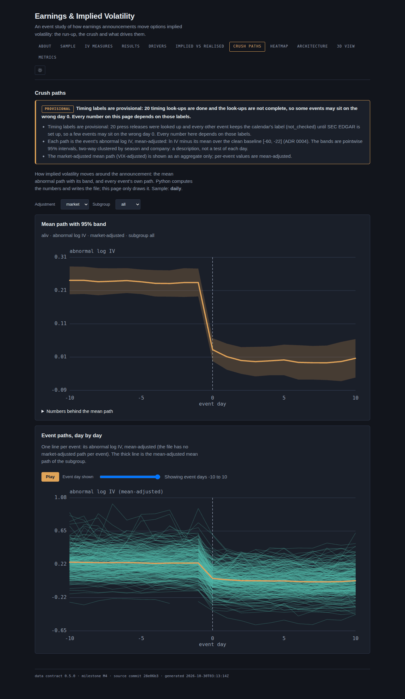 | 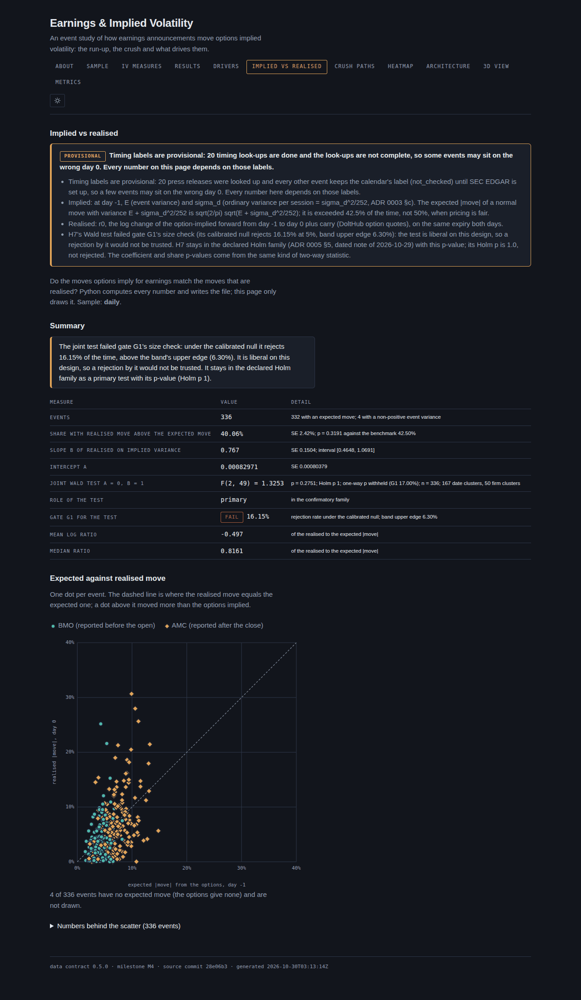 |
| **Results: the seven hypotheses and gate G1** | **Drivers of the crush** |
| 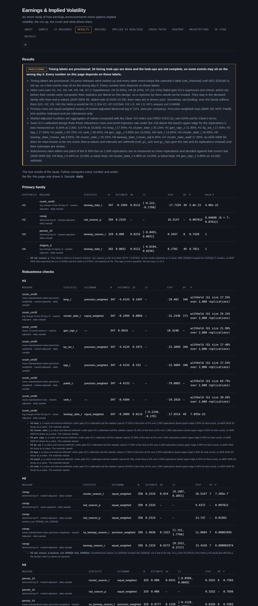 | 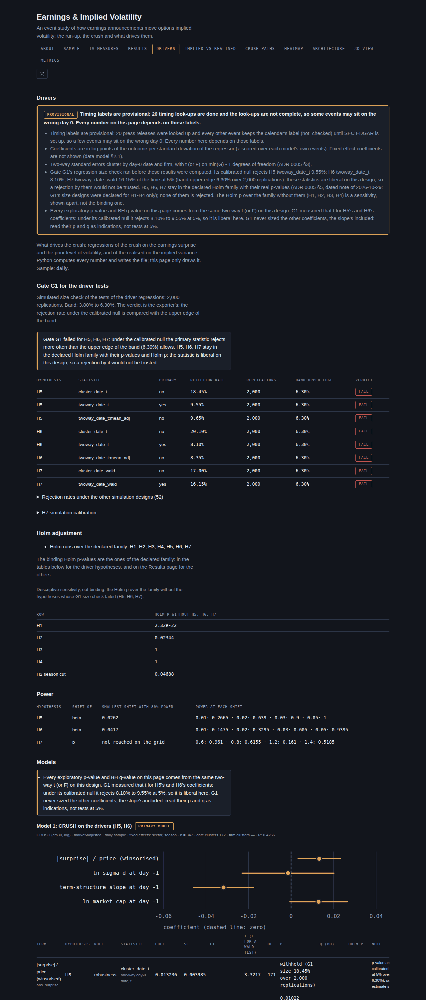 |
| **Sample funnel** | **IV measures** |
| 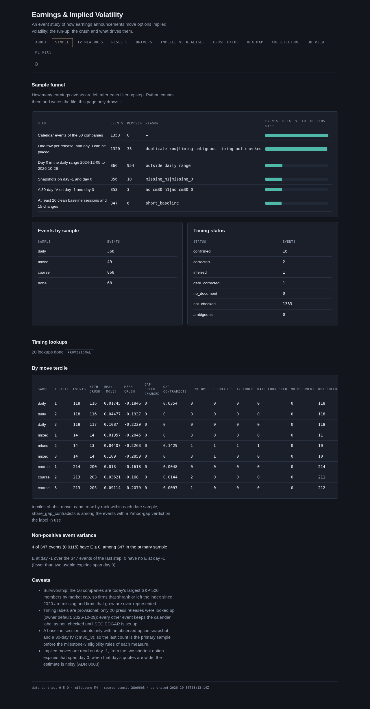 | 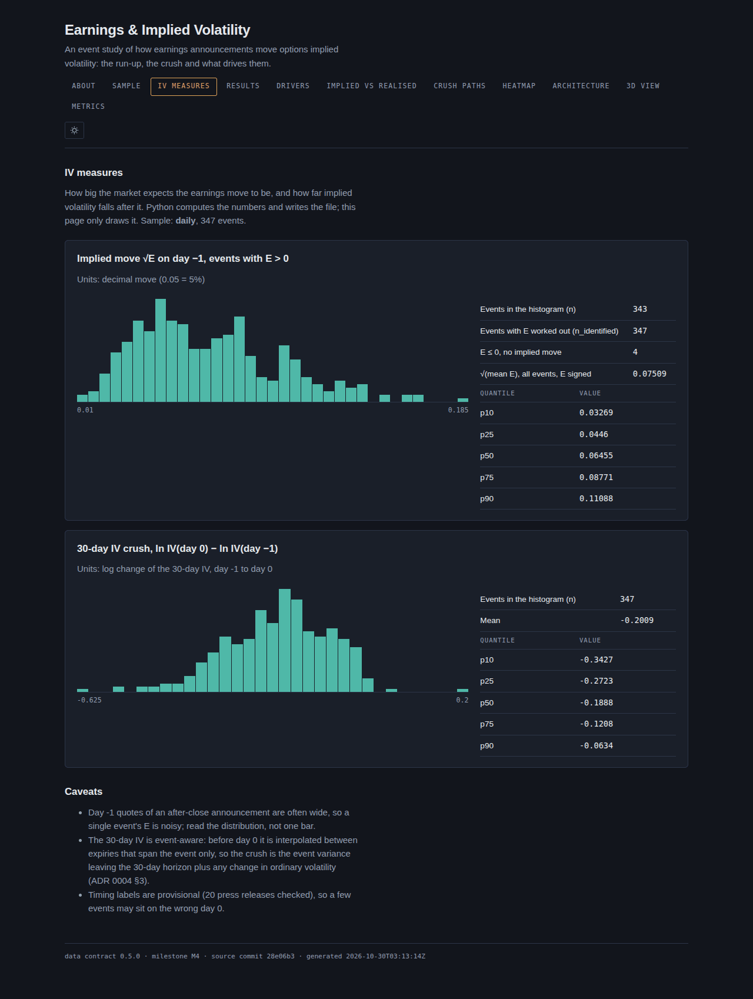 |
| **Company × event-day heatmap** | **Architecture** |
| 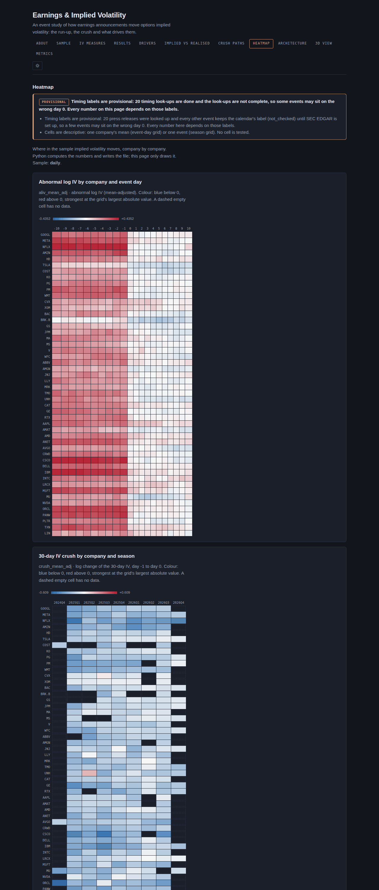 | 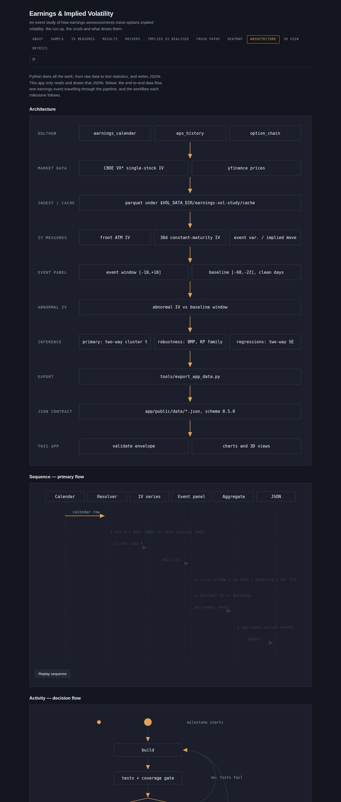 |
| **About** | **3D view** |
| 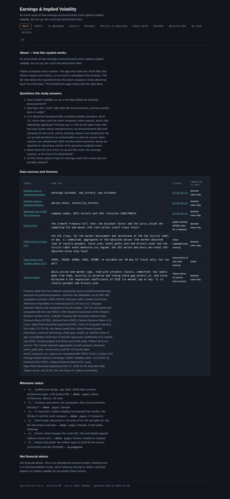 | 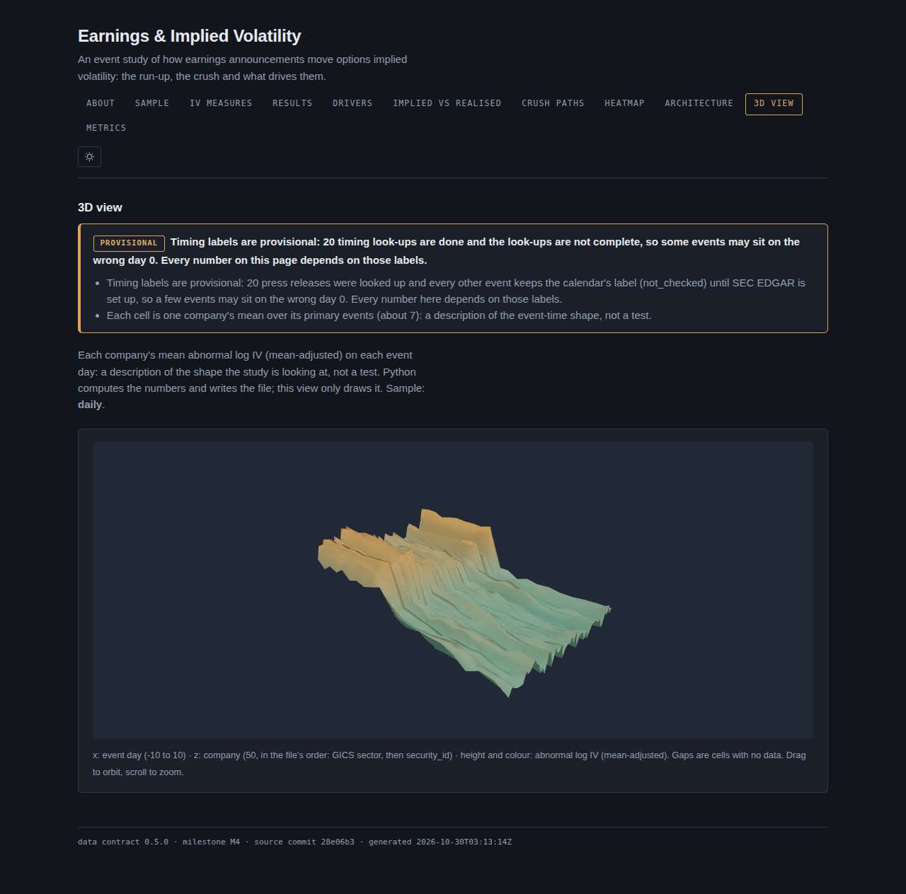 |
| **Metrics (local page-view counts)** | **About, at phone width (390 px; the top 2,400 px)** |
| 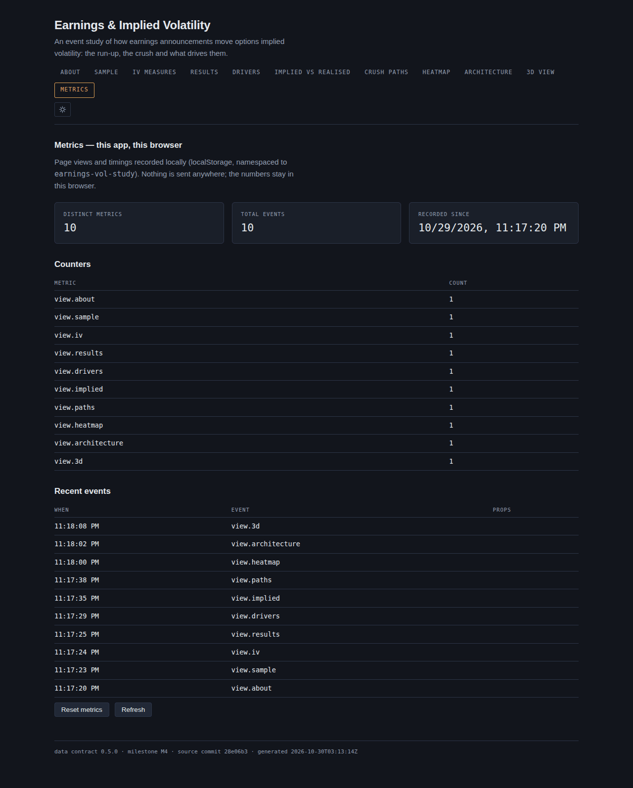 | 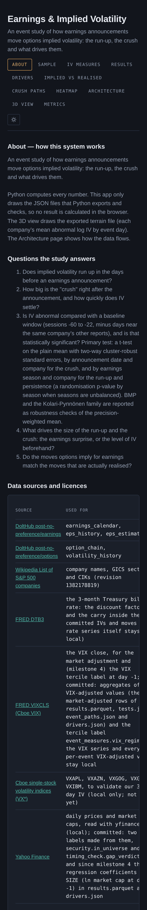 |

**3D stills.** Blender hero renders: **not rendered: Blender unreachable (2026-10-29)**. The Blender MCP could not
connect and the machine has no Blender, so [`tools/blender/event_terrain.py`](tools/blender/event_terrain.py) has never
run. These three.js stills of the app's 3D terrain view stand in for them (the default camera, then orbited):

| Default view | Turned to the side | From above |
|---|---|---|
|  | 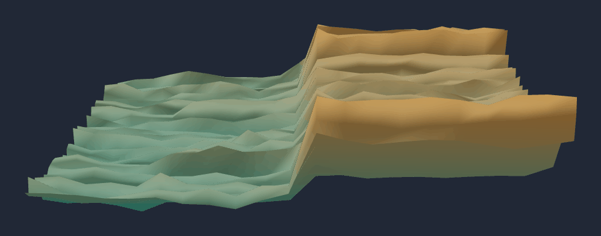 | 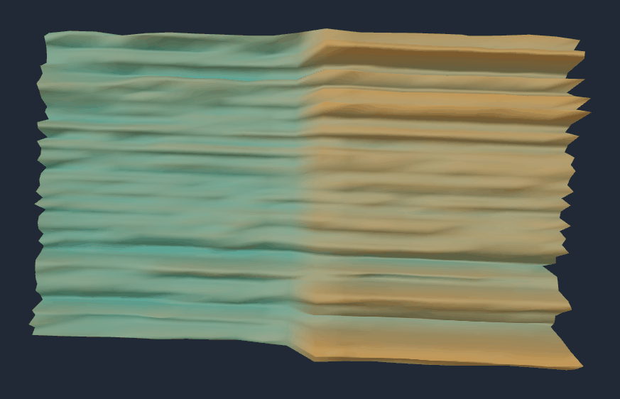 |

## How to run

You need Python 3.12 with [uv](https://docs.astral.sh/uv/), and Node 22 with npm for the app. The tests, the notebook
check, the exporter, the report and the app need no market data: they read fixtures and the committed tables in
`data/derived/`. Rebuilding those tables does (below).

```bash
# Setup
uv sync --frozen                                 # Python dependencies, exact versions from uv.lock
cd app && npm ci && cd ..                        # app dependencies, exact versions from package-lock.json

# Tests and checks
uv run --frozen pytest -q -p no:cacheprovider    # the Python tests (the dolt-marked tests skip without dolt)
uv run --frozen python tools/build_notebooks.py --check          # the notebooks match src/
uv run --frozen python tools/licensing/check_data_files.py       # no raw vendor file is tracked
uv run --frozen python tools/report_numbers.py --check           # report, README and PR/FAQ numbers match the data
uv run --frozen --group diagrams python tools/diagrams/build.py docs/architecture/specs --out docs/architecture/out --check

# The app
uv run --frozen python tools/export_app_data.py  # write app/public/data/*.json from data/derived and params.yaml
cd app && npm run dev                            # run the app locally
cd app && npm run verify                         # lint + tests + coverage + production build
cd app && npm run build && npm run preview       # serve the production build

# The report and the pictures
uv sync --frozen --group report                                                        # once: python-docx, markdown-it-py
uv run --frozen python tools/report_numbers.py                                         # fill every number from the data
uv run --frozen --with playwright==1.64.1 python tools/screenshots.py                  # docs/images/*.png
uv run --frozen --group report --with playwright==1.64.1 python tools/build_report.py  # docs/report/*.pdf and *.docx
```

`tools/screenshots.py` and `tools/build_report.py` use the Chromium that Playwright installs
(`~/.cache/ms-playwright/chromium-1234/chrome-linux/chrome`, or set `PLAYWRIGHT_CHROMIUM`). `uv run python
tools/build_notebooks.py` (without `--check`) rewrites the notebooks; never edit them by hand.

### Rebuilding the data (the pipeline)

This needs the `dolt` binary (2.6.1 was used), the two DoltHub clones in `$VOL_DATA_DIR/dolthub/` (`earnings` and
`options`), about 10 GB of disk for private mirrors of them, and network access to Wikipedia, Yahoo Finance and FRED.

```bash
uv run --frozen python -m earnings_vol.ingest.run --chain-from 2020-01-01   # mirrors, universe, calendar, EPS, prices, FRED, chains
uv run --frozen python -m earnings_vol.events.run                           # sessions, events, day 0, EPS, timing checks
uv run --frozen python -m earnings_vol.measures.run                         # snapshots, IV per expiry, iv_daily, event_iv
uv run --frozen python -m earnings_vol.panel.run                            # window matrices, abnormal IV, event_measures
uv run --frozen python -m earnings_vol.stats.run --g1                       # gate G1 first (several minutes)
uv run --frozen python -m earnings_vol.stats.run                            # results.parquet
uv run --frozen python tools/export_app_data.py                             # the app's JSON
```

The pipeline never queries the shared DoltHub clones directly: on dolt 2.6.1 even a `SELECT` rewrites a clone's files.
It copies each clone to a private mirror and reads it `AS OF` a commit pinned in `params.yaml`. Nothing calls SEC EDGAR
yet: its client (`src/earnings_vol/ingest/edgar.py`) refuses to run until `SEC_EDGAR_USER_AGENT` holds a real contact.
The milestone pages list the exact commands and what each one measured.

## Data

The repository is a public portfolio. It commits the real data that the app and the docs need (the app's JSON, small
derived tables in `data/derived/`, the hand look-ups in `data/manual/`) and no bulk raw file. **The data is not covered
by the MIT licence.** DoltHub and Wikipedia data are CC BY-SA 4.0; values computed with the VIX fall under Cboe's terms;
the labels and coefficients built from Yahoo prices fall under Yahoo's terms. [DATA.md](DATA.md) lists what is committed
from each source and each source's terms; [`data/derived/README.md`](data/derived/README.md) and
[`app/DATA.md`](app/DATA.md) describe the tables and the JSON contract. No VIX value and no per-event VIX-adjusted value
is committed, and none appears in this README, the report or the screenshots.

## How the work was checked

Every milestone was attacked by a separate adversarial reviewer before it was called done, with the default verdict
"broken" and the evidence-gated-validation protocol: each claim is checked through documents and through a runtime probe
of its own, and only claims that both channels support survive. The ledgers record each claim, its verdict and the probe
behind it; the probes and their outputs are in [`docs/validation/probes/`](docs/validation/probes/). Some findings that
changed the study:

- **Milestone 0** ([code](docs/validation/m0-code-ledger.md), [methodology](docs/validation/m0-methodology-ledger.md),
  [delta](docs/validation/m0-delta-ledger.md), [delta 2](docs/validation/m0-delta2-ledger.md)): a simulation showed that
  letting the stock's price gap fix before-open/after-close labels corrects the big movers and leaves the quiet events
  wrong, so labels now come only from documents (ADR 0002 §3).
- **Milestone 1** ([ledger](docs/validation/m1-ledger.md), [delta](docs/validation/m1-delta-ledger.md)): the look-up
  rule as worded required more events than the code reported; the rule was scoped to events that can enter a sample.
- **Milestone 2** ([ledger](docs/validation/m2-ledger.md)): float rounding broke exact cent ties in the parity-forward
  strike choice, and the quadratic fallback extrapolated the at-the-money variance from one side of the money; both
  were fixed (milestone 2, decisions table).
- **Milestone 3** ([ledger](docs/validation/m3-ledger.md), [delta](docs/validation/m3-delta-ledger.md)): β pooled
  baselines that the ADR excludes; H4 was not sized on its own series; robustness rows that gate G1 found oversized
  still printed p-values. All were fixed, and the fixes were reviewed again.
- **Milestone 4** ([ledger](docs/validation/m4-ledger.md)): dropping H5–H7 from Holm after their failed size check
  was refuted as "declared in advance", so the declared family H1–H7 binds again; a missing G1 verdict was read as a
  pass (fail-open), now refused.

Tests use hand-worked expected values, and most Python test modules list in their header the code mutations they
were seen to fail on (each mutation applied, the test seen to fail, the file restored).

## Learning

This project is also a learning record. [LEARNING_LOG.md](LEARNING_LOG.md) is the index. Each milestone has a page
with the design decisions, a code walkthrough by `file:line`, the measured results, "predict before you look" and
"explain it back" questions: [0 scaffold and design](docs/milestones/00-scaffold-and-design.md),
[1 universe and events](docs/milestones/01-universe-and-events.md), [2 IV measures](docs/milestones/02-iv-measures.md),
[3 event study](docs/milestones/03-event-study.md), [4 drivers](docs/milestones/04-drivers.md),
[5 report and polish](docs/milestones/05-report-and-polish.md). The concept notes in
[`docs/concepts/`](docs/concepts/) explain each idea from first principles.

## Repository layout

```
earnings-vol-study/
├── README.md, DATA.md, LICENSE, LEARNING_LOG.md
├── params.yaml                 every tunable choice: universe rule, pinned Dolt commits, sample ranges, windows
├── pyproject.toml, uv.lock     Python 3.12, exact pins; dependency groups dev, diagrams, report
├── src/earnings_vol/           the package, one sub-package per ADR 0001 layer
│   ├── ingest/                 Dolt (through a private mirror), Wikipedia, Yahoo, FRED; the gated EDGAR client
│   ├── events/                 sessions, security, events and day 0, EPS, timing checks
│   ├── measures/               snapshots, Black-76 on the parity forward, per-expiry variance, iv_daily, event_iv
│   ├── panel/                  window matrices, abnormal IV, event_measures and the regressors
│   ├── stats/                  clustering, event tests, regressions, gate G1, Holm and BH, results
│   └── export/                 the app's JSON views
├── tools/
│   ├── export_app_data.py      writes app/public/data/*.json
│   ├── report_numbers.py       fills every measured number in the report, README and PR/FAQ (--check)
│   ├── build_report.py         the report's PDF and DOCX
│   ├── screenshots.py          docs/images/*.png from the production build
│   ├── build_notebooks.py      generates notebooks/ from src/
│   ├── diagrams/, blender/, licensing/
├── tests/                      pytest
├── notebooks/                  generated (never edited by hand)
├── data/derived/, data/manual/ committed tables (CC BY-SA 4.0) and the hand look-ups
├── research/prototypes/        throwaway scripts behind numbers quoted in the ADRs (not tested)
├── docs/
│   ├── prfaq.md                the product story, revised with the measured results
│   ├── report/                 the report (.md, .pdf, .docx) and its templates
│   ├── adr/                    decision records 0001–0005
│   ├── architecture/           diagrams, specs, the data model, a graphify code graph
│   ├── concepts/, milestones/  learning notes
│   ├── validation/             adversarial review ledgers and probes
│   └── images/                 screenshots, report figures, 3D stills
└── app/                        React 19 + TypeScript + Vite + react-three-fiber; reads app/public/data/*.json only
```

## Read more

- Decision records: [ADR 0001 architecture](docs/adr/0001-overall-architecture.md),
  [0002 day zero](docs/adr/0002-day-zero-convention.md), [0003 IV measures](docs/adr/0003-iv-measures.md),
  [0004 baseline and windows](docs/adr/0004-baseline-and-event-windows.md),
  [0005 statistical tests](docs/adr/0005-statistical-test-suite.md).
- Architecture: [diagrams](docs/architecture/README.md), the [data model](docs/architecture/data-model.md) and the
  [code graph](docs/architecture/graph/README.md).
- Prototypes: [`research/prototypes/`](research/prototypes/README.md).

## License

The code is MIT licensed ([`LICENSE`](LICENSE)). The tables in `data/derived/` are CC BY-SA 4.0
([`data/derived/LICENSE`](data/derived/LICENSE)); other data keeps its source's terms ([DATA.md](DATA.md)).
