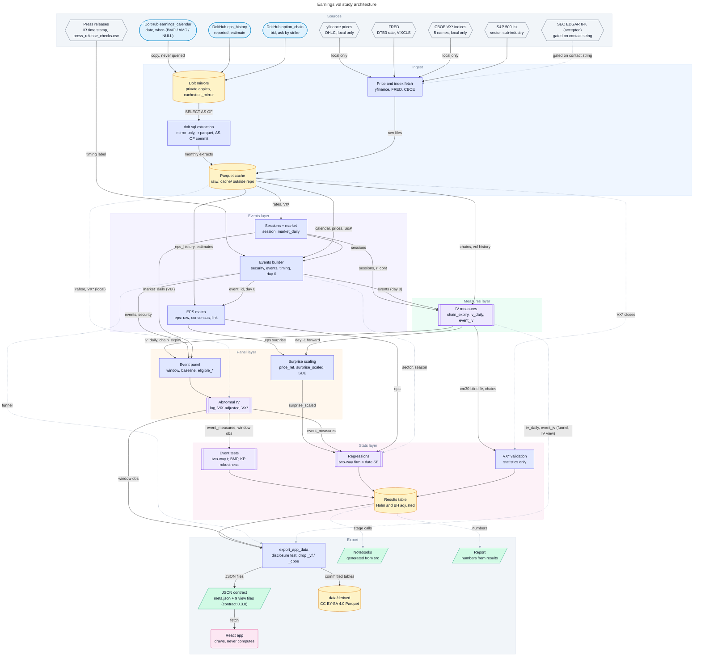

# Architecture diagrams

Design diagrams for the earnings / implied-vol event study, kept in step with the tables built so far (milestone 2). Each diagram is one YAML spec
in [`specs/`](specs/); the toolkit builds Mermaid, SVG, PNG, draw.io and Lucid files from it into [`out/`](out/). The
specs follow the schema of `vol-diagram-kit`, a local toolkit vendored in [`tools/diagrams/`](../../tools/diagrams/)
(it is also public at <https://github.com/rajib2k5/vol-diagram-kit>). The specs are the source; everything in `out/` is
generated from them.

The tables, keys and JSON files they show are defined in [`data-model.md`](data-model.md), and the
decisions behind them are in [`../adr/`](../adr/README.md). If a diagram and `data-model.md` disagree,
`data-model.md` wins and the diagram is a bug.

| Diagram | Question it answers | Spec | Mermaid |
|---|---|---|---|
| Architecture | Which components exist, and which way does data flow from sources to the app? | [`architecture.yaml`](specs/architecture.yaml) | [`out/architecture.mmd`](out/architecture.mmd) |
| Data flow | Which source columns become which derived table, and which tables feed which JSON file? | [`data_flow.yaml`](specs/data_flow.yaml) | [`out/data_flow.mmd`](out/data_flow.mmd) |
| Process | Who does what in one milestone, and where does work loop back? | [`process.yaml`](specs/process.yaml) | [`out/process.mmd`](out/process.mmd) |
| ERD | What are the stored tables, their keys and cardinalities, and which tables is each JSON file exported from? | [`erd.yaml`](specs/erd.yaml) | [`out/erd.mmd`](out/erd.mmd) |
| Event sequence | What happens to one announcement, from calendar row to exported JSON? | [`event_sequence.yaml`](specs/event_sequence.yaml) | [`out/event_sequence.mmd`](out/event_sequence.mmd) |

## Architecture

Raw downloads (yfinance, FRED, CBOE) go to `$VOL_DATA_DIR/earnings-vol-study/raw/`. Dolt extracts and the
derived stage tables go to `$VOL_DATA_DIR/earnings-vol-study/cache/`. Neither is inside the repository. The ingest
never queries the shared DoltHub clones: a `SELECT` rewrites a clone's files on dolt 2.6.1, so it copies each clone to
a private mirror, `$VOL_DATA_DIR/earnings-vol-study/cache/dolt_mirror/{earnings,options}`, and runs
`dolt sql -r parquet` there (`SELECT` only, `AS OF` the commits pinned in `params.yaml`). Around each batch it checks
that the shared clone did not change at all (`src/earnings_vol/ingest/dolt.py`). There is one
lane per layer of [ADR 0001](../adr/0001-overall-architecture.md) (ingest, events, measures, panel, stats, export),
and each layer reads only from the layers before it in that list.

Two sources feed the timing label ([ADR 0002 §3](../adr/0002-day-zero-convention.md)). **SEC EDGAR 8-K acceptance
times are accepted (2026-10-28) but gated on the owner's contact string** (dashed edge): the client refuses to run
until `SEC_EDGAR_USER_AGENT` is set, so nothing flows yet. Until then the rule in force is the company's press release
(its investor-relations time stamp, checked by hand; 20 look-ups are done at milestone 1), then the calendar label. The price gap is a local
diagnostic: it triggers a second reading (daily/mixed) or a look-up (coarse) and never sets a label. Who writes and who reads which
table:

| Layer | Writes | Reads |
|---|---|---|
| events | `session`, `market_daily`, `security`, `ticker_alias`, `events`, `eps`, `timing_check` | raw and cache extracts: calendar, EPS, Yahoo prices, FRED, S&P list; hand-checked press releases, recorded in the committed `data/manual/press_release_checks.csv`; the SEC EDGAR filing index once the owner's contact string is set |
| measures | `session_snapshot` (milestone 1), `chain_expiry` (local), `iv_daily`, `event_iv` (milestone 2: the IV columns of `event_measures`, built early) | option-chain extracts, `session_snapshot`, `session`, `market_daily` (`r_cont`), `security`, `ticker_alias`, `events` (day 0) |
| panel | `event_window_obs`, `event_measures`, `event_measures_vx` | `iv_daily`, `chain_expiry`, `events`, `eps`, `security`, `session`, `market_daily`, local Yahoo and VX\* extracts |
| stats | `results` | `event_measures`, `event_measures_vx`, `event_window_obs`, `events`, `eps`, `security`; for validation also `iv_daily`, `chain_expiry`, the VX\* extract |

The event tests ([ADR 0005](../adr/0005-statistical-test-suite.md)) have one primary statistic: a two-way
cluster-robust t, by day-0 date × firm for the crush and by season × firm for the run-up and persistence (with a
Rademacher randomisation p-value when seasons are unbalanced). BMP and the Kolari-Pynnönen family are robustness rows,
labelled as tests of the precision-weighted mean. Regressions use two-way firm × date standard errors.

The "Events builder" and "EPS match" boxes are one layer with a fixed internal order (base events, timing, day 0, EPS
matching, then `orphan_nearby`, `sample` and `exclusion_reason`), so there is no edge from "EPS match" back to
"Events builder". The price-scaled surprises (`price_ref`, `surprise_scaled`, `sue_hist`) are built in the panel layer,
because they need the day -1 option forward from `measures`.



## Entity-relationship diagram

Fifteen stored tables (all columns, types, nullability and keys as in `data-model.md` section 3; `event_iv` is the
newest, built at milestone 2) on the left, and the Python to app JSON files (`meta.json` and the nine view files, at
contract 0.3.0) on the right. Column names carry the licensing suffix (`_yf`, `_cboe`) exactly as in the data model: a
suffixed column never leaves the machine, except one a committed table names in `keep_restricted` (at milestone 2
only `timing_check.gap_verdict_yf`, owner decision of 2026-10-29), so dropping the others gives the committed shape. Relationship labels start with
the row number of data-model section 5 (R1, R2, ...), so each line can be checked against that table. The `from_*`
columns in the JSON entities are lineage links that say which tables a file is exported from. They are not stored
foreign keys, and their cardinality marks carry no meaning. The `envelope (all files)` entity is the wrapper that
every JSON file shares. A JSON entity lists the top-level keys of `data`; nested fields such as
`tests.rows[].estimand`, `tests.rows[].n_clusters_firm` or `drivers.models[].n_clusters_season` are in data-model
section 4. At milestone 2 three files are written, `meta.json`, `sample_funnel.json` and the new `iv_measures.json`,
all at schema version 0.3.0; the other view files do not exist yet. `meta.json` has `project`, `milestone`, `title`,
`data_sources` (each source with `name`, `uses`, `url`, `licence`, `committed`), `data_licence`, `sample`, `params`,
`files` and `provenance`. In `sample_funnel.json`, `by_move_tercile` and `evar_nonpositive` are filled since
milestone 2 (they were null at 0.2.0). The `events` entity's label says that `edgar_accession` and `edgar_accepted_utc` are gated on the owner's
contact string: they stay null until it is set.

```mermaid
---
title: "Earnings vol study schema"
---
erDiagram
    security {
        string security_id PK
        string name
        enum gics_sector
        string gics_sub_industry
        string cik "nullable"
        bool in_universe
        enum cboe_vx_index "nullable"
    }
    ticker_alias {
        string ticker PK
        date32 valid_from PK
        date32 valid_to "nullable"
        string security_id FK
    }
    session {
        date32 session_date PK
        int32 session_index
        bool is_half_day
        string close_time_et
        enum era
    }
    market_daily {
        date32 session_date PK, FK
        float64 r_dtb3
        float64 r_cont
        float64 vix_close_cboe "nullable"
        float64 ln_vix_cboe "nullable"
    }
    chain_expiry {
        string security_id PK, FK
        date32 session_date PK, FK
        date32 expiration PK
        date32 snapshot_date
        int16 tau_sessions
        int16 tau_cal_days
        float64 df
        float64 forward "nullable"
        int16 forward_n_strikes
        float64 forward_dispersion "nullable"
        int16 n_strikes_valid
        float64 strike_lo "nullable"
        float64 strike_hi "nullable"
        float64 k_lo "nullable"
        float64 k_hi "nullable"
        float64 rel_spread_lo "nullable"
        float64 rel_spread_hi "nullable"
        float64 w_atm "nullable"
        float64 iv_atm "nullable"
        enum atm_method
        float64 vendor_iv_atm "nullable"
        float64 straddle_atm "nullable"
        float64 iv_straddle "nullable"
        string next_event_id FK "nullable"
        bool spans_next_event "nullable"
        enum status
        string flags
    }
    iv_daily {
        string security_id PK, FK
        date32 session_date PK, FK
        date32 snapshot_date "nullable"
        enum snapshot_status
        string next_event_id FK "nullable"
        int16 sessions_to_next_event "nullable"
        string prev_event_id FK "nullable"
        int16 sessions_since_prev_event "nullable"
        date32 front_expiry FK "nullable"
        int16 front_tau "nullable"
        float64 front_atm_iv "nullable"
        float64 cm30_iv "nullable"
        enum cm30_method
        date32 cm30_exp_lo FK "nullable"
        date32 cm30_exp_hi FK "nullable"
        float64 cm30_blind_iv "nullable"
        float64 sigma_d_iv "nullable"
        float64 event_var "nullable"
        date32 ev_exp1 FK "nullable"
        date32 ev_exp2 FK "nullable"
        int16 ev_tau1 "nullable"
        int16 ev_tau2 "nullable"
        float64 ev_w1 "nullable"
        float64 ev_w2 "nullable"
        float64 implied_move "nullable"
        float64 implied_abs_move "nullable"
        float64 implied_abs_move_total "nullable"
        enum implied_move_status
        float64 ts_slope "nullable"
        float64 forward_front "nullable"
        float64 vendor_iv_current "nullable"
        string flags
    }
    event_iv["event#95;iv (milestone 2#58; the IV columns of event#95;measures)"] {
        string event_id PK, FK
        date32 pre_session "nullable"
        date32 post_session "nullable"
        int16 crush_span_sessions "nullable"
        float64 evar_m1 "nullable"
        float64 evar_m2 "nullable"
        float64 implied_move_m1 "nullable"
        float64 implied_abs_move_total_m1 "nullable"
        enum implied_move_status "nullable"
        float64 sigma_d_m1 "nullable"
        float64 cm30_m1 "nullable"
        float64 cm30_0 "nullable"
        float64 ts_slope_m1 "nullable"
        float64 crush_mean_adj "nullable"
        float64 dsigma_d_mean_adj "nullable"
        date32 front_fixed_expiry "nullable"
        float64 front_fixed_iv_m1 "nullable"
        float64 front_fixed_iv_0 "nullable"
        bool front_fixed_interpolated
        float64 crush_front_fixed "nullable"
        float64 realized_ret_0 "nullable"
        float64 abs_ret_over_implied "nullable"
        float64 abs_move_cand_max "nullable"
        string flags
    }
    session_snapshot {
        string security_id PK, FK
        date32 session_date PK, FK
        date32 snapshot_date "nullable"
        enum snapshot_status
    }
    events["events (edgar#95;#42;#58; gated on the owner's contact string)"] {
        string event_id PK
        string security_id FK
        string ticker_at_event
        date32 announce_date
        date32 announce_date_used
        enum timing_raw "nullable"
        enum timing_used "nullable"
        enum timing_status
        enum timing_source "nullable"
        bool gap_check_changed
        string edgar_accession "nullable"
        string edgar_accepted_utc "nullable"
        date32 day0_session FK "nullable"
        date32 day_m1_session FK "nullable"
        date32 fiscal_period_end "nullable"
        string prev_event_id "nullable"
        string next_event_id "nullable"
        int16 gap_sessions_prev "nullable"
        bool orphan_nearby
        string season
        enum sample
        string exclusion_reason "nullable"
        string calendar_commit
    }
    eps {
        string security_id PK, FK
        date32 fiscal_period_end PK
        string event_id FK "nullable"
        enum match_status
        int16 lag_days "nullable"
        float64 reported "nullable"
        float64 estimate "nullable"
        float64 surprise "nullable"
        float64 consensus "nullable"
        float64 consensus_high "nullable"
        float64 consensus_low "nullable"
        int16 consensus_count "nullable"
        date32 consensus_date "nullable"
        float64 surprise_disp "nullable"
    }
    timing_check {
        string event_id PK, FK
        float64 gap_bmo_yf "nullable"
        float64 gap_amc_yf "nullable"
        float64 gap_scale_yf "nullable"
        float64 z_bmo_yf "nullable"
        float64 z_amc_yf "nullable"
        float64 z_max_outside_yf "nullable"
        int16 rel_day_max_outside_yf "nullable"
        enum gap_verdict_yf "nullable"
        bool outside_flag_yf "nullable"
    }
    event_window_obs {
        string event_id PK, FK
        int16 rel_day PK
        date32 session_date FK
        bool observed
        bool in_window
        bool in_baseline
        enum baseline_excluded_reason "nullable"
        float64 cm30_iv "nullable"
        float64 ln_cm30 "nullable"
        float64 d_ln_cm30 "nullable"
        float64 e_abn_cboe "nullable"
        float64 aliv_cboe "nullable"
        float64 aliv_mean_adj "nullable"
        float64 aiv_level "nullable"
        float64 front_fixed_iv "nullable"
        bool front_fixed_interpolated
        float64 sigma_d_iv "nullable"
        float64 event_var "nullable"
        float64 ln_vx_cboe "nullable"
        float64 e_abn_vx_cboe "nullable"
    }
    event_measures {
        string event_id PK, FK
        bool eligible_crush
        bool eligible_runup
        bool eligible_persist_10
        string ineligible_reason
        int16 baseline_n
        int16 baseline_n_changes
        float64 baseline_mean_ln_iv "nullable"
        float64 baseline_mean_iv "nullable"
        float64 beta_vix "nullable"
        int32 beta_n
        float64 s_abn_cboe "nullable"
        float64 runup_cboe "nullable"
        float64 crush_cboe "nullable"
        float64 persist_1_cboe "nullable"
        float64 persist_5_cboe "nullable"
        float64 persist_10_cboe "nullable"
        float64 dsigma_d_cboe "nullable"
        float64 crush_mean_adj "nullable"
        float64 dsigma_d_mean_adj "nullable"
        float64 crush_two_session_cboe "nullable"
        float64 crush_two_session_mean_adj "nullable"
        float64 crush_front_fixed "nullable"
        int16 crush_span_sessions "nullable"
        float64 sa_crush_cboe "nullable"
        float64 sa_runup_cboe "nullable"
        float64 sa_persist_1_cboe "nullable"
        float64 sa_persist_5_cboe "nullable"
        float64 sa_persist_10_cboe "nullable"
        float64 sa_dsigma_d_cboe "nullable"
        float64 evar_m1 "nullable"
        float64 evar_m2 "nullable"
        float64 implied_move_m1 "nullable"
        float64 implied_abs_move_total_m1 "nullable"
        enum implied_move_status
        float64 sigma_d_m1 "nullable"
        float64 cm30_m1 "nullable"
        float64 ts_slope_m1 "nullable"
        float64 price_ref "nullable"
        float64 surprise_scaled "nullable"
        float64 abs_surprise_scaled_w "nullable"
        float64 sue_hist "nullable"
        int16 sue_hist_n "nullable"
        float64 realized_ret_0 "nullable"
        float64 abs_move_cand_max "nullable"
        float64 realized_ret_0_yf "nullable"
        float64 abs_ret_over_implied "nullable"
        enum vix_regime "nullable"
        float64 ln_mcap_yf "nullable"
    }
    event_measures_vx {
        string event_id PK, FK
        enum vx_index
        int16 baseline_n_changes
        float64 beta_vix_vx_cboe "nullable"
        float64 s_abn_vx_cboe "nullable"
        float64 runup_vx_cboe "nullable"
        float64 crush_vx_cboe "nullable"
        float64 persist_10_vx_cboe "nullable"
        float64 sa_runup_vx_cboe "nullable"
        float64 sa_crush_vx_cboe "nullable"
        float64 sa_persist_10_vx_cboe "nullable"
    }
    results {
        string result_id PK
        enum family
        enum hypothesis "nullable"
        enum role
        string measure
        string statistic
        enum estimand "nullable"
        int16 rel_day "nullable"
        enum sample
        string subgroup_key
        string subgroup_value
        enum adjustment
        string model_id "nullable"
        string term "nullable"
        int32 n
        int32 n_clusters "nullable"
        int32 n_clusters_firm "nullable"
        float64 df "nullable"
        float64 estimate "nullable"
        float64 se "nullable"
        float64 stat "nullable"
        float64 p_value "nullable"
        float64 ci_lo "nullable"
        float64 ci_hi "nullable"
        float64 p_holm "nullable"
        float64 q_bh "nullable"
        float64 rbar "nullable"
        string params_hash
        string code_commit
    }
    json_envelope["envelope (all files)"] {
        string kind PK
        string schema_version
        string generated_at
        string source_commit
        object data
    }
    json_meta["meta.json"] {
        string kind PK
        string project
        int32 milestone
        string title
        array data_sources
        object data_licence
        object sample
        object params
        array files
        object provenance
        string from_events FK "nullable"
    }
    json_sample_funnel["sample#95;funnel.json"] {
        string kind PK
        array steps
        object timing_status_counts
        array timing_status_by_sample
        array by_move_tercile "nullable"
        string by_move_tercile_status
        object evar_nonpositive "nullable"
        string evar_nonpositive_status
        array by_sample
        object lookups
        array caveats
        object provenance
        string from_events FK "nullable"
        string from_iv_daily FK "nullable"
        string from_event_iv FK "nullable"
        string from_timing_check FK "nullable"
    }
    json_iv_measures["iv#95;measures.json"] {
        string kind PK
        object sample
        object implied_move
        object crush
        array caveats
        object provenance
        string from_event_iv FK "nullable"
    }
    json_event_paths["event#95;paths.json"] {
        string kind PK
        array rel_days
        array series
        array per_event
        object provenance
        string from_event_window_obs FK "nullable"
        string from_results FK "nullable"
    }
    json_heatmap["heatmap.json"] {
        string kind PK
        array grids
        object provenance
        string from_event_measures FK "nullable"
        string from_results FK "nullable"
    }
    json_terrain["terrain.json"] {
        string kind PK
        string measure
        string units
        array rel_days
        array rows
        array values
        string row_order
        object provenance
        string from_event_window_obs FK "nullable"
        string from_security FK "nullable"
    }
    json_implied_vs_realised["implied#95;vs#95;realised.json"] {
        string kind PK
        array points
        object summary
        object provenance
        string from_event_measures FK "nullable"
        string from_results FK "nullable"
    }
    json_tests["tests.json"] {
        string kind PK
        array rows
        object provenance
        string from_results FK "nullable"
    }
    json_drivers["drivers.json"] {
        string kind PK
        array models
        object provenance
        string from_results FK "nullable"
    }
    json_validation["validation.json"] {
        string kind PK
        array vx
        object vendor_vs_ours
        object vol_history_maturity
        object leak
        object realised_vs_yahoo
        object provenance
        string from_results FK "nullable"
    }
    security ||--|{ ticker_alias : "R1 known as"
    security ||--o{ events : "R2 announces"
    security ||--o{ eps : "R3 reports"
    security ||--o{ iv_daily : "R5 has"
    session ||--o| market_daily : "R6 has"
    session ||--o{ iv_daily : "R8 on"
    session |o--o{ events : "R9a day 0"
    session |o--o{ events : "R9b day -1"
    session ||--o{ event_window_obs : "R10 on"
    iv_daily ||--o{ chain_expiry : "R11 (1/2) expiries of snapshot"
    iv_daily ||--o{ chain_expiry : "R11 (2/2) expiries of snapshot"
    chain_expiry |o--o| iv_daily : "R12a front expiry (composite)"
    chain_expiry |o--o| iv_daily : "R12b cm30 low (composite)"
    chain_expiry |o--o| iv_daily : "R12c cm30 high (composite)"
    chain_expiry |o--o| iv_daily : "R12d event expiry 1 (composite)"
    chain_expiry |o--o| iv_daily : "R12e event expiry 2 (composite)"
    events |o--o| eps : "R13 reports period"
    events ||--|| event_measures : "R15 summarised by"
    events ||--o| timing_check : "R16 checked by"
    events ||--o{ event_window_obs : "R17 rel#95;day -60..+10"
    events |o--o{ iv_daily : "R19a next event"
    events |o--o{ iv_daily : "R19b prev event"
    events |o--o{ chain_expiry : "R20 next event"
    events ||--o| event_measures_vx : "R21 cboe5 member"
    security ||--o{ session_snapshot : "R22 observed on"
    session ||--o{ session_snapshot : "R23 has"
    events ||--|| event_iv : "R24 IV measures of"
    events |o--o{ json_meta : "feeds"
    events |o--o{ json_sample_funnel : "feeds"
    iv_daily |o--o{ json_sample_funnel : "feeds"
    event_iv |o--o{ json_sample_funnel : "feeds"
    timing_check |o--o{ json_sample_funnel : "feeds (aggregate only)"
    event_iv |o--o{ json_iv_measures : "feeds (aggregate only)"
    event_window_obs |o--o{ json_event_paths : "feeds"
    results |o--o{ json_event_paths : "feeds"
    event_measures |o--o{ json_heatmap : "feeds"
    results |o--o{ json_heatmap : "feeds"
    event_window_obs |o--o{ json_terrain : "feeds"
    security |o--o{ json_terrain : "feeds"
    event_measures |o--o{ json_implied_vs_realised : "feeds"
    results |o--o{ json_implied_vs_realised : "feeds"
    results |o--o{ json_tests : "feeds"
    results |o--o{ json_drivers : "feeds"
    results |o--o{ json_validation : "feeds"
```



## Where the drawings differ from `data-model.md`

These are limits of the diagram toolkit (`vol-diagram-kit`, vendored in `tools/diagrams/`). `data-model.md` is the source, and the drawings are generated to match it as
closely as the kit allows. The kit has one foreign-key target per column, no composite keys, no self references, and
no way to show enum members or unique constraints.

- **Self references not drawn (R18a, R18b).** `events.prev_event_id` and `events.next_event_id` point at
  `events.event_id`. The kit rejects self references, so they are plain nullable columns in the ERD and have no line.
- **R11, a composite FK, drawn as two lines.** `chain_expiry (security_id, session_date)` references
  `iv_daily (security_id, session_date)`, the first two columns of `chain_expiry`'s primary key. Each column gets its
  own line, labelled "R11 (1/2)" and "R11 (2/2)". Read the pair as one identifying relationship, `iv_daily` 1 :
  0..\* `chain_expiry`.
- **R12a to R12e, composite FKs, drawn as one line each.** Each is the triple (`security_id`, `session_date`, role
  column) of `iv_daily` to `chain_expiry (security_id, session_date, expiration)`. The kit can only draw the role
  column (`front_expiry`, `cm30_exp_lo`, `cm30_exp_hi`, `ev_exp1`, `ev_exp2`) pointing at `chain_expiry.expiration`.
  The other two parts are not drawn, because `iv_daily.security_id` and `iv_daily.session_date` already carry their
  own FKs to `security` (R5) and `session` (R8). The data model's advice to draw R12a to e as one line is followed
  only in spirit: there are five lines, because the kit allows one relation per column.
- **`iv_daily` and `chain_expiry` reference each other** (R11 one way, R12 the other). The kit lays them out as two
  groups of lines between the same pair of tables.
- **Retired rows are not drawn.** R4 (`chain_expiry` to `security`) and R7 (`chain_expiry` to `session`) are implied
  by R11 with R5 and R8, so `chain_expiry.security_id` and `.session_date` point at `iv_daily` and not at `security`
  and `session`. R14 (`events.fiscal_period_end` to `eps`) is retired: the only `events`-`eps` link is
  `eps.event_id` to `events` (R13), and `events.fiscal_period_end` is a plain column.
- **Cardinality 0..71.** `events` to `event_window_obs` (R17) is drawn as `0..*`, with the real range in the label.
- **Enums and unique constraints.** An enum is drawn as type `enum`. Its member list is in `data-model.md`. The
  unique constraints on `session.session_index` and `eps.event_id` have no marker in the kit.
- **Licensing classes (U, R, S, F) are not drawn.** Only the `_yf` / `_cboe` suffixes show which columns are class R.
  The class of every other column is in `data-model.md` section 2.1.
- **Columns cannot carry a note.** `events.edgar_accession` and `events.edgar_accepted_utc` stay null until the
  owner's contact string is set (ADR 0002: EDGAR accepted 2026-10-28, gated on that string). The kit has no per-column
  note, so the `events` entity's label says it. The `edgar` value of `timing_source` is an enum member and is not drawn.
- **`session_snapshot` is temporary.** It holds the first four columns of `iv_daily` (data model §3.6a, R22 and
  R23). At milestone 2 `iv_daily` carries the same four columns and the funnel reads them there; the table is kept
  (it feeds `iv_daily`), and dropping it is left for milestone 3. The ERD draws it as its own table.
- **`event_iv` is early.** It holds the IV columns of the planned `event_measures` (data model §3.11a, R24), built by
  the measures layer at milestone 2; milestone 3 folds them into `event_measures`.
- **JSON entities show top-level keys only.** Nested fields (for example `tests.rows[].estimand`) and the members of
  `sample_funnel.timing_status_counts` (`confirmed`, `corrected`, `inferred`, `date_corrected`, `no_document`,
  `not_checked`, `ambiguous`) are in data-model section 4.
- **The ERD against the data model.** After the milestone-1 sync a throwaway script (not in the repository) read
  `erd.yaml` and `data-model.md` and compared them: 14 tables, 241 columns (name, order, type, nullability, PK, FK) and
  the 26 relationship lines of section 5, with 0 differences. The only items it does not count as differences are the
  kit limits listed above. *Updated after the milestone-1 review:* `security.universe_rank` is gone (a Yahoo-derived
  rank, data model §3.1), so the stored tables have **240 columns** (counted from `erd.yaml`). The six `timing_check`
  cells of §3.9 that read not-null (`gap_scale_yf`, `z_bmo_yf`, `z_amc_yf`, `z_max_outside_yf`, `gap_verdict_yf`,
  `outside_flag_yf`) now read nullable, and `security.cik` is fifth in §3.1, in `erd.yaml` and in the registry. Checked
  again on 2026-10-29 with a throwaway script: `security`, `timing_check` and `eps` in §3 equal `erd.yaml` column for
  column (name, order, nullability). *Re-checked after the milestone-2 review* with another throwaway script: the
  eleven built tables of `src/earnings_vol/schema.py` (155 columns) equal `erd.yaml` column for column (name, order,
  nullability).
- **Data flow.** There is no `iv_daily` to `events` edge any more: `events` needs no IV data (the per-measure
  `eligible_*` columns moved to `event_measures`). One dashed edge feeds `events` from `eps` (`match_status` to
  `orphan_nearby`). It stays inside the events layer, whose fixed internal order makes it legal. Two more dashed edges
  enter `events`: the SEC EDGAR input (accepted, gated on the contact string), and `timing_check`, which triggers a second reading (daily/mixed) or a
  look-up (coarse) and never sets `timing_used` (ADR 0002 §3). The five DoltHub source tables are fed by one
  "Dolt mirrors" node (the private copies of the clones). *Milestone 2:* `session_snapshot` feeds `iv_daily` (which
  sessions have a snapshot), and `iv_daily`, `event_iv` and `timing_check` (its gap verdict, committed since the owner's
  decision of 2026-10-29) feed `sample_funnel.json`; `event_iv` feeds the new `iv_measures.json`.

## Diagrams

The five specs in `specs/` are built by the vendored toolkit in `tools/diagrams/` into `out/`: `.mmd` (Mermaid, which
GitHub renders), `.svg`, `.png`, and for the flows and the ERD also `.drawio` and `.lucid.xml`, plus the toolkit's
`.diagram-kit-manifest.json`. Edit a spec, never a file in `out/`. The two fenced diagrams above are copies of
`out/architecture.mmd` and `out/erd.mmd` and must be updated with them. The Figma / FigJam import (drag the SVG onto the
canvas) and the Lucidchart import (draw.io XML) are untested, as the kit's own README says. Mermaid is laid out by
Mermaid itself, so its geometry differs from the kit's SVG and PNG.

Rebuild (the kit refuses to overwrite a file it did not write; never pass `--overwrite`):

```bash
uv run --frozen --group diagrams python tools/diagrams/build.py docs/architecture/specs --out docs/architecture/out
```

Check that `out/` is up to date with the specs (`tests/test_diagrams.py` runs this with `--no-png`):

```bash
uv run --frozen --group diagrams python tools/diagrams/build.py docs/architecture/specs --out docs/architecture/out --check
```

Render gate, to run before every commit that changes a spec. It renders each `.mmd` in headless Chromium with Mermaid
12.2.0 (the version GitHub uses) and checks that every label is drawn once, in its own element, and reads as written.
Set up once per machine with `npm install --prefix ~/.cache/diagram-kit mermaid@12.2.0`, then:

```bash
DIAGRAM_KIT_MERMAID_JS=~/.cache/diagram-kit/node_modules/mermaid/dist/mermaid.min.js \
DIAGRAM_KIT_CHROMIUM=$HOME/.cache/ms-playwright/chromium-1234/chrome-linux/chrome \
  uv run --frozen --group diagrams --with playwright==1.64.1 python tools/diagrams/build.py docs/architecture/specs --verify-mermaid
```

`DIAGRAM_KIT_CHROMIUM` points at an existing Chromium; without it, run `uv run --with playwright==1.64.1 playwright install chromium`.

PNG bytes are verified on aarch64 only: the kit never compared them across CPU architectures. On an x86_64 machine or
runner use `--check --no-png`, which still compares every `.mmd`, `.svg`, `.drawio` and `.lucid.xml` byte for byte.

The 3D "event-time IV terrain" hero render is separate: see [`../../tools/blender/README.md`](../../tools/blender/README.md).
