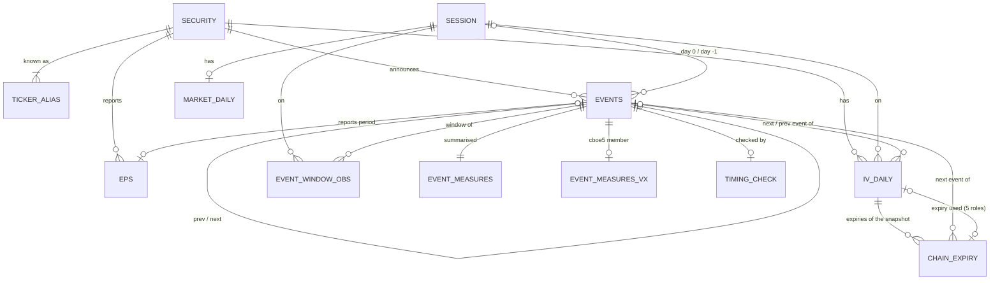

# Data model

- **Status:** milestone 0. Source schemas verified; derived tables designed, not yet built. **Revised 2026-10-28 after
  the milestone-0 methodology review** (note below).
- **Date:** 2026-10-28
- **Decisions behind it:** [ADR 0001](../adr/0001-overall-architecture.md) (layers, cache, licensing),
  [0002](../adr/0002-day-zero-convention.md) (day 0, timing), [0003](../adr/0003-iv-measures.md) (IV measures),
  [0004](../adr/0004-baseline-and-event-windows.md) (windows, abnormal IV), [0005](../adr/0005-statistical-test-suite.md) (tests)

This file is the **single source** for:

- the stored tables (§3);
- their keys and cardinalities (§5), from which the Mermaid ERD and the YAML ERD spec are drawn;
- the Python → app JSON contract (§4).

If code and this file disagree, one of them is a bug.

> **Revised after milestone-0 review** ([ledger](../validation/m0-methodology-ledger.md)). Changes follow the ADR
> revisions:
>
> - **Timing (ADR 0002 §3, ledger claim 2 and N10).**
>   - `events.timing_status` has new values, and `timing_source`, `edgar_accession` and `edgar_accepted_utc` are new
>     columns. The two `edgar_*` columns and the `edgar` value of `timing_source` exist **only if the owner approves
>     EDGAR**: ADR 0002's EDGAR rule is *Proposed: pending owner decision*.
>   - `date_suspect` no longer excludes an event.
>   - No label is set by prices alone. Under the default (no EDGAR: the press release, then the calendar label)
>     `timing_used` and `timing_status` stay class F; they would be class U under the proposed EDGAR rule.
> - **Statistics (ADR 0005, ledger 7b, 7d and claim 9).**
>   - `results.statistic` drops `kp_t` and `cluster_t`. It adds `twoway_date_t`, `twoway_season_t` (the primaries),
>     `cluster_date_t`, `cluster_season_t`, `rad_season_p`, `sa_twoway_season_t` and `kpp_t`.
>   - `results.n_clusters_firm` is new, for the two-way rows.
>   - The new `results.estimand` column labels each row as equal- or precision-weighted.
>   - `kp_ow_t` is no longer described as "not a published procedure"; it is a refinement of Kolari, Pape & Pynnönen
>     (2018).
> - **Units (ADR 0003 §c, ledger claim 13).** Every stored σ_d column is now stated as an annualised volatility, and
>   per-session variance is `sigma_d²/252`.
> - **Leftovers from earlier passes.** `iv_tercile` was used but never defined, and is removed. `beta_vix` is added to
>   the disclosure test's non-linear list (ledger N11). `stale_copy` already matched ADR 0002 §1, which now matches
>   it.

> **Revised after the milestone-0 delta review** ([delta ledger](../validation/m0-delta-ledger.md)). Changes follow
> ADR 0002's and ADR 0005's delta notes:
>
> - **`events.timing_status` (4b-ii).** `unverified` meant "no document found" here but "never looked up" in ADR 0002.
>   It is split into `no_document` and `not_checked` (§3.7). New members:
>   {`confirmed`,`corrected`,`inferred`,`date_corrected`,`no_document`,`not_checked`,`ambiguous`}.
> - **The default timing rule (4b-i, 4c).** Every event with D on or after 2024-09-11, and every NULL-label event, is
>   looked up by hand. The record is a new committed source file, `data/manual/press_release_checks.csv` (§1.3).
> - **The move terciles (N7).** `sample_funnel.by_move_tercile` used |`realized_ret_0`|, which is measured on the day
>   0 used and so puts mislabelled events in the low tercile by construction. It now uses the new label-free column
>   `event_measures.abs_move_cand_max` (§3.11). The new `events.gap_check_changed` (§3.7) feeds the funnel's new
>   `n_gap_check_changed` and the sensitivity analysis without gap-triggered changes (§4).
> - **`results` (N2).** A new invariant pins each row's reference distribution: `df` from the cluster counts, and
>   `p_value` from `stat` and `df` (§3.13, ADR 0005 §5 G1).

---

## 1. Source tables as found

Verified on **2026-10-28** through DoltHub's read-only SQL API (`/api/v1alpha1/post-no-preference/<repo>/master`) with
`SHOW CREATE TABLE`, `GROUP BY` counts and `LIMIT`-ed samples. The local clones were **not** touched. The DDL below is
exactly what the API returned. Collation clauses are omitted, and all tables are `utf8mb4_0900_bin`.

### 1.1 `post-no-preference/earnings` (CC BY-SA 4.0)

Tables: `balance_sheet_assets`, `balance_sheet_equity`, `balance_sheet_liabilities`, `cash_flow_statement`,
`earnings_calendar`, `eps_estimate`, `eps_history`, `income_statement`, `rank_score`, `sales_estimate`. The study uses
the first three below.

```sql
CREATE TABLE `earnings_calendar` (
  `act_symbol` varchar(64) NOT NULL,
  `date` date NOT NULL,
  `when` text,
  PRIMARY KEY (`act_symbol`,`date`)
);
CREATE TABLE `eps_history` (
  `act_symbol` varchar(64) NOT NULL,
  `period_end_date` date NOT NULL,
  `reported` decimal(16,2),
  `estimate` decimal(16,2),
  PRIMARY KEY (`act_symbol`,`period_end_date`)
);
CREATE TABLE `eps_estimate` (
  `date` date NOT NULL,
  `act_symbol` varchar(64) NOT NULL,
  `period` varchar(64) NOT NULL,
  `period_end_date` date,
  `consensus` decimal(7,2),
  `recent` decimal(7,2),
  `count` smallint,
  `high` decimal(7,2),
  `low` decimal(7,2),
  `year_ago` decimal(7,2),
  PRIMARY KEY (`date`,`act_symbol`,`period`)
);
```

| Fact | Value / evidence |
|---|---|
| `earnings_calendar` rows, range | 122,113 rows; `date` 2020-01-22 → **2026-12-04** (future rows are scheduled or projected dates) |
| `when` values | `'After market close'` 50,915; `'Before market open'` 39,487; NULL 31,711 (26.0%). No other value. |
| NULL `when`, 30 large caps | 9 of 784 rows (1.1%) |
| Wrong `when` (price-verified) | GOOGL 2024-10-29 and NFLX 2024-10-17 are labelled BMO but were AMC (ADR 0002) |
| Missing events | GS: no rows for Jul 2024 or Jan 2025, although `eps_history` has those periods. COST: 20 rows where 27 are expected. |
| Ticker changes | FB → META: calendar `FB` up to 2022-04-27, `META` from 2022-07-27 |
| `eps_history` range | 169,386 rows; `period_end_date` 2016-07-31 → 2026-09-30. **Normalised to month-ends**: day 31 for 87,028 rows, 30 for 81,486, 28 for 700, 29 for 172. AAPL's fiscal quarter ending 2025-12-27 is stored as 2025-12-31. |
| `eps_history` split basis | **Not split-adjusted.** NVDA: 6.12 for 2024-04-30, then 0.68 for 2024-07-31, after the 10:1 split. |
| `eps_history` duplicates | `FB` *and* `META` rows for 2021-12-31 and 2022-03-31 |
| `eps_estimate` | Weekly (Sunday) snapshots. `period` ∈ {`Current Quarter`, `Next Quarter`, `Current Year`, `Next Year`}. AAPL's last snapshot before the event, 2025-10-26 for period 2025-09-30, shows consensus 1.73 = `eps_history.estimate` 1.73. |

### 1.2 `post-no-preference/options` (CC BY-SA 4.0)

```sql
CREATE TABLE `option_chain` (
  `date` date NOT NULL,
  `act_symbol` varchar(64) NOT NULL,
  `expiration` date NOT NULL,
  `strike` decimal(7,2) NOT NULL,
  `call_put` varchar(64) NOT NULL,      -- 'Call' | 'Put'
  `bid` decimal(7,2),
  `ask` decimal(7,2),
  `vol` decimal(5,4),                   -- vendor IV, method undocumented
  `delta` decimal(5,4),
  `gamma` decimal(5,4),
  `theta` decimal(5,4),                 -- per calendar day
  `vega` decimal(5,4),                  -- per vol point
  `rho` decimal(5,4),                   -- per 1% rate
  PRIMARY KEY (`date`,`act_symbol`,`expiration`,`strike`,`call_put`)
);
CREATE TABLE `volatility_history` (
  `date` date NOT NULL,
  `act_symbol` varchar(64) NOT NULL,
  `hv_current` decimal(5,4), `hv_week_ago` decimal(5,4), `hv_month_ago` decimal(5,4),
  `hv_year_high` decimal(5,4), `hv_year_high_date` date,
  `hv_year_low` decimal(5,4),  `hv_year_low_date` date,
  `iv_current` decimal(5,4), `iv_week_ago` decimal(5,4), `iv_month_ago` decimal(5,4),
  `iv_year_high` decimal(5,4), `iv_year_high_date` date,
  `iv_year_low` decimal(5,4),  `iv_year_low_date` date,
  PRIMARY KEY (`date`,`act_symbol`)
);
```

| Fact | Value / evidence |
|---|---|
| Columns that do **not** exist | underlying price, open interest, volume, timestamp |
| Vendor greeks and IV | Vendor-computed with undocumented inputs. Call/put IV at the same strike differ by 0.1–0.3 vol points on normal days and up to 3.1 on an announcement day. Deep-ITM IVs are meaningless. |
| Expirations per snapshot | **3–4**, chosen by the vendor per date and identical across symbols. Front ≈ 10–16 calendar days, second ≈ front + 14, third ≈ monthly 39–60 days. The set can change entirely between consecutive sessions. |
| Strikes per expiry | ≈ 19–27, irregular. AAPL 2025-11-14 on 2025-10-30 had no 270 strike (listed on 10-29 and 10-31). |
| Snapshot frequency | Weekly on **Saturdays** 2019-02-09 → 2020-01-04; Mon/Wed/Fri 2020-01-06 → 2024-09-09; **daily from 2024-09-11**. Single sessions are sometimes missing (2024-11-12). |
| Non-session snapshots | Exist on holidays (2024-09-02 Labor Day) as **stale copies** of the previous session. 2025 has 259 snapshot dates against 250 NYSE sessions. |
| Snapshot time | Closing quotes of `date` (parity forward ≈ official close; no after-hours contamination on AAPL's AMC day). Commits at ≈ 06:35 UTC on D+1. ADR 0002 has the evidence. |
| Breadth | `volatility_history` ≈ 1,538 symbols per day (531 in 2019) |
| `volatility_history.iv_current` | Maturity undocumented; AAPL values are consistent with ≈ 30-day ATM, about 1 vol point lower. Unconfirmed. `iv_month_ago` is NULL in every row sampled. |
| Query hint | `date` leads both primary keys, so always filter on `date` first. A `COUNT(DISTINCT act_symbol)` over one full `option_chain` date timed out on the API. |

### 1.3 Other sources (never committed row by row)

| Source | Fields used | Licence posture |
|---|---|---|
| Yahoo Finance via `yfinance` | daily `Open, High, Low, Close, Volume, Dividends, Stock Splits`; shares outstanding | local only; columns suffixed `_yf` |
| FRED `DTB3` | 3-month T-bill rate | US government data; may be committed |
| FRED `VIXCLS` | VIX close | **CBOE index**, so treated as CBOE data: suffix `_cboe`, never committed |
| CBOE VX\* CSVs | `VXAPL, VXAZN, VXGOG, VXGS, VXIBM` daily closes | never committed; suffix `_cboe` |
| Wikipedia "List of S&P 500 companies" (snapshot) | ticker, name, GICS sector and sub-industry | CC BY-SA 4.0, compatible; may be committed |
| SEC EDGAR submissions JSON (`data.sec.gov/submissions/CIK##########.json`, one per security) | `form`, `items`, `acceptanceDateTime` (UTC), `accessionNumber` of 8-K filings with Item 2.02 | **Proposed, pending owner decision** (ADR 0002, status note): used only if the owner approves EDGAR. US-government public data; class U, may be committed. SEC's fair-access policy allows ≤ 10 requests/s and requires a real contact email in the User-Agent, so a real run needs a contact string the owner chooses. Added after the review (ADR 0002 §3). |
| Company press releases (investor-relations pages, or the newswire copy they link to) | the release's date and time: its time stamp, else its own words, else the earnings-call time it announces | Read by hand, one event at a time (ADR 0002 §3, "The default rule"). Under the default (no EDGAR) they are the first timing source, looked up for every event with D on or after 2024-09-11 and every NULL-label event. *Revised after the delta review:* each look-up is recorded in a committed, hand-maintained file, `data/manual/press_release_checks.csv`, one row per look-up: `security_id`, `announce_date` (the calendar's D; with `security_id` it gives `event_id`), `found` (bool), `release_date`, `release_time_et` (`HH:MM` New York time, null if the release gives none), `basis` (`time_stamp`, `release_text` or `call_time`), `url`, `checked_on`, `reread` (bool: a second reading triggered by the gap), `note`. A re-read adds a second row for the same event; the latest row decides. An event with no row is `not_checked`. The file holds dates, times and URLs, facts about the company, and no quoted text: class U, committed. |

---

## 2. Conventions

- **Types** are Arrow/Parquet: `string`, `date32`, `int16`, `int32`, `float64`, `bool`, `enum` (a dictionary-encoded
  string with the listed values only). Source `decimal` columns become `float64`, and NULL stays null.
- **Keys:** PK = primary key (unique, not null), FK = foreign key. Composite keys are listed in order.
- **Units:** IV is a decimal fraction, session-annualised (`0.2826` = 28.26%) unless the name says otherwise. Log
  quantities are natural-log points (`-0.123` ≈ −12.3%). Moves are decimal fractions of price. `tau_*` counts sessions
  unless the column ends in `_cal_days`.
  - **Every `sigma_d*` column is an annualised volatility**, $\sigma_{d,\text{ann}} = \sqrt{252\,\sigma_d^2}$, not a
    variance and not per session (ADR 0003 §c, "Units"). Wherever it is added to E or to a squared return it must be
    converted first: $\sigma_d^2 = \texttt{sigma\_d}^2/252$ per session.
  - `E` (`event_var`, `evar_*`) and `w_atm` are total variances in squared-log-return units.
  - `dsigma_d_*` is a log change and has no units.
- **Nulls:** a null number means "not computed". When the reason matters there is a sibling `*_status` enum.
  A column typed `…, null` may hold a real null; every other column is NOT NULL and the writer rejects a null in it.
  **An enum never has a `NULL` member.** "No value" is a real null. The `'<NULL>'` sentinel that carries SQL NULL
  through Dolt's CSV output (ADR 0001 §3) is turned into a real null by the extract parser and never reaches a table.
- **Flags:** `flags` is a `string` of `|`-separated codes, sorted, `''` if none (e.g. `fwd_dispersion|interpolated`).
- **Source suffixes:** `_yf` = from Yahoo, `_cboe` = from CBOE (including VIX). Any column with these suffixes is
  **dropped** before writing `data/derived/` or app JSON (ADR 0001 §7). §2.1 says which columns need a suffix.
- **Committed?** marks whether the table goes to `data/derived/` (CC BY-SA 4.0). Every table also exists in
  `$VOL_DATA_DIR/earnings-vol-study/cache/stage/<params_hash>/`.
- **FKs are checked in the stage cache.** Where the parent table is not committed (`chain_expiry`, the parent of
  `iv_daily`'s R12 FKs), the committed copy of the child keeps the column as plain information.

### 2.1 Licensing class of every column computed from Yahoo or CBOE data

ADR 0001 §7 states the rule. In short, each column has one of four classes:

| Class | Meaning | Committed? | Suffix |
|---|---|---|---|
| **U** | Lineage is DoltHub, FRED `DTB3`, Wikipedia, `exchange_calendars` or our own parameters only. Keys and counts of available observations are U even in a local-only table. | yes | none |
| **R** | A **numeric value** of a Yahoo or CBOE series for one date or one event, or any transform that keeps its magnitude (log, change, gap, z-score, residual). Also **any column that can be combined with committed columns to compute such values**, including a per-event statistic, if there are enough of them to solve for the dates involved (see `s_abn` below). | **never** | `_yf` / `_cboe`, required |
| **S** | A statistic estimated from many restricted observations. It is committed only if the **export disclosure test** below shows that no single-date VIX change can be solved for from everything exported. Counting equations against unknowns is not enough. | yes, if the test passes | none; listed below |
| **F** | A **categorical label** derived with restricted data, from which no numeric value can be computed. It is either a fact that Yahoo prices only helped check (the announcement timing), or a coarse label with at most 5 levels (VIX tercile, threshold flag), or a one-time cross-sectional rank of firms. A finer label on a per-date series, such as a daily VIX rank, is R. | yes, by default (**owner decision**) | none; listed below |

The schema registry that mirrors §3 in code records each column's class. The writer refuses class R. A test asserts,
over **value columns** (keys excluded), that a column is class R exactly when it has a suffix. So a missing suffix and a
stray suffix both fail.

Columns with Yahoo or CBOE lineage are listed below. Every column not listed here is class U.

- A column that depends on Yahoo data only through day 0 is committable exactly when the timing label is. That covers
  almost every per-event column (`season`, `sample`, `event_var` at day −1, every window row, …).
- Under the default (ADR 0002 without EDGAR: the press release, then the calendar label) the label is class F. Every
  `daily` and `mixed` event is looked up, but a gap contradiction triggers a second reading, and in `coarse` it
  decides which events are looked up at all. The "stricter" reading below would then withhold all of those columns.
- The label would be class U under ADR 0002's *proposed* EDGAR rule, which would leave those columns with no Yahoo
  lineage at all. That rule is pending the owner's decision. *Caveat found in the delta review:* the EDGAR rule's own
  gap-triggered press-release check (ADR 0002 §3, job 1) would also put a Yahoo-derived bit into the status, so it
  is class U only if that check is dropped (ADR 0002, delta note item 9).

| Column(s) | Class | Committed | Why |
|---|---|---|---|
| `market_daily.vix_close_cboe`, `ln_vix_cboe` | R | no | the index itself |
| `timing_check` value columns, all `*_yf`, including `rel_day_max_outside_yf` | R | no | Yahoo gaps and their z-scores. The location of the largest outside gap is a detail of the evidence, not a fact about the company. |
| `events.timing_used`, and what follows from it: `day0_session`, `day_m1_session`, every `rel_day` | **F** under the default (no EDGAR); U only under ADR 0002's proposed EDGAR rule | yes | When a company announced is a fact, taken from documents: the press release and the calendar label, plus the SEC 8-K acceptance time if the owner approves EDGAR (ADR 0002 §3). **Settled after the review (ledger N10):** no label is ever set by Yahoo gaps alone. A NULL label is filled only from a document, and without one the event is `ambiguous`. So the class-F "fact that Yahoo prices only helped check" rationale holds for every committed label. Under the proposed EDGAR rule Yahoo would play no part at all. |
| `events.timing_status`, `timing_source`, `gap_check_changed`, `edgar_accession`, `edgar_accepted_utc` | `timing_status`, `timing_source` and `gap_check_changed` (added after the delta review) are **F** under the default (no EDGAR), because a Yahoo gap can trigger the second reading or the `coarse` look-up that sets them; all four are U under the proposed EDGAR rule (with the caveat above) | yes | Under the default, which labels got a second reading, and which `coarse` events got a look-up, depends on a Yahoo gap trigger, so `timing_status` carries one Yahoo-derived bit per event (F, as before). Under the proposed EDGAR rule they would record calendar-vs-document agreement only. The two `edgar_*` columns exist only if the owner approves EDGAR. |
| `event_measures.vix_regime` | F | yes (owner decision) | It is a three-level bin of VIX on day −1, with the cut points taken over the sample. It reveals order, not values. |
| `security.in_universe`, `universe_rank` | F if the milestone-1 rule ranks by Yahoo market cap; U otherwise | yes | a rank of 50 firms on one date |
| `event_window_obs.e_abn_cboe`, `aliv_cboe` | R | no | Were they committed, $\Delta\ln\text{VIX}_t = (\texttt{d\_ln\_cm30} - \texttt{e\_abn\_cboe})/\beta_s$ would follow. Without $\beta_s$, cross-firm ratios still give the series up to a single scale factor. |
| `event_window_obs.ln_vx_cboe`, `e_abn_vx_cboe`; the `_cboe` columns of `event_measures_vx` | R | no | VX\* values and their transforms |
| `event_measures.runup_cboe`, `crush_cboe`, `persist_1_cboe`, `persist_5_cboe`, `persist_10_cboe`, `dsigma_d_cboe`, `crush_two_session_cboe`, `sa_*_cboe` | R | no | For example, `crush_cboe` $= \Delta x_0 - \beta_s\Delta m_0$, and $\Delta x_0$ follows from the committed `iv_daily.cm30_iv`, so $\Delta\ln\text{VIX}$ on every day-0 date could be recovered. |
| `event_measures.s_abn_cboe` | R | no | **Measured, 2026-10-28.** Each $s_i$ gives one quadratic equation in the unknown $\Delta m_t$ on that event's baseline dates. $\Delta x_t$, the baseline dates and $\beta_s$ are all committed. The adversarial reviewer simulated the coarse era (884 events, 657 unknown dates, simplified: fixed 23-change baselines, no exclusion holes, full precision), starting from committed data only. In 2 of 5 seeds it recovered every date to RMSE ≤ 1.7e-13; in the other 3 it reached correlation 0.984–0.994 with the true series. We re-ran seed 2 and got RMSE 1.69e-13. An earlier draft wrongly classed `s_abn` as S. |
| `event_measures.realized_ret_0_yf`, `ln_mcap_yf` | R | no | Yahoo close and market cap |
| `event_measures.beta_vix`, `beta_n` | S | yes | These are 50 slopes, one per security. Alone they reveal nothing, but they are the known coefficients that make every exported market-adjusted aggregate a *linear* equation in the VIX series. That is why the export rules below exist. |
| `results` rows computed from R columns, including every `cboe5` row | S | only under the export rules below | See below. |

**Export rules for aggregates of class-R inputs.** These cover every `results` row, JSON series or cell and
regression coefficient computed from market-adjusted values, `_yf` values or VX\* values. Mean-adjusted aggregates
have no class-R input and are not restricted.

1. **Default export set.** Market-adjusted values are exported only for the subgroups `all` and `timing`, per measure,
   sample and rel_day, plus the named regressor coefficients of the ADR 0005 §3 models. Finer subgroups (`sector`,
   `season`, `vix_regime`, `security`) and the heatmaps are exported **mean-adjusted**. **Fixed-effect
   coefficients are never exported**: a firm fixed effect is a per-firm mean, and so is a sector effect for a
   one-firm sector. `cboe5` rows are exported only for `all`.
2. **Minimum cell:** ≥ 10 events on ≥ 10 distinct day-0 dates. **Secondary suppression:** no partition may have
   exactly one suppressed cell, because `all` minus the other cells would give it back. A suppressed cell is exported
   as `null` **without its `n`**.
3. **Disclosure test, run at every export.** It is a mechanical gate, not a judgement.
   - **Unknowns:** the ln VIX **levels** $m_t$ on every session any exported row touches. Changes are not the right
     unknowns: ALIV is a level minus a baseline mean.
   - **Rows:** one coefficient row for every exported number that is linear in $m$ given the committed columns: cell
     means, path means, scalar test estimates and regression coefficients. Each row is built from **that row's exact
     event set**. Path cells (events observed at $t$) and scalar rows (events with `eligible_*`) differ, and their
     differences can isolate single events.
   - **Assertions,** on the full-precision Parquet, with tolerance $10^{-8}$ on the projection onto the null space:
     - no single event's market-adjusted value (each event's ALIV at every exported rel_day, its crush, run-up,
       persistence and two-session crush) lies in the row space;
     - no difference $m_t - m_s$ lies in it, for **any** pair of dates. That is equivalent to "no two dates have equal
       null-space rows". It covers the 2-session Mon→Wed and Wed→Fri changes of the coarse era, which a
       single-session check cannot see.
   - **On failure** the export is refused. The remedy is either a common event set per subgroup, sample and measure
     family, or dropping rows until the test passes.
   - **Not covered:** standard errors, p-values, CIs, `rbar` and regression $R^2$ add *non-linear* equations.
     - So does the committed **`beta_vix`** itself. It is an OLS slope, $\sum\Delta x\,\Delta m/\sum(\Delta m)^2$
       over each security's clean baseline dates, so each of the 50 values is one non-linear equation in the
       unknown $\Delta m$. *Added after the review (ledger N11):* this list used to omit it, although the linear
       part of the test already uses `beta_vix` as a known coefficient.
     - At milestone 3 a non-linear solve (as in the `s_abn` simulation) is run once on the real export, with the 50
       `beta_vix` equations included.
     - If it recovers anything above, the fields concerned are dropped for market-adjusted rows. If `beta_vix` is
       what makes the difference, it moves to class R.
4. **Scope notes.** Every dummy-variable coefficient counts as a fixed effect and is never exported. That includes the
   VIX-tercile dummies of ADR 0005 §3's market-conditions variant, since each would be a regime mean of a
   market-adjusted outcome. The per-security VX\* statistics in `validation.vx[]` are validation, not `cboe5` event
   results. They are allowed per security, and they enter the disclosure test with the VX\* levels as extra unknowns.

**The default set is not yet proven (measured, 2026-10-28).** In the reviewer's simulation of exactly this default
set (`all`/BMO/AMC paths at −10…+10, plus crush, run-up and persist rows over their own eligibility sets; 78 rows,
rank 44; market-wide and per-security missing days), no VIX change was identified. But in 1 of 4 seeds **one event's
ALIV₀ was identified exactly**, because the path and scalar event sets differed. Our re-run of seed 3 reproduced it:
1 of 1,970 per-event values. That is why the test checks per-event values and arbitrary pairs.

**Why the minimum cell alone failed (measured, 2026-10-28).** The adversarial reviewer simulated the daily era (≈ 390
events, 50 securities, sectors of 10 down to 1 firm). Market-adjusted path cells by `all`/`timing`/`sector`/`season`
(plus `vix_regime` and an `iv_tercile` subgroup that has since been removed) × rel_day −10…+10, every one with ≥ 10 events on ≥ 10 dates, were combined by ordinary
least squares. This used committed `aliv_mean_adj`, `beta_vix`, `in_baseline` and the subgroup labels. It recovered
Δln VIX **exactly** on every day-0 date in seeds 1–3, and on 355–372 of 357–372 window dates. Our re-run of seed 1 gave
180 of 180 day-0 dates to 1.3e-14. Working from the 4-decimal JSON alone, the day-0 error was ≤ 2.8e-3, against a daily
sd of 0.07. The leak needs `season` *together with* `timing` and `sector`. Without `season` the series was not
identified (correlation 0.25–0.41). We ran the default set alone, `all` + `timing`, in the same simulation (63
equations, seeds 1–3). It identified **0** of 357–372 window dates and 0 of 180–189 day-0 dates, and the
least-squares estimate's correlation with the true series was 0.05–0.25. That simulation covers path means only, not
the regression coefficients or scalar test rows, so the disclosure test still has to pass on the real export.

**Owner decision (a licence-interpretation call, not settled here, and not legal advice).** The default above is
the strict reading for numeric values and the permissive reading for labels. It makes the primary, market-adjusted
per-event values local-only. A reader of `data/derived/` can still recompute them with the pipeline and their own
copy of FRED `VIXCLS`. The owner can read the rule differently in either direction:

1. **Looser:** a sparse sample of Δln VIX on announcement dates is not CBOE data. Then drop the `_cboe` suffix from
   the market-adjusted columns and commit them. This is a rename, cheap before milestone 3 builds these tables and
   expensive after.
2. **Stricter:** labels count as Yahoo/CBOE data too. Then `vix_regime` (and a Yahoo-based `universe_rank`) become
   R, and the timing label could not be committed either. That would leave nothing per event, since day 0 depends on
   the label. We see no workable version of the study under that reading for timing, so F is the default. Withholding
   `vix_regime` alone would be workable. The adversarial reviewer recommends doing so, since no view needs it per
   event.

The cost of the default is real. Subgroup results for run-up and persistence, where market adjustment matters most
(ADR 0004 §2), are published mean-adjusted only. Under the "looser" reading this cost disappears.

---

## 3. Derived tables

### 3.1 `security`: one row per company considered

| Column | Type | Key | Lineage / meaning |
|---|---|---|---|
| `security_id` | string | **PK** | stable id = ticker at study build (e.g. `META`); never reassigned |
| `name` | string | | Wikipedia S&P 500 list |
| `gics_sector` | enum (11 GICS sectors) | | Wikipedia S&P 500 list |
| `gics_sub_industry` | string | | Wikipedia S&P 500 list |
| `in_universe` | bool | | milestone-1 selection rule |
| `universe_rank` | int16, null | | order of selection |
| `cboe_vx_index` | enum {`VXAPL`,`VXAZN`,`VXGOG`,`VXGS`,`VXIBM`}, null | | GOOGL is mapped to `VXGOG` (an index on GOOG) |

Committed: yes.

### 3.2 `ticker_alias`: ticker → security over time

| Column | Type | Key | Lineage |
|---|---|---|---|
| `ticker` | string | **PK** (1/2) | `act_symbol` as it appears in any source |
| `valid_from` | date32 | **PK** (2/2) | |
| `valid_to` | date32, null | | null = still valid |
| `security_id` | string | FK → `security` | |

Example rows: (`FB`, 2012-05-18, 2022-06-08, `META`), (`META`, 2022-06-09, null, `META`). Committed: yes.

### 3.3 `session`: NYSE trading calendar

| Column | Type | Key | Lineage |
|---|---|---|---|
| `session_date` | date32 | **PK** | `exchange_calendars` XNYS |
| `session_index` | int32 | unique | 0, 1, 2, … (rel_day arithmetic) |
| `is_half_day` | bool | | early close |
| `close_time_et` | string | | `16:00` or `13:00` |
| `era` | enum {`none`,`weekly`,`mwf`,`daily`} | | which snapshot regime covers this session (§1.2); `none` before 2019-02-09 and after the pinned data end |

Range: 2016-01-01 → 2027-12-31. That covers every EPS-period zone (`eps_history` starts 2016-07-31) and every
calendar row's window (rows run to 2026-12-04), so every session FK resolves. Committed: yes.

### 3.4 `market_daily`: market-wide inputs per session

| Column | Type | Key | Lineage |
|---|---|---|---|
| `session_date` | date32 | **PK**, FK → `session` | |
| `r_dtb3` | float64 | | FRED DTB3 (percent, discount basis): the last value on or before the session, since rates move slowly |
| `r_cont` | float64 | | DTB3 converted to continuous compounding |
| `vix_close_cboe` | float64, null | | FRED VIXCLS for that session only. It is null when FRED has no value and is never carried forward, so a missing VIX never becomes a fake zero change. |
| `ln_vix_cboe` | float64, null | | ln of the above |

Written by the `events` layer (module `market.py`, ADR 0001 §1), because `measures` needs `r_cont` and `panel` needs
VIX. Committed: no (it has `_cboe` columns). `r_*` may be split out and committed if useful.

### 3.5 `chain_expiry`: the atom, one row per (security, session, expiry) (ADR 0003 §0)

| Column | Type | Key | Lineage / meaning |
|---|---|---|---|
| `security_id` | string | **PK** (1/3); FK (1/2) → `iv_daily` (R11) | via `ticker_alias` from `option_chain.act_symbol` |
| `session_date` | date32 | **PK** (2/3); FK (2/2) → `iv_daily` (R11) | `as_of_session(option_chain.date)` |
| `expiration` | date32 | **PK** (3/3) | `option_chain.expiration` |
| `snapshot_date` | date32 | | `option_chain.date` |
| `tau_sessions` | int16 | | sessions in (session_date, expiration] |
| `tau_cal_days` | int16 | | calendar days |
| `df` | float64 | | $e^{-r\,\tau_{cal}/365}$, r = `market_daily.r_cont` |
| `forward` | float64 | | median parity forward $K + (C_{mid}-P_{mid})/DF$ from `bid`, `ask` |
| `forward_n_strikes` | int16 | | strikes used for the forward (≤ 4) |
| `forward_dispersion` | float64 | | (max − min) $F_K$ / F |
| `n_strikes_valid` | int16 | | strikes passing the quote filter |
| `strike_lo`, `strike_hi` | float64 | | ATM bracket strikes |
| `k_lo`, `k_hi` | float64 | | ln(K/F) of the bracket strikes |
| `rel_spread_lo`, `rel_spread_hi` | float64 | | (ask−bid)/mid of the OTM quotes at the bracket strikes |
| `w_atm` | float64 | | ATM total implied variance (Black-76, OTM side, linear in k) |
| `iv_atm` | float64 | | $\sqrt{252\,w/\tau}$ |
| `atm_method` | enum {`bracket_linear`,`quadratic`,`none`} | | |
| `vendor_iv_atm` | float64, null | | `option_chain.vol` interpolated the same way (validation only) |
| `straddle_atm` | float64, null | | C+P mid interpolated to k = 0 |
| `iv_straddle` | float64, null | | IV inverted from `straddle_atm` |
| `next_event_id` | string, null | FK → `events` | the security's next event with day0 > session_date. For a `timing_ambiguous` event (null day 0), its **effective day 0** is next(D), the later candidate. Ambiguous events therefore still split expiries into clean and spanning. |
| `spans_next_event` | bool, null | | expiration ≥ that event's day0 (effective day 0 for an ambiguous event) |
| `status` | enum {`ok`,`no_atm`,`no_forward`,`stale`} | | `stale` = the session's snapshot is a `stale_repeat` (ADR 0002 §1). Its rows are kept so the decision can be audited, and no measure uses them. |
| `flags` | string | | e.g. `fwd_dispersion`, `wide_bracket`, `few_strikes` |

Keys: `(security_id, session_date)` is a composite FK to `iv_daily`'s primary key. Every `chain_expiry` row therefore
belongs to exactly one `iv_daily` row, and the security and session follow from it (R11). Cardinality: about 3.3 rows
per (security, session) that has a snapshot, and **none** when `iv_daily.snapshot_status = missing`. That gives
3.3 × ≈ 61,400 observed (security, session) pairs ≈ **200k rows** (arithmetic in §3.6). Committed: **no**. It can be
rebuilt from Dolt, and at about 30 columns it would take a large share of the 20 MB budget (Parquet size not yet
measured; measure at milestone 2).

### 3.6 `iv_daily`: one row per (security, session)

| Column | Type | Key | Lineage / meaning |
|---|---|---|---|
| `security_id` | string | **PK** (1/2), FK → `security` | |
| `session_date` | date32 | **PK** (2/2), FK → `session` | |
| `snapshot_date` | date32, null | | null if no snapshot |
| `snapshot_status` | enum {`ok`,`stale_repeat`,`missing`} | | ADR 0002 §1. `stale_copy` is not a session status. It is the reason a *duplicate* snapshot is dropped when another snapshot maps to the same session, and the session's status then comes from the snapshot that was kept. The stage manifest counts these drops. |
| `next_event_id` | string, null | FK → `events` | |
| `sessions_to_next_event` | int16, null | | day0 − session, in sessions |
| `prev_event_id` | string, null | FK → `events` | |
| `sessions_since_prev_event` | int16, null | | |
| `front_expiry` | date32, null | FK (3/3) → `chain_expiry`, R12a | shortest expiry with τ ≥ 5 among the `ok` rows |
| `front_tau` | int16, null | | |
| `front_atm_iv` | float64, null | | `chain_expiry.iv_atm` of `front_expiry` (rolls; display only) |
| `cm30_iv` | float64, null | | **event-aware** 21-session IV (ADR 0003 §b) |
| `cm30_method` | enum {`interp_clean`,`interp_spanning`,`extrap_clean`,`extrap_spanning`,`two_component`,`flat_sigma`,`none`} | | |
| `cm30_exp_lo`, `cm30_exp_hi` | date32, null | each FK (3/3) → `chain_expiry`, R12b / R12c | expiries used |
| `cm30_blind_iv` | float64, null | | event-blind interpolation (validation and leak measure) |
| `sigma_d_iv` | float64, null | | ex-event ("diffusive") IV: $\sigma_{d,\text{ann}} = \sqrt{252\,(w_2-w_1)/(\tau_2-\tau_1)}$, the forward variance between two same-class expiries expressed as an **annualised volatility**. Per-session variance = `sigma_d_iv²/252`. |
| `event_var` | float64, null | | **E, signed** (needs at least 2 spanning expiries) |
| `ev_exp1`, `ev_exp2` | date32, null | each FK (3/3) → `chain_expiry`, R12d / R12e | the two spanning expiries |
| `ev_tau1`, `ev_tau2` | int16, null | | |
| `ev_w1`, `ev_w2` | float64, null | | their `w_atm` |
| `implied_move` | float64, null | | √E if E > 0 |
| `implied_abs_move` | float64, null | | $\sqrt{2/\pi}\sqrt E$ |
| `implied_abs_move_total` | float64, null | | $\sqrt{2/\pi}\sqrt{E+\texttt{sigma\_d\_iv}^2/252}$, i.e. with σ_d² per session (ADR 0003 §c) |
| `implied_move_status` | enum {`ok`,`nonpositive_event_variance`,`not_identified`} | | |
| `ts_slope` | float64, null | | ln(σ_T1/σ_T2) of the two shortest valid expiries |
| `forward_front` | float64, null | | `chain_expiry.forward` of the front expiry. For display only: the realised move and `price_ref` read `chain_expiry` directly, because they need the same expiry on two days and its `df`. |
| `vendor_iv_current` | float64, null | | `volatility_history.iv_current` (validation) |
| `flags` | string | | |

**The five "expiry used" FKs (R12a–e).** Each one is the triple (`security_id`, `session_date`, *role column*) →
`chain_expiry` (`security_id`, `session_date`, `expiration`). The first two columns are this row's own primary key, so
the referenced expiry is always one of this row's own `chain_expiry` children (R11). A null role column means no
reference (the FK is not checked). Invariants, tested at milestone 2:

- every non-null role column matches a `chain_expiry` row with `status = ok`;
- `front_expiry` is the shortest expiry with τ ≥ 5 among the `ok` rows;
- `ev_exp1` < `ev_exp2`, and both have `spans_next_event = true`;
- `cm30_exp_lo` and `cm30_exp_hi` depend on `cm30_method` (ADR 0003 §b):
  - `interp_*` / `extrap_*`: lo < hi, both in the named class;
  - `two_component`: lo = the longest clean expiry, hi = the spanning one;
  - `flat_sigma`: lo = hi = the single clean expiry;
  - `none`: both null.

Cardinality: 1 row per security per NYSE session in the coverage, **including sessions without a snapshot**
(`snapshot_status = missing`, measure columns null). The coverage is 2020-01-02 → 2026-10-26, which is **1,713
sessions** (counted with the NYSE holiday list; the daily-era part, 533 sessions, matches ADR 0004).

| | sessions per security | × 50 securities |
|---|---:|---:|
| all sessions in coverage (= rows) | 1,713 | **85,650** |
| Mon/Wed/Fri sessions in the coarse era, 2020-01-06 → 2024-09-09 | 695 | 34,750 |
| daily era, 2024-09-11 → 2026-10-26 | 533 | 26,650 |
| observed (= Mon/Wed/Fri + daily) | 1,228 | **61,400** |

The row count is an upper bound, because a security with shorter option coverage has fewer rows. The observed count
is approximate in both directions and is not counted here; milestone 1 counts it. Missing single days (such as
2024-11-12) lower it. Extra weekday snapshots (such as Tue 2020-06-09) raise it, as do non-session snapshots that map
to an otherwise unobserved session and pass the `stale_repeat` test.
Committed: yes.

### 3.7 `events`: one row per announcement

| Column | Type | Key | Lineage / meaning |
|---|---|---|---|
| `event_id` | string | **PK** | `"{security_id}:{announce_date}"`, e.g. `AAPL:2025-10-30` |
| `security_id` | string | FK → `security` | via `ticker_alias` |
| `ticker_at_event` | string | | `earnings_calendar.act_symbol` |
| `announce_date` | date32 | | `earnings_calendar.date` |
| `timing_raw` | enum {`BMO`,`AMC`}, null | | `earnings_calendar.when`: `'Before market open'` → `BMO`, `'After market close'` → `AMC`, SQL NULL → null. Any other value is an error, since §1.1 found exactly these three. |
| `timing_used` | enum {`BMO`,`AMC`}, null | | After the ADR 0002 §3 check, from documents. Null for `ambiguous`, and for a NULL-label `not_checked` event outside every sample. For a non-session D the label does not affect day 0. A release timed inside the session (09:30–16:00) is stored as `BMO`, which gives the same day 0 (ADR 0002 §3, added after the delta review). Class F under the default (no EDGAR), U under the proposed EDGAR rule (§2.1). |
| `timing_status` | enum {`confirmed`,`corrected`,`inferred`,`date_corrected`,`no_document`,`not_checked`,`ambiguous`} | | ADR 0002 §3, revised after the review and again after the delta review. `confirmed`: a document agrees with the label. `corrected`: a document contradicts it, and its timing is used. `inferred`: no label, a document gives the timing. `date_corrected`: the documents put the announcement on another date, which is used (replaces `date_suspect`, which used to exclude the event). `no_document`: **looked up**, nothing found (no press release, and no 8-K if EDGAR is approved); the calendar label is kept. `not_checked`: **never looked up**; the calendar label is kept. `ambiguous`: looked up, nothing found, and the label is NULL. *Delta review (4b-ii):* `no_document` and `not_checked` replace `unverified`, which this table defined as "no document found" while ADR 0002 also gave it to every event nobody looked up. **Invariant** (tested at milestone 1; the `events` layer stops otherwise; the same statement as ADR 0002 §3): `not_checked` is allowed only for an event with `announce_date` before 2024-09-11, a non-NULL label and no gap trigger; any other `not_checked` event is a build error. Labelled events with `announce_date` in the 10 sessions before 2024-09-11 are looked up too, because a wrong label or date can move their day 0 into `mixed`. Same class as `timing_used`. |
| `timing_source` | enum {`edgar`,`press_release`,`calendar`}, null | | What decided `timing_used`: a hand-checked press release, the calendar label alone (`no_document`, `not_checked`), or the 8-K acceptance time. **`edgar` only if the owner approves EDGAR** (ADR 0002, status note); under the default the values are `press_release` and `calendar`. Null for `ambiguous`. |
| `gap_check_changed` | bool | | *Added after the delta review.* True when a gap-triggered check changed the label: a second reading of the press release under the default, or a press-release check of the 8-K under the proposed EDGAR rule (ADR 0002 §3, job 1). The sensitivity analysis of job 1 re-runs the pipeline with these changes undone (`params.timing_undo_gap_checks`). Class F, like `timing_status`. |
| `edgar_accession` | string, null | | **Only if the owner approves EDGAR** (ADR 0002 is proposed; null for every event under the default). Accession number of the matched Item 2.02 8-K; null if none. Class U. |
| `edgar_accepted_utc` | string, null | | **Only if the owner approves EDGAR** (null for every event under the default). Its `acceptanceDateTime` as EDGAR gives it (ISO 8601, UTC). The BMO/AMC reading converts it to New York time (ADR 0002 §3). Class U. |
| `day0_session` | date32, null | FK → `session` (R9a) | ADR 0002 §2 |
| `day_m1_session` | date32, null | FK → `session` (R9b) | |
| `fiscal_period_end` | date32, null | **not a key** | A denormalised copy of the matched `eps` row's `fiscal_period_end`. The link of record is `eps.event_id` (R13), and this copy must agree with it (invariant in §3.8). |
| `prev_event_id` | string, null | FK → `events.event_id` (**self-reference**, R18a) | The same security's previous event, ordered by `announce_date`. Null for the security's first event. |
| `next_event_id` | string, null | FK → `events.event_id` (**self-reference**, R18b) | The same security's next event. Null for its last event. |
| `gap_sessions_prev` | int16, null | | day0 − previous day0 in sessions; null if either day 0 is null |
| `orphan_nearby` | bool | | An `orphan` or `pre_calendar` EPS-period zone overlaps [−60, +10] (around next(D) when day 0 is null). Needs `eps.match_status` and `session` only, both from this same layer. |
| `season` | string | | calendar quarter of day 0 (of next(D) when day 0 is null), e.g. `2025Q1` |
| `sample` | enum {`daily`,`mixed`,`coarse`,`none`} | | A partition of events by day-0 date, from the ranges in ADR 0004 §5. It uses `day0_session`, or `announce_date` when day 0 is null, and never IV data. `none` = outside every range. |
| `exclusion_reason` | string, null | | The first failed **event-level** rule, in this order: `timing_ambiguous`, `outside_samples`. (`date_suspect` was removed after the review. A doubtful date is checked against documents and then kept, either confirmed or corrected; ADR 0002 §3.) It is computed last in the layer, because it needs `sample`. Every event still gets an `event_measures` row, and a non-null reason makes every `eligible_*` false. Only events with a null reason get `event_window_obs` rows. A `timing_ambiguous` event has null `day0_session` and `day_m1_session`. It still gets the two-session robustness crush (ADR 0002 §2), computed from `iv_daily` at prev(D) and next(D), and for other events' baselines its zone is [−21, +10] around **both** candidate days (ADR 0004 §1). Wherever another table needs its day 0 (`season`, `orphan_nearby`, `iv_daily`/`chain_expiry.next_event_id`), it uses the effective day 0, next(D). Data-availability rules live in `event_measures.ineligible_reason`. |
| `calendar_commit` | string | | Dolt commit hash read |

The prev/next chain covers **every** event of the security, excluded ones included, because baseline exclusion needs
every other event's zone (ADR 0004 §1). Orphan EPS periods are not events and are not in the chain. Invariants, tested
at milestone 1:

- `next.prev_event_id = event_id` whenever `next_event_id` is set, and the reverse;
- both ends of each link have the same `security_id`;
- `prev.announce_date < announce_date` for every link (this also rules out cycles);
- each security **with at least one event** has exactly one event with a null `prev_event_id` and one with a null
  `next_event_id`;
- following `next_event_id` from that first event visits every event of the security, in `announce_date` order.

Without the ordering check, a correct chain A→B plus a detached loop C⇄D would pass the other checks. The traversal
check tests the whole chain directly.

Committed: yes. Per-measure eligibility moved to `event_measures` (§3.11), because it needs observed snapshots and
clean baseline counts, which `events` cannot know (ADR 0001 §1).

### 3.8 `eps`: one row per (security, fiscal period)

| Column | Type | Key | Lineage / meaning |
|---|---|---|---|
| `security_id` | string | **PK** (1/2), FK → `security` | |
| `fiscal_period_end` | date32 | **PK** (2/2) | `eps_history.period_end_date` (month-end normalised) |
| `event_id` | string, null | FK → `events`, **unique**; **the link of record** (R13) | The first announcement of the same security 10–100 days after the period end. If two periods would claim the same event, the one with the smaller lag keeps it. The other has no event of its own and becomes `orphan`. That is a genuine missing event, and its zone rightly contaminates nearby baselines. Null iff `match_status` ∈ {`orphan`, `pre_calendar`}. |
| `match_status` | enum {`matched`,`orphan`,`pre_calendar`,`ticker_conflict`} | | `pre_calendar` = unmatched, not a tie loser, and the 10–100-day window starts before the calendar does (2020-01-22). This can only happen to periods ending on or before 2019-12-31. Examples are quarters ending in Oct–Nov 2019 and mid-January reporters' 2019-12-31 periods. `orphan` = unmatched and not `pre_calendar`, so tie losers are always orphans. Both kinds of zone are removed from baselines (ADR 0004 §1), but only `orphan` counts towards ADR 0002's orphan-rate check. `ticker_conflict` = two tickers report the period with different values (ADR 0002 §4). It keeps its `event_id`. |
| `lag_days` | int16, null | | announce_date − fiscal_period_end; null iff `event_id` is null |
| `reported` | float64, null | | `eps_history.reported` (as reported, **not split-adjusted**). Null when the source is null, and for `ticker_conflict`, where neither value is chosen. |
| `estimate` | float64, null | | `eps_history.estimate`, with the same null rule |
| `surprise` | float64, null | | reported − estimate; null if either is null |
| `consensus`, `consensus_high`, `consensus_low` | float64, null | | `eps_estimate` row with period = `Current Quarter`, same period_end, last `date` ≤ day −1 |
| `consensus_count` | int16, null | | `eps_estimate.count` |
| `consensus_date` | date32, null | | `eps_estimate.date` used |
| `surprise_disp` | float64, null | | (reported − consensus)/(high − low) if count ≥ 3 and high > low |

Price-scaled surprises (`price_ref`, `surprise_scaled`, `abs_surprise_scaled_w`, `sue_hist`, `sue_hist_n`) moved to
`event_measures` (§3.11). They need the day −1 option forward, which the `measures` layer produces after `eps` is
written (ADR 0001 §1). How many source EPS values are null is not measured yet; milestone 1 counts them.

**One link, one direction.** `eps.event_id → events.event_id` is the only FK between the two tables (R13).
`events.fiscal_period_end` is a convenience copy. Invariants, tested at milestone 1 (`tests/test_events_eps_link.py`,
planned):

1. every non-null `eps.event_id` exists in `events` and appears at most once;
2. `eps.security_id = events.security_id` for every linked pair;
3. `events.fiscal_period_end` equals the linked row's `eps.fiscal_period_end`, and it is null iff no `eps` row links
   to the event;
4. `eps.event_id` is null iff `match_status` ∈ {`orphan`, `pre_calendar`}, and `lag_days` is null iff `eps.event_id`
   is null;
5. every linked pair has 10 ≤ `lag_days` ≤ 100, and **no** event of the security falls between the period end
   + 10 days and the linked event (the linked event is the first in the window);
6. `ticker_conflict` rows have null `reported` and `estimate`;
7. on a fixture where two periods could claim one event, the smaller lag wins and the other period becomes `orphan`.

The test must be seen to fail when one event's `fiscal_period_end` is corrupted, when the tie rule is reversed, and
when the matcher takes the *last* rather than the first event in the window, and when it skips an already-claimed
event to take the next one.

Cardinality: `events` 0..1 — 0..1 `eps`. An orphan or pre-calendar period has no event, and an event can lack an EPS
row. Committed: yes.

### 3.9 `timing_check`: the price-gap diagnostic (local only)

Since the review, this table is a **diagnostic**. It never sets `timing_used` and never excludes an event (ADR 0002
§3). It feeds two things. The first is the hand-check list of ADR 0002 §3's default rule: in `daily` and `mixed`,
events whose gap contradicts the press-release label or whose nearby flag fires get a second reading; in `coarse`, a
labelled event is looked up only on such a trigger. The second is the sample funnel's `share_gap_contradicts` by
tercile of `event_measures.abs_move_cand_max` (revised after the delta review; the terciles used to be of |r₀|).

| Column | Type | Key | Lineage |
|---|---|---|---|
| `event_id` | string | **PK**, FK → `events` | |
| `gap_bmo_yf`, `gap_amc_yf` | float64 | | market-adjusted overnight log gap at each candidate day |
| `gap_scale_yf` | float64 | | median \|gap\| over [−60, −22] |
| `z_bmo_yf`, `z_amc_yf` | float64 | | |
| `z_max_outside_yf` | float64 | | largest z in [D−3, D+4] excluding the candidates |
| `rel_day_max_outside_yf` | int16, null | | where that largest z is. Yahoo-derived evidence detail, class R (§2.1). |
| `gap_verdict_yf` | enum {`supports`,`contradicts`,`quiet`} | | the gap's verdict on `timing_used`, with ADR 0002 §3's thresholds (4, 3×). Class R. |
| `outside_flag_yf` | bool | | a session in [D−3, D+4], other than the candidates, with z ≥ 6 and ≥ 3× the candidates' maximum. Class R. |

Committed: **no**. All its value columns are class R; the key `event_id` is U. Only the resulting `events.timing_used` / `timing_status` (class F under the default, U only under ADR 0002's proposed EDGAR rule; §2.1) are
committed.

### 3.10 `event_window_obs`: one row per (event, rel_day), from rel_day −60 to +10

| Column | Type | Key | Lineage / meaning |
|---|---|---|---|
| `event_id` | string | **PK** (1/2), FK → `events` | |
| `rel_day` | int16 | **PK** (2/2) | −60 … +10 sessions from day 0 |
| `session_date` | date32 | FK → `session` | |
| `observed` | bool | | `iv_daily.snapshot_status = ok` |
| `in_window` | bool | | rel_day ∈ [−10, +10] |
| `in_baseline` | bool | | ADR 0004 §1 |
| `baseline_excluded_reason` | enum {`other_event_zone`,`orphan_zone`,`not_observed`,`null_iv`,`outside`}, null | | `orphan_zone` covers both `orphan` and `pre_calendar` periods. `not_observed` covers `missing` and `stale_repeat` sessions. |
| `cm30_iv` | float64, null | | `iv_daily.cm30_iv` |
| `ln_cm30` | float64, null | | |
| `d_ln_cm30` | float64, null | | one-session change; null if the previous session is unobserved |
| `e_abn_cboe` | float64, null | | $\Delta x - \beta_s \Delta m$ (ADR 0004 §2). Class R: local only. |
| `aliv_cboe` | float64, null | | Market-adjusted abnormal log IV (the primary definition). Class R: local only. |
| `aliv_mean_adj` | float64, null | | mean-adjusted abnormal log IV (committed) |
| `aiv_level` | float64, null | | abnormal IV in vol points, mean-adjusted (display) |
| `front_fixed_iv` | float64, null | | IV of the event's T1\* expiry (from `chain_expiry`) |
| `front_fixed_interpolated` | bool | | T1\* not listed that day |
| `sigma_d_iv` | float64, null | | `iv_daily.sigma_d_iv` |
| `event_var` | float64, null | | `iv_daily.event_var` when `next_event_id` = this event |
| `ln_vx_cboe` | float64, null | | ln of the VX\* index of the event's security, for the `cboe5` sample only; null for other securities. Class R. |
| `e_abn_vx_cboe` | float64, null | | the same abnormal change computed on `ln_vx_cboe`. Class R. |

Cardinality: `events` 1 — 0..71 `event_window_obs`. Committed: yes, without the `_cboe` columns. **Licensing:** the
committed per-row values are mean-adjusted. The market-adjusted `e_abn_cboe` and `aliv_cboe` would let a reader recover
Δln VIX on every window date from `d_ln_cm30` and `beta_vix` (§2.1). Relaxing this is an owner decision (§2.1).
Mean-adjusted run-up and persistence per event are `aliv_mean_adj` at rel_day −1 and +h.

### 3.11 `event_measures`: one row per event, the tested quantities (ADR 0004 §3, ADR 0005)

| Column | Type | Key | Meaning |
|---|---|---|---|
| `event_id` | string | **PK**, FK → `events` (1:1) | |
| `eligible_crush`, `eligible_runup`, `eligible_persist_10` | bool | | Per-measure eligibility. It needs `events.exclusion_reason` null, the observed sessions the measure uses (ADR 0002 §5, ADR 0004 §4) and a baseline of at least 20 sessions and 15 changes (ADR 0004 §1). `persist_10` also needs day +10 ≤ the data end. |
| `ineligible_reason` | string | | `\|`-separated `measure:reason` codes (flags convention), e.g. `crush:missing_0\|persist_10:beyond_data_end`; `''` if all are eligible. Reasons: `event_excluded`, `missing_m1`, `missing_0`, `missing_target`, `short_baseline`, `beyond_data_end`. |
| `baseline_n`, `baseline_n_changes` | int16 | | clean sessions and clean one-session changes |
| `baseline_mean_ln_iv`, `baseline_mean_iv` | float64, null | | μ_i and the level mean |
| `beta_vix` | float64, null | | β_s (pooled per security). Class S. |
| `beta_n` | int32 | | changes used for β_s. Class S. |
| `s_abn_cboe` | float64, null | | s_i, the sd of the market-adjusted baseline changes. **Class R**: enough of them can be solved for Δln VIX (§2.1). |
| `runup_cboe`, `crush_cboe`, `persist_1_cboe`, `persist_5_cboe`, `persist_10_cboe`, `dsigma_d_cboe` | float64, null | | **The primary tested quantities**: market-adjusted, log (ADR 0004 §3). Class R: local only. `stats` reads them from the stage cache. |
| `crush_mean_adj`, `dsigma_d_mean_adj` | float64, null | | Mean-adjusted (committed). Run-up and persistence have no column here: they are `event_window_obs.aliv_mean_adj` at −1 and +h. |
| `crush_two_session_cboe`, `crush_two_session_mean_adj` | float64, null | | $x(\text{next}(D)) - x(\text{prev}(D))$, market- and mean-adjusted, for `timing_ambiguous` events only (the ADR 0002 §2 robustness crush); null otherwise, or when either end is unobserved. `results.measure = crush_two_session`. At about 1% of events its market-adjusted cell never reaches 10 events, so only the mean-adjusted version is exported. |
| `crush_front_fixed` | float64, null | | ln σ_T1\*(0) − ln σ_T1\*(−1), from `chain_expiry` |
| `crush_span_sessions` | int16, null | | 1 daily; 1–3 coarse |
| `sa_crush_cboe`, `sa_runup_cboe`, `sa_persist_1_cboe`, `sa_persist_5_cboe`, `sa_persist_10_cboe`, `sa_dsigma_d_cboe` | float64, null | | Standardised $A_i/(s_i\sqrt{a^\top\hat R a})$. Class R. |
| `evar_m1` | float64, null | | E at day −1 (signed) |
| `evar_m2` | float64, null | | E at day −2 (robustness for wide announcement-day quotes, ADR 0003 §c) |
| `implied_move_m1`, `implied_abs_move_total_m1` | float64, null | | |
| `implied_move_status` | enum (as `iv_daily`) | | |
| `sigma_d_m1`, `cm30_m1`, `ts_slope_m1` | float64, null | | regressors. `sigma_d_m1` and `cm30_m1` are annualised volatilities. H7's regressor is `evar_m1 + sigma_d_m1²/252` (ADR 0005 §3). |
| `price_ref` | float64, null | | As-of, unadjusted parity spot on day −1: `chain_expiry.forward × chain_expiry.df` of `iv_daily.front_expiry` on day −1. Dividends inside about 2 weeks are ignored. (Moved from `eps`.) |
| `surprise_scaled` | float64, null | | `eps.surprise / price_ref`; null without a linked `eps` row |
| `abs_surprise_scaled_w` | float64, null | | \|surprise_scaled\| winsorised at 1%/99% over the events with the same `events.sample` |
| `sue_hist` | float64, null | | (surprise_scaled − mean of the security's previous 8) / sd of the previous 8, ordered by day 0 |
| `sue_hist_n` | int16, null | | number of prior quarters used (≥ 4 required) |
| `realized_ret_0` | float64, null | | ln(F_0/F_−1) + carry, same expiry on both days, from `chain_expiry` (ADR 0003 §e) |
| `abs_move_cand_max` | float64, null | | *Added after the delta review (ledger N7).* The larger absolute parity-forward move over the two candidate day-0 sessions: max(\|r(prev(D) → D)\|, \|r(D → next(D))\|), each computed like `realized_ret_0` (same expiry on both days, plus carry). For a non-session D, the one move \|r(prev(D) → next(D))\|. Each end is the nearest observed snapshot, so in `coarse` a move can span more than one session. It does not depend on the timing label, and it exists for `ambiguous` events too. The sample funnel's move terciles use it (ADR 0002 §3, job 3); \|`realized_ret_0`\| is measured on the day 0 used and would put mislabelled events in the low tercile. Null when an end is unobserved. Class U. |
| `realized_ret_0_yf` | float64, null | | Yahoo close-to-close (cross-check). Class R. |
| `abs_ret_over_implied` | float64, null | | \|realized_ret_0\| / implied_abs_move_total_m1, E > 0 only |
| `vix_regime` | enum {`low`,`mid`,`high`}, null | | VIX tercile at day −1 over the sample. Class F, a coarse label (§2.1); committing it is part of the owner decision. |
| `ln_mcap_yf` | float64, null | | Class R |

Committed: yes, without the `_yf` and `_cboe` columns (§2.1). Every event has a row (1:1), and an excluded event has
all `eligible_*` false. The `panel` layer reads `iv_daily`, `chain_expiry`, `events`, `eps`, `security`, `session`,
`market_daily` and the local Yahoo and VX\* extracts. Its order has no cycle:

1. window rows with their class-U columns (`observed`, `in_baseline`, `ln_cm30`, `d_ln_cm30`, …);
2. β per security from the pooled clean baseline changes (stored in `event_measures.beta_vix`);
3. the market-adjusted window columns (`e_abn_cboe`, `aliv_cboe`);
4. the rest of `event_measures`;
5. the same steps on ln VX\*, giving `beta_vix_vx_cboe`, `e_abn_vx_cboe` and `event_measures_vx`.

Each table is written once, at the end.

### 3.12 `event_measures_vx`: the `cboe5` sample on the CBOE VX\* series (local only)

| Column | Type | Key | Meaning |
|---|---|---|---|
| `event_id` | string | **PK**, FK → `events` (R21) | An event is a member when its security has `security.cboe_vx_index` set, `events.exclusion_reason` is null, VX\* is observed on day −1 and day 0, and at least 20 clean VX\* baseline sessions and 15 changes remain after the same exclusions as ADR 0004 §1 (other events' zones, orphan and pre-calendar zones). |
| `vx_index` | enum {`VXAPL`,`VXAZN`,`VXGOG`,`VXGS`,`VXIBM`} | | class U (an identifier) |
| `baseline_n_changes` | int16 | | class U (a count of available observations) |
| `beta_vix_vx_cboe`, `s_abn_vx_cboe` | float64, null | | as in §3.11, on ln VX\* |
| `runup_vx_cboe`, `crush_vx_cboe`, `persist_10_vx_cboe` | float64, null | | as in §3.11, on ln VX\* |
| `sa_runup_vx_cboe`, `sa_crush_vx_cboe`, `sa_persist_10_vx_cboe` | float64, null | | standardised |

Cardinality: `events` 1 — 0..1 `event_measures_vx`; having a row means the event is in `cboe5`. Committed: **no**
(every `_cboe` column is class R). Because membership needs a null `exclusion_reason`, `cboe5` inherits the day-0
ranges of `daily`, `mixed` and `coarse`, so it starts around 2020-04-01 (ADR 0004 §5). It also needs at least 15 clean
VX\* baseline changes, like ADR 0004 §1. It is written by `panel` with the same pure functions as `event_measures`,
applied to `event_window_obs.ln_vx_cboe`. Only `results` rows with `sample = cboe5` and `subgroup_key = all` leave the
machine (§2.1 export rules).

### 3.13 `results`: every aggregate the report or app shows

| Column | Type | Key | Meaning |
|---|---|---|---|
| `result_id` | string | **PK** | SHA-1 of the key columns below |
| `family` | enum {`event_test`,`regression`,`validation`,`descriptive`} | | |
| `hypothesis` | enum {`H1`…`H7`}, null | | primary family (ADR 0005 §4) |
| `role` | enum {`primary`,`robustness`,`exploratory`} | | |
| `measure` | string | | e.g. `crush_cm30`, `runup`, `persist_10`, `dsigma_d`, `evar`, `aliv_path`, `crush_two_session` |
| `statistic` | string | | `twoway_date_t`, `twoway_season_t`, `cluster_date_t`, `cluster_season_t`, `rad_season_p`, `sa_twoway_season_t`, `bmp_t`, `kp_ow_t`, `kpp_t`, `patell_z`, `gen_sign_z`, `rank_t`, `ols_coef`, `wald`, `corr`, `mean` (ADR 0005 §2, §4). **Primary:** `twoway_date_t` (two-way day-0 date × firm, CR1 components, $t_{\min(G)-1}$) for H1 and H4; `twoway_season_t` (two-way merged season × firm) for H2 and H3. If seasons are unbalanced (more than 1.5×), the H2/H3 p-value comes from `rad_season_p` (ADR 0005 §2b). `cluster_date_t` and `cluster_season_t` are the one-way forms, kept as robustness. `rad_season_p` is a full-enumeration Rademacher randomisation p by season; it cannot be below $2/2^G$. **`kpp_t`** = Kolari, Pape & Pynnönen (2018)'s average-overlap adjustment of BMP. It replaces `kp_t` (KP 2010, r̄ over all pairs), which was deleted after the review. **`kp_ow_t`** = the per-pair form of the same adjustment (Pynnönen 2022, eq. 25), a refinement, not a new procedure. Both are reported for one-session measures only. `cs_t` is no longer reported as a test. The Webb bootstrap (`wcr_season_p` in a first draft) was deleted after the second review, because it was more liberal than CR1. |
| `estimand` | enum {`equal_weighted`,`precision_weighted`}, null | | What the row's estimate and test are about. `precision_weighted` for `bmp_t`, `kp_ow_t`, `kpp_t`, `sa_twoway_season_t` and `patell_z` (the mean of standardised values, ADR 0005 §2d). `equal_weighted` for the primary rows, `cluster_*_t` and `rad_season_p`. Null for `gen_sign_z` and `rank_t`, which test a sign share and a mean rank rather than a mean, and for regressions and validation. Added after the review (ledger 7b). |
| `rel_day` | int16, null | | for path or point results |
| `sample` | enum {`daily`,`mixed`,`coarse`,`cboe5`} | | The analysis sample. `daily`, `mixed` and `coarse` are the values of `events.sample` other than `none`; `none` never appears here, because those events are not tested. `cboe5` is **not** a value of `events.sample`, because it is not a partition by date. It is an overlay: the events with an `event_measures_vx` row, drawn from all three date samples, measured on VX\* instead of `cm30_iv`. An event can count in both `daily` and `cboe5`. |
| `subgroup_key` | string | | `all`, `timing`, `sector`, `vix_regime`, `season`, `security`. (`iv_tercile` was listed here and in §2.1 but never defined by any table; it was removed after the review.) Rows with class-R inputs (`adjustment = market`, and every `cboe5` row) are exported only under the §2.1 export rules: market-adjusted for `all` and `timing` only, `cboe5` for `all` only, with minimum cells, secondary suppression and the disclosure test. Every other subgroup is exported mean-adjusted. |
| `subgroup_value` | string | | e.g. `AMC`, `Information Technology` |
| `adjustment` | enum {`market`,`mean`} | | |
| `model_id`, `term` | string, null | | regressions only |
| `n` | int32 | | events (or observations) |
| `n_clusters` | int32, null | | G of the row's time clustering: distinct day-0 dates, or season clusters after merging seasons with fewer than 10 events (ADR 0005 §2b) |
| `n_clusters_firm` | int32, null | | G of the firm dimension, for two-way rows (`twoway_*`, `sa_twoway_season_t`, two-way regressions); null otherwise. The critical value uses $\min$(`n_clusters`, `n_clusters_firm`) − 1 degrees of freedom. |
| `df` | float64, null | | |
| `estimate`, `se`, `stat`, `p_value`, `ci_lo`, `ci_hi` | float64, null | | |
| `p_holm` | float64, null | | primary rows only |
| `q_bh` | float64, null | | exploratory rows only |
| `rbar` | float64, null | | the correlation term of the row's KP variant: the clamped per-pair $\bar r$ for `kp_ow_t`; $\bar\nu\hat{\bar\rho}$ for `kpp_t` |
| `params_hash`, `code_commit` | string | | provenance |

No foreign keys; keyed by names. Committed: yes.

**Invariant on the reference distribution** (added after the delta review, ledger N2; ADR 0005 §5, gate G1). For
every row whose `statistic` is a cluster-robust t (`twoway_*`, `cluster_*`, `sa_twoway_season_t`, and regression
`ols_coef` rows) or a cluster-robust `wald`:

- `df` = min(`n_clusters`, `n_clusters_firm`) − 1 for a two-way row, and `n_clusters` − 1 for a one-way row;
- `p_value` equals, to 1e-10, the two-sided $t_{df}$ tail of `stat`, or for `wald` the $F$ tail with `df` as the
  denominator degrees of freedom.

A fit left at statsmodels' default `use_t=False` breaks it, because its p-values are normal (χ² for Wald).

---

## 4. Python → app JSON contract

Every file is `app/public/data/<kind>.json` and uses the fixed envelope (`schema_version`, `kind`, `generated_at`,
`source_commit`, `data`). The per-view files below arrive with **schema_version 0.2.0**, and the bump is coordinated
with `app/src/lib/contract.ts`. Every `data` object carries:

```
provenance: { params_hash: string, code_commit: string, sample_label: string,
              dolt_commits: { earnings: string, options: string } }
```

Numbers are rounded at export: IV and log quantities to 4 dp, moves to 5 dp, p-values to 4 significant figures. Missing
values are `null`, never NaN. Arrays indexed by `rel_days` have the same length as `rel_days`.

| File (`kind`) | `data` fields | Built from |
|---|---|---|
| `meta` (exists, 0.1.0) | `project`, `milestone`, `title`, `data_sources[] {name, uses, url, licence, committed}` (`uses` = the tables or series taken from the source), `data_licence {name, url, applies_to[], attribution}` (`applies_to` names the sources the licence covers; `attribution` is the text the About page shows). Written by `tools/export_app_data.py` (`DATA_SOURCES`, `DATA_LICENCE`) and checked by `parseMetaData` in `app/src/lib/meta.ts`, which requires exactly these keys. · **planned 0.2.0:** `sample {label, day0_from, day0_to, n_events, n_securities}`, `params {event_window, baseline, baseline_exclusion, cm30_horizon_sessions, clock}`, `files[]` (kinds available), `provenance` (as every 0.2.0 file) | `tools/export_app_data.py` constants today; params and `events` from 0.2.0 |
| `sample_funnel` | `steps[] {step, label, n_events, n_removed, reason}`, `timing_status_counts {confirmed, corrected, inferred, date_corrected, no_document, not_checked, ambiguous}`, `by_move_tercile[] {sample, tercile, n_events, timing_status_counts, share_gap_contradicts, n_gap_check_changed, mean_crush_mean_adj}`, `evar_nonpositive {n, share}`, `by_sample[] {sample, n_events}` | `events` (`exclusion_reason`, `sample`, `timing_status`, `gap_check_changed`), `event_measures` (`eligible_*`, `ineligible_reason`, `abs_move_cand_max` for the terciles, `crush_mean_adj`), and `timing_check.gap_verdict_yf` for `share_gap_contradicts`. That share is an aggregate of a class-R input, so it falls under the §2.1 export rules. `by_move_tercile` is ADR 0002 §3's outcome-dependence check, per date sample, because `coarse` has a different look-up rule. *Revised after the delta review:* `unverified` is split into `no_document` and `not_checked`; the terciles are of `abs_move_cand_max`, not \|`realized_ret_0`\| (ledger N7); `sample` and `n_gap_check_changed` are new. |
| `event_paths` | `rel_days[]` (−10…10), `series[] {measure, adjustment, units, subgroup_key, subgroup_value, n[], mean[], ci_lo[], ci_hi[]}`, `per_event[] {event_id, ticker, sector, day0, timing_used, values[]}` (`aliv_mean_adj` of cm30, for animated paths) | `event_window_obs`, `results` (`aliv_path`). Market-adjusted `series[]` exist only for `all` and `timing` (§2.1 export rules); other subgroups' series are mean-adjusted. A suppressed rel_day is `null`, and its `n` is not shown. |
| `heatmap` | `grids[] {id, title, measure, units, row_labels[], row_keys[], col_labels[], values[][], n[][], q[][] or null}`. Grid `company_by_season`: rows = securities (sector order), cols = seasons, value = `crush_mean_adj` (one event per cell, so per-event data). Grid `sector_by_regime`: rows = sectors, cols = `vix_regime`, value = mean **mean-adjusted** crush with BH q. For the one-session crush the two adjustments must agree within 10% (ADR 0004). | `event_measures`, `results` |
| `terrain` | `measure`, `units`, `rel_days[]`, `rows[] {security_id, ticker, sector, n_events}`, `values[][]` (rows × rel_days, mean `aliv_mean_adj`, null where missing), `row_order` (text) | `event_window_obs` aggregated per security. A per-security mean covers ≈ 7 dates, so it is treated as per-event data and uses mean-adjusted values (§2.1). Matches `app/src/lib/terrain.ts` `values[company][eventDay]`. |
| `implied_vs_realised` | `points[] {event_id, ticker, sector, day0, timing_used, event_var, implied_move, implied_abs_move_total, realized_ret_0, abs_realized, implied_move_status, surprise_scaled}`, `summary {n, n_evar_nonpositive, share_exceed, share_exceed_benchmark (= 0.425), mean_log_ratio, median_ratio, regression {a, a_se, b, b_se, wald_p, n_clusters}}` | `event_measures` (including `surprise_scaled`), `results` (H7) |
| `tests` | `rows[] {hypothesis, role, measure, statistic, estimand, sample, subgroup_key, subgroup_value, adjustment, rel_day, units, n, n_clusters, n_clusters_firm, estimate, se, stat, df, p_value, p_holm, q_bh, ci_lo, ci_hi, rbar}` | `results` where `family = event_test` |
| `drivers` | `models[] {model_id, dep_var, label, cov_type, fixed_effects[], n, n_clusters_date, n_clusters_season, n_clusters_firm, r2, terms[] {term, label, coef, se, t, p_value, ci_lo, ci_hi, p_holm}}` | `results` where `family = regression`. `terms[]` holds named regressors only; fixed-effect coefficients are never exported (`fixed_effects[]` lists their names only, §2.1). |
| `validation` | `vx[] {security_id, vx_index, n_days, corr_dlog, slope_dlog, slope_ci_lo, slope_ci_hi, mean_level_spread, crush_ratio_mean, crush_ratio_ci_lo, crush_ratio_ci_hi}`, `vendor_vs_ours {n, median_abs_diff, p95_abs_diff}`, `vol_history_maturity {best_tau_sessions, r2_by_tau[] {tau, r2}}`, `leak {mean_cm30_minus_blind_baseline, p95}`, `realised_vs_yahoo {n, median_abs_diff_bp}` | `results` where `family = validation`. **Statistics only, never a VX\* or Yahoo series.** |

---

## 5. Keys and cardinalities (the source for the ERD drawings)

Every FK is listed once, from the child column that holds it. "Parent : child" reads "how many parent rows one child
row points at : how many child rows point at one parent row". A nullable FK makes the parent side `0..1`. A row marked
**retired** keeps its number so that older references still resolve. Retired rows are not relationships and are not
drawn.

| # | Parent | Child | Child FK column(s) → parent key | Cardinality (parent : child) | Notes |
|---|---|---|---|---|---|
| R1 | `security` | `ticker_alias` | `security_id` → `security_id` | 1 : 1..* | |
| R2 | `security` | `events` | `security_id` → `security_id` | 1 : 0..* | |
| R3 | `security` | `eps` | `security_id` → `security_id` | 1 : 0..* | |
| R4 | — | — | — | — | **retired.** `chain_expiry` → `security` is implied by R11 + R5. |
| R5 | `security` | `iv_daily` | `security_id` → `security_id` | 1 : 0..* | |
| R6 | `session` | `market_daily` | `session_date` → `session_date` | 1 : 0..1 | |
| R7 | — | — | — | — | **retired.** `chain_expiry` → `session` is implied by R11 + R8. |
| R8 | `session` | `iv_daily` | `session_date` → `session_date` | 1 : 0..* | |
| R9a | `session` | `events` | `day0_session` → `session_date` | 0..1 : 0..* | nullable |
| R9b | `session` | `events` | `day_m1_session` → `session_date` | 0..1 : 0..* | nullable |
| R10 | `session` | `event_window_obs` | `session_date` → `session_date` | 1 : 0..* | |
| R11 | `iv_daily` | `chain_expiry` | (`security_id`, `session_date`) → (`security_id`, `session_date`) | 1 : 0..* | **Identifying**: the FK is the first two columns of the child's PK. 0 children iff `iv_daily.snapshot_status = missing`. |
| R12a | `chain_expiry` | `iv_daily` | (`security_id`, `session_date`, `front_expiry`) → (`security_id`, `session_date`, `expiration`) | 0..1 : 0..1 | "Expiry used". The referenced row is always a child of the same `iv_daily` row (R11). Checked in the stage cache only; `chain_expiry` is not committed. |
| R12b | `chain_expiry` | `iv_daily` | (`security_id`, `session_date`, `cm30_exp_lo`) → same | 0..1 : 0..1 | as R12a |
| R12c | `chain_expiry` | `iv_daily` | (`security_id`, `session_date`, `cm30_exp_hi`) → same | 0..1 : 0..1 | as R12a |
| R12d | `chain_expiry` | `iv_daily` | (`security_id`, `session_date`, `ev_exp1`) → same | 0..1 : 0..1 | as R12a |
| R12e | `chain_expiry` | `iv_daily` | (`security_id`, `session_date`, `ev_exp2`) → same | 0..1 : 0..1 | as R12a. Draw R12a–e as **one** line labelled "expiry used (5 roles)". |
| R13 | `events` | `eps` | `event_id` (unique, nullable) → `event_id` | 0..1 : 0..1 | **The only `events`–`eps` link.** Orphan periods have none. Invariants in §3.8. |
| R14 | — | — | — | — | **retired.** `events.fiscal_period_end` is a denormalised copy checked by the R13 invariants, not an FK. |
| R15 | `events` | `event_measures` | `event_id` → `event_id` | 1 : 1 | |
| R16 | `events` | `timing_check` | `event_id` → `event_id` | 1 : 0..1 | local only |
| R17 | `events` | `event_window_obs` | `event_id` → `event_id` | 1 : 0..71 | rel_day −60…+10 |
| R18a | `events` | `events` | `prev_event_id` → `event_id` | 0..1 : 0..1 | **Self-reference**, nullable, same security, ordered by `announce_date`. Invariants in §3.7. |
| R18b | `events` | `events` | `next_event_id` → `event_id` | 0..1 : 0..1 | Self-reference, the mirror of R18a. Draw R18a/b as one self-loop labelled "prev / next". |
| R19a | `events` | `iv_daily` | `next_event_id` → `event_id` | 0..1 : 0..* | |
| R19b | `events` | `iv_daily` | `prev_event_id` → `event_id` | 0..1 : 0..* | |
| R20 | `events` | `chain_expiry` | `next_event_id` → `event_id` | 0..1 : 0..* | |
| R21 | `events` | `event_measures_vx` | `event_id` → `event_id` | 1 : 0..1 | local only; the `cboe5` members |
| — | `results` | — | — | — | aggregates; keyed by names, no FK |

Relationships-only sketch (the full attribute ERD is generated from §3 and the table above):



---

## 6. Open questions this model depends on

1. ~~The hub cache path~~ **Resolved:** the hub's `STATUS.md` convention is followed. Downloads go to
   `$VOL_DATA_DIR/earnings-vol-study/raw/`; Dolt extracts and stages go to `$VOL_DATA_DIR/earnings-vol-study/cache/`
   (`config.raw_dir()` / `config.cache_dir()`). See ADR 0001 §2.
2. **Missing calendar events** (GS, COST): recover dates from a second source, or leave them as orphan zones. See ADR 0002 §3.
3. **Owner decision: how strictly to read the Yahoo/CBOE licence rule.** The default is strict for numbers:
   market-adjusted per-row and per-event values and `s_abn_cboe` stay local, and small market-adjusted cells are
   suppressed. Labels (class F: timing, `vix_regime`) are committed. See §2.1 for both alternative readings. Decide
   before milestone 3, because the answer renames columns.
4. **Whether `dolt sql -r parquet` works on dolt v2.6.1.** It would remove the CSV parsing step. Measure at milestone 1.
5. **`cboe5` before 2020.** VX\* history from 2011 cannot be used yet, for two reasons. The calendar starts on
   2020-01-22, so a second source of event dates is needed (the same owner decision as item 2). And `cboe5` members
   need a null `exclusion_reason`, so pre-2020 events would also need an exemption from `outside_samples`. See ADR
   0004 §5.
6. **Owner decision: SEC EDGAR as the primary timing source** (ADR 0002, *Proposed: pending owner decision*). SEC's
   fair-access policy needs a real contact email in the User-Agent, which the approved plan excluded. If the owner
   declines, the default is the press release, looked up for every event with D on or after 2024-09-11 and every
   NULL-label event, then the calendar label (ADR 0002 §3, "The default rule"); `timing_status` stays class F, and
   `edgar_accession` / `edgar_accepted_utc` stay null (§2.1, §3.7).
7. **Whether about 415 press-release look-ups are practical** (added after the delta review). Milestone 1 times the
   first 20. If the owner judges the cost too high, `daily` and `mixed` move to the `coarse` sample's gap-triggered
   rule, with its stated selection, before any IV measure is computed (ADR 0002 §3, "What would make (b) win").
