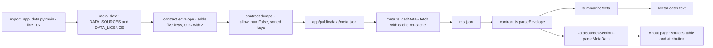
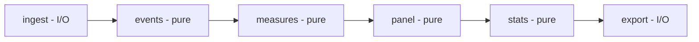

# Milestone 0: scaffold and design

- **Status:** done, pending owner review
- **Date:** 2026-10-28
- **Last synced:** 2026-10-28, after two adversarial reviews (methodology and code) and the fixes that followed:
  the architect revised ADRs 0001 to 0005 and the data model, and the code and app were changed. The ADRs,
  [`data-model.md`](../architecture/data-model.md) and the code are the source of truth. This page only restates
  them. **ADR 0002's SEC EDGAR rule is *Proposed: pending owner decision*** (section 4.1).
- **Results:** none. This milestone builds the frame and writes the design down. Every number below that is not a
  test count, a coverage figure or a build size is either a *design fact* taken from an ADR (an "architecture
  decision record", a short document that states one decision and why), or a *simulated* rate from a prototype in
  `research/prototypes/`, and it says which. Design facts were measured on the source data on 2026-10-28. Both are
  inputs to the design, not results of the study.
- **Where this fits:** [LEARNING_LOG.md](../../LEARNING_LOG.md) is the index. Background on the finance is in
  [the concepts doc](../concepts/00-background.md). The product story is in the [PR/FAQ](../prfaq.md).

**How to use this page.** Read sections 1 and 3 first. Keep section 2 open next to the code. Sections 4 and 5 are
interview preparation. Do section 6 *before* milestone 1 runs, then section 7 in chat.

---

## 1. What was built and why

### 1.1 The two halves

An **event study** measures how some quantity behaves around a dated event, compared with a quiet "baseline" period
before it. Here the event is an **earnings announcement** (a company reports its quarterly profit). The quantity is
**implied volatility** (IV): the volatility number that makes an option-pricing formula match the option's market
price. The study asks how IV rises into the announcement, how far it falls afterwards (the "IV crush"), and whether
options priced the stock's real move correctly. [The PR/FAQ](../prfaq.md) has the full pitch.

The project has two halves and a file format between them.

| Half | Folder | Job | State at milestone 0 |
|---|---|---|---|
| Python | [`src/earnings_vol/`](../../src/earnings_vol/), [`tools/`](../../tools/), [`tests/`](../../tests/) | Compute every number. Write JSON files. | Two modules: [`config.py`](../../src/earnings_vol/config.py) and [`contract.py`](../../src/earnings_vol/contract.py). Two scripts in `tools/` (`export_app_data.py`, `build_notebooks.py`). A third folder, [`tools/blender/`](../../tools/blender/README.md), holds 3D-scene tooling that is described in its own README and is not covered here. |
| App | [`app/`](../../app/) | Read the JSON, check it, draw it. **Never compute a result.** | A React shell with About, Architecture, 3D preview and a local Metrics page, plus a footer that checks `meta.json`. The About page draws the data-sources and licence table from `meta.json` (section 2.6). |
| Contract | `app/public/data/*.json` | The only thing the two halves share. | One file, [`meta.json`](../../app/public/data/meta.json), schema `0.1.0`. |

The word **contract** means: both sides agree on the exact shape of the file, and both sides check it. Python checks
by construction ([`contract.py`](../../src/earnings_vol/contract.py)). The app checks on load
([`contract.ts`](../../app/src/lib/contract.ts)).

Notebooks (Jupyter files, which mix text, code and output) are a third thing: **generated** from `src/` by
[`tools/build_notebooks.py`](../../tools/build_notebooks.py), never written by hand.

A fourth folder, [`research/prototypes/`](../../research/prototypes/README.md), holds throwaway scripts that back
numbers quoted in the ADRs:

- the event spacing (`spacing.py`) and the AAPL worked example (`worked.py`);
- the range of the event-variance leak (`leak_grid.py`);
- three Kolari-Pynnönen size simulations for a one-session measure at N = 50 (`kp_sim.py`, `kp_partial.py`,
  `kp_partial_clamp.py`);
- two size and power simulations at the real daily design, N = 352, for the crush, the run-up and the persistence
  (`h2h3_size_sim.py`, `h2h3_followup_sim.py`). They are what moved every primary test to two-way clustering
  (section 4.5);
- a simulation of why abnormal IV levels must not be summed (`iv_persistence_mc.py`, section 4.4).

Outputs are kept beside the scripts as `*.out.txt`. The scripts are **not part of the package and not tested to its
standard**. The adversarial review re-ran the KP scripts and got identical output. In this sync I re-ran `worked.py`,
`leak_grid.py`, `spacing.py`, `h2h3_size_sim.py` and `h2h3_followup_sim.py`: apart from timing lines, each printed
exactly its kept output (`spacing.py` keeps none; it printed the numbers quoted in section 4.3). **Nothing in `src/`
or `tests/` implements any statistic or simulation yet.**

### 1.2 What exists now, measured

I ran these commands on 2026-10-28 in this repository, in the final sync pass after the code-review fixes. Output is
quoted as printed, except that the notebook check prints the absolute path of the repository, which is shortened
here to the repository-relative path.

| Command | Printed |
|---|---|
| `uv run pytest -q` | `70 passed in 1.25s` |
| `uv run python tools/build_notebooks.py --check` | `OK: notebooks/00_scaffold_tour.ipynb is in sync with src/` (exit code 0; path shortened as said above) |
| `cd app && npm run verify` | lint clean; `Test Files  23 passed (23)`; `Tests  208 passed (208)`; coverage `Statements 98.96%`, `Branches 96.98%`, `Functions 97.67%`, `Lines 99.48%`; build `✓ built in 2.48s` |

The 70 Python tests split as 11 in `test_config.py`, 39 in `test_contract.py`, 11 in `test_export_app_data.py` and
9 in `test_notebooks_sync.py` (from `uv run pytest --co -q`). Tool versions on this machine: Python 3.12.13, uv 0.11.25,
Node v22.23.1, npm 10.9.8.

### 1.3 The five ADRs in one line each

| ADR | One line |
|---|---|
| [0001 overall architecture](../adr/0001-overall-architecture.md) | A one-way pipeline (ingest → events → measures → panel → stats → export). Dolt is read with `SELECT` only, pinned to a commit. Cache is Parquet outside the repo. The app gets one versioned JSON file per view. Only DoltHub-derived tables are committed, and every column has a licence class (U, R, S or F) that decides whether it may leave the machine (section 4.6). |
| [0002 day zero](../adr/0002-day-zero-convention.md) | Day 0 is the first trading session whose *closing* option quotes come after the news. Before-open reports: the announcement day. After-close reports: the next session. The calendar's label is checked against documents, never against IV, and never decided by the size of the price move. SEC EDGAR 8-K acceptance times as the main source are **proposed, pending the owner's decision**. The default without them is the company's press release, then the calendar label. The overnight price gap is a local diagnostic that only triggers a hand check. |
| [0003 IV measures](../adr/0003-iv-measures.md) | Recompute IV ourselves (Black-76 on the put-call-parity forward from the 4 strikes nearest the money, out-of-the-money side, session clock). The primary series is an *event-aware* 30-day IV. The event variance E is stored signed, and its formula carries a factor 252 when written with session counts and annualised IVs (section 4.2). |
| [0004 baseline and windows](../adr/0004-baseline-and-event-windows.md) | Window [−10, +10]. Baseline [−60, −22] minus other events' zones, with at least 20 clean sessions. Abnormal IV is log IV adjusted for VIX. Test run-up, crush and persistence, not CAAIV. |
| [0005 statistical tests](../adr/0005-statistical-test-suite.md) | Every tested quantity is a weighted sum of one-session changes, and H1 to H4 are about *equal-weighted* means. Primary test: a two-way cluster-robust t, by day-0 date × firm for the crush and by season × firm for run-up and persistence (a Rademacher randomisation p-value if seasons are unbalanced). Boehmer-Musumeci-Poulsen (BMP) and the Kolari-Pynnönen (KP) family, with Kolari, Pape & Pynnönen's overlap adjustment, are robustness rows, labelled as tests of the precision-weighted mean. Regressions use two-way firm × date standard errors. Seven hypotheses with a Holm correction. A size gate (G1) on the real event set must pass at milestone 3 (section 4.5). |

### 1.4 Why this design and not the alternatives

**Why not compute in the browser?**
The ADR's answer is short: the app would hold a second copy of the statistics, and the copy could disagree with
Python ([ADR 0001, alternatives table](../adr/0001-overall-architecture.md)). Here is what that means in practice.

- *Two implementations drift.* A mean computed in TypeScript and a mean computed in pandas can differ by how they
  treat a null, by which events they include, or by rounding. The chart would then disagree with the report, and
  nobody could say which is right. With one place that computes, there is one answer.
- *The tests live in Python.* The hand-worked oracles and the planned Monte Carlo size checks are written against the
  Python functions. A browser copy would be untested by those.
- *Data size and licence.* The DoltHub `options` clone is 8.3 GiB on disk (`du -h`; 8.9 GB in decimal units). CBOE and Yahoo data must never be
  published. If the browser computed, it would need the rows. Shipping only finished aggregates avoids both problems.
- *Provenance.* A Python run can stamp the Dolt commit and a parameter hash on its output. A calculation that happens
  in a viewer's browser has no such stamp.

The rule has a cost. Any new number the app wants needs a new field in the JSON, a Python change and a version bump.
That is deliberate ([ADR 0001 §4](../adr/0001-overall-architecture.md)).

**Why not hand-written notebooks?**
A notebook is a JSON file that also stores outputs, run counts and (in the newer format) cell ids. Edit it by hand,
or let Jupyter save outputs, and every git diff is noise. State also hides in it: cells can be run out of order.
ADR 0001 says notebooks "are untestable, diff badly and hide state". So we **generate** them from
[`build_notebooks.py`](../../tools/build_notebooks.py). The generated notebook *imports* the package instead of
copying its code, so `src/` stays the single source of truth. A test fails if the file on disk is not what a fresh
build produces (section 2.5).

**Why a versioned envelope?**
The envelope is the five-key wrapper around every file: `schema_version`, `kind`, `generated_at`, `source_commit`,
`data`.

- `schema_version` lets the app **refuse** a file it does not understand ([`contract.ts:63`](../../app/src/lib/contract.ts#L63)),
  instead of drawing it wrongly. A wrong chart that looks fine is worse than an error message.
- The key set is exact (no missing, no extra). Drift between Python and the app shows up at load time.
- `generated_at` and `source_commit` say which code wrote the file and when.
- One validator covers every file. `schema_version` versions the *whole* contract, so Python, TypeScript and the
  docs change together in one commit ([ADR 0001 §4](../adr/0001-overall-architecture.md)).

**Why recompute IV instead of trusting the vendor column?**
The vendor's `vol` column in the options data has inputs we cannot see (spot, dividends, rate, day count). ADR 0003
measured that call and put IV at the *same strike* differ by 0.1 to 0.3 vol points on a normal day and by up to 3.1
vol points on an announcement day, and that deep in-the-money rows carry meaningless values. We cannot defend a
number line by line if we cannot see how it was made. So we recompute from the bid/ask midpoint with **Black-76**
(the standard pricing formula for options on a forward price), using the **forward price implied by put-call
parity** taken from the same snapshot. That one choice removes the need for a spot price (the data has none), for a
dividend forecast and for the snapshot time. Call and put then agree by construction. The vendor's numbers are kept
only to validate ours ([ADR 0003 §d](../adr/0003-iv-measures.md)).

**Two smaller choices, for completeness.**

- *Dolt is read-only and pinned.* The shared DoltHub clones (a Dolt repo is a database with git-style history) are
  read through the `dolt sql` command line with `SELECT` only and `AS OF '<commit hash>'`. A fingerprint check before
  and after each batch proves nothing in `.dolt/` changed ([ADR 0001 §3](../adr/0001-overall-architecture.md)). This is
  planned for milestone 1. Nothing at milestone 0 touches Dolt.
- *Pure functions in the middle, I/O at the edges.* A "pure" function takes values and returns values: no clock, no
  network, no files. Pure functions are testable with a hand-worked example. [`envelope()`](../../src/earnings_vol/contract.py#L30)
  already follows this: it does not read the clock, the caller passes the time in.

---

## 2. Code walkthrough by `file:line`

Line numbers were read from the files on 2026-10-28 with `grep -n` and `cat -n`. If a file changes, the numbers move.

### 2.1 `config.py`: where the data lives

Source: [`src/earnings_vol/config.py`](../../src/earnings_vol/config.py). It answers one question: where is the
data on disk? Everything else asks this file instead of writing a path by hand. The header comment
([`config.py:10-23`](../../src/earnings_vol/config.py#L10-L23)) draws the layout.

An **environment variable** is a named setting the shell passes to a program. This project uses one: `VOL_DATA_DIR`.

```
$VOL_DATA_DIR/                      data_dir()      default ~/data/vol-projects
  dolthub/<name>/                   dolt_repo(name) shared clones, READ ONLY, must contain .dolt/
  earnings-vol-study/               project_dir()   this project's own folder (a path only)
    raw/                            raw_dir()       small sources we download: CBOE CSVs, yfinance prices
    cache/                          cache_dir()     files we can rebuild: Parquet extracts, derived tables
```

**Parquet** is a column-oriented file format that keeps column types (dates stay dates, missing stays missing).

| Where | What it does |
|---|---|
| [`config.py:33`](../../src/earnings_vol/config.py#L33) | `DATA_DIR_ENV = "VOL_DATA_DIR"`: the variable's name, in one place. |
| [`config.py:36`](../../src/earnings_vol/config.py#L36) | `DEFAULT_DATA_DIR = "~/data/vol-projects"`: used when the variable is not set. |
| [`config.py:39`](../../src/earnings_vol/config.py#L39) | `PROJECT = "earnings-vol-study"`: the name of this project's folder. |
| [`config.py:42-48`](../../src/earnings_vol/config.py#L42-L48) | `data_dir()`: reads the variable and calls `expanduser()` so `~` means the home folder. Tests: [`test_config.py:12`](../../tests/test_config.py#L12), [`:17`](../../tests/test_config.py#L17), [`:25`](../../tests/test_config.py#L25). |
| [`config.py:51-69`](../../src/earnings_vol/config.py#L51-L69) | `dolt_repo(name)`: builds `data_dir()/dolthub/<name>`. An empty folder is not a clone, so line [63](../../src/earnings_vol/config.py#L63) demands a `.dolt` folder inside. If it is missing, lines [64-68](../../src/earnings_vol/config.py#L64-L68) raise `FileNotFoundError` with the exact `dolt clone` command to fix it. It never writes. Tests: [`test_config.py:33`](../../tests/test_config.py#L33), [`:42`](../../tests/test_config.py#L42), [`:50`](../../tests/test_config.py#L50). |
| [`config.py:72-79`](../../src/earnings_vol/config.py#L72-L79) | `project_dir()`: only builds the path. It does *not* create the folder. [`test_config.py:57`](../../tests/test_config.py#L57) pins that. A function that only names a place should not have side effects. |
| [`config.py:82-94`](../../src/earnings_vol/config.py#L82-L94) | `raw_dir()`: `project_dir()/raw`. Line [93](../../src/earnings_vol/config.py#L93) makes it with `mkdir(parents=True, exist_ok=True)`, so a second call is safe and missing parents are created. |
| [`config.py:97-109`](../../src/earnings_vol/config.py#L97-L109) | `cache_dir()`: `project_dir()/cache`, made the same way ([line 108](../../src/earnings_vol/config.py#L108)). If you delete it, the next run rebuilds from the Dolt clones and `raw/`. |

Two things to be able to say out loud:

1. The rule from the shared data folder that several projects read is: each project downloads its own small sources into
   `$VOL_DATA_DIR/<project>/raw/`. The cache sits beside it in the same project folder
   ([ADR 0001 §2](../adr/0001-overall-architecture.md)).
2. **Do not confuse two "data" places.** `$VOL_DATA_DIR` is *outside* the repository and holds big or unshareable
   data. The repository's own [`data/derived/`](../../data/derived/README.md) holds small derived tables that may be
   shared under CC BY-SA 4.0. At milestone 0 it holds one file, `earnings_calendar_30_large_caps.json`, a DoltHub extract
   that `research/prototypes/spacing.py` reads. No pipeline table is there yet.

### 2.2 `contract.py`: the envelope and the JSON writer

Source: [`src/earnings_vol/contract.py`](../../src/earnings_vol/contract.py). The header comment
([`contract.py:4-17`](../../src/earnings_vol/contract.py#L4-L17)) lists the five keys.

| Where | What it does |
|---|---|
| [`contract.py:22`](../../src/earnings_vol/contract.py#L22) | `SCHEMA_VERSION = "0.1.0"`. The TypeScript side has the same string at [`contract.ts:17`](../../app/src/lib/contract.ts#L17). [`test_contract.py:21`](../../tests/test_contract.py#L21) pins it. |
| [`contract.py:30-58`](../../src/earnings_vol/contract.py#L30-L58) | `envelope(kind, data, *, generated_at, source_commit)`: returns the five-key dictionary. The `*` forces the last two to be passed by name. |
| [`contract.py:33-34`](../../src/earnings_vol/contract.py#L33-L34) | It does **not** read the clock. The caller passes `generated_at`, so a test passes a fixed time and gets the same output every run. |
| [`contract.py:38-43`](../../src/earnings_vol/contract.py#L38-L43) | Refuses wrong types with `TypeError`: `kind` and `source_commit` must be non-empty strings and `data` a dict. The app rejects a non-string `kind` or `source_commit` and a non-object `data` ([`contract.ts:83-88`](../../app/src/lib/contract.ts#L83-L88)), so those mistakes now fail at export, not in the browser (tests from [`test_contract.py:119`](../../tests/test_contract.py#L119) to [`:139`](../../tests/test_contract.py#L139)). **Known gap** (delta review, 10c): the app checks only `typeof … === 'string'`, so it *accepts* an empty `kind` or `source_commit`; only Python refuses `""`. Added after the code review. |
| [`contract.py:47-48`](../../src/earnings_vol/contract.py#L47-L48) | Refuses a **naive** datetime (one with no time zone) with `ValueError`. "14:00" without a zone is ambiguous, and guessing would write a wrong `Z` time. The check also catches a time zone object that returns no offset ([`test_contract.py:68`](../../tests/test_contract.py#L68)). |
| [`contract.py:51`](../../src/earnings_vol/contract.py#L51) | `generated_at.astimezone(timezone.utc)`: converts to UTC first. 14:00+02:00 is 12:00 UTC. |
| [`contract.py:55`](../../src/earnings_vol/contract.py#L55) | `strftime("%Y-%m-%dT%H:%M:%SZ")`: prints the time with a literal `Z`. |
| [`contract.py:61-81`](../../src/earnings_vol/contract.py#L61-L81) | `dumps(env)`: turns the envelope into JSON text with `allow_nan=False`, `sort_keys=True`, `indent=2` and one trailing newline ([line 75](../../src/earnings_vol/contract.py#L75)). |
| [`contract.py:27`](../../src/earnings_vol/contract.py#L27), [`:80`](../../src/earnings_vol/contract.py#L80), [`:84-92`](../../src/earnings_vol/contract.py#L84-L92) | Also refuses a whole number outside ±(2⁵³ − 1), `MAX_SAFE_INT`. A JavaScript number cannot hold it exactly: the app would read a rounded number, or `Infinity` beyond about 308 digits. `dumps` reads its own text back with `json.loads(..., parse_int=_check_safe_int)`, which sees every integer at any depth. Floats are not checked. Tests from [`test_contract.py:143`](../../tests/test_contract.py#L143) to [`:167`](../../tests/test_contract.py#L167). Added after the code review. |

**UTC and the `Z`.** UTC is the world reference time, with no daylight saving. `Z` ("Zulu") is the standard way to
write "offset zero". Writing every timestamp as UTC with a `Z` means no reader has to guess a time zone, and the
text sorts correctly. `strftime` can print microseconds (`%f`), but this format string omits `%f`, so microseconds
are dropped ([`test_contract.py:57`](../../tests/test_contract.py#L57)). The text is stable to the second.

**Sorted keys.** `sort_keys=True` makes the same data give the same bytes, whatever order the dictionary was built
in ([`test_contract.py:98`](../../tests/test_contract.py#L98)). A git diff then shows only real changes.

#### What `json.dumps` does with NaN (this is interview material)

`NaN` means "not a number". It is a special floating-point value that appears when a calculation has no answer, such
as `0.0/0.0`. **pandas uses NaN for missing values**, so once the pipeline holds DataFrames, NaN is everywhere.

JSON (the text format the app reads) has no NaN. Its number grammar allows only ordinary numbers. What happens
depends on who writes and who reads. I measured each row below on this machine:

| Who | Call | Result |
|---|---|---|
| Python, default | `json.dumps({"x": float("nan")})` | `{"x": NaN}`. It writes the **bare token `NaN`**. That is not valid JSON. (`inf` becomes the bare token `Infinity`.) |
| Browser or Node reader | `JSON.parse('{"x": NaN}')` | **throws `SyntaxError`**. Node v22.23.1 prints `SyntaxError: Unexpected token 'N', "{"x": NaN}" is not valid JSON`. The wording differs by browser. The error type does not. In the app, `res.json()` rejects, and [`meta.ts:23-26`](../../app/src/lib/meta.ts#L23-L26) turns that into a footer error. Its message blames a missing file, which would mislead in this case. |
| Python with the guard | `json.dumps(..., allow_nan=False)` | **raises `ValueError`**: `Out of range float values are not JSON compliant: nan`. |
| A serialiser that writes `null` | JavaScript `JSON.stringify({x: NaN})` gives `{"x":null}`. pandas `DataFrame({'x':[np.nan]}).to_json()` gives `{"x":{"0":null}}`. | Both write `null` **silently**. The file is valid. The information that something was undefined is gone. |

So Python's default does not write `null`. It writes something the browser rejects. `contract.dumps` passes
`allow_nan=False` ([`contract.py:75`](../../src/earnings_vol/contract.py#L75)) for two reasons:

1. **Fail early, on your own machine.** Without the guard, the bad file would be written and the *viewer* would hit a
   `SyntaxError` in the footer. With the guard, the export stops with a clear message that names `nan`.
2. **Force a decision.** A missing value must be written as `null` *on purpose*, with a reason next to it
   (`implied_move_status = "nonpositive_event_variance"`, [ADR 0001 §4](../adr/0001-overall-architecture.md)). If a
   serialiser quietly turned every NaN into `null`, a bug such as a division by zero would look exactly like "no data".

A failed export also does no damage. In [`export_app_data.py:119`](../../tools/export_app_data.py#L119) the call
`contract.dumps(env)` is the argument of `write_text`, so it runs *before* `write_text` opens the file. I checked this: a `ValueError` from `dumps` left the
old file untouched (`'OLD GOOD FILE\n'` was still there).

Tests: [`test_contract.py:106-111`](../../tests/test_contract.py#L106-L111) tries `nan`, `inf` and `-inf`.
[`test_contract.py:114`](../../tests/test_contract.py#L114) puts a NaN deep inside nested lists, to show the guard
checks the whole tree.

> **Corrections note.** An earlier draft of the `dumps` docstring said JavaScript would silently turn NaN into
> `null`. That was wrong, and it has been fixed (the docstring now reads at
> [`contract.py:64-66`](../../src/earnings_vol/contract.py#L64-L66): Python writes the bare token `NaN`, and the
> app's `JSON.parse` rejects it with a `SyntaxError`). The silent-`null` behaviour belongs to *writers* such as
> `JSON.stringify`, not to the `JSON.parse` reader. The old wording mixed the two up. The comment in
> [`test_contract.py:108-109`](../../tests/test_contract.py#L108-L109) had the same slip and has since been fixed too
> (section 2.8, item 1).

### 2.3 `tools/export_app_data.py`: writing `meta.json`

Source: [`tools/export_app_data.py`](../../tools/export_app_data.py). `tools/` holds scripts, not a package.
Run: `uv run python tools/export_app_data.py`.

| Where | What it does |
|---|---|
| [`export_app_data.py:20-21`](../../tools/export_app_data.py#L20-L21) | `ROOT` is found from the script's own location. `DEFAULT_OUT` is `app/public/data/meta.json`. |
| [`export_app_data.py:30-59`](../../tools/export_app_data.py#L30-L59) | `DATA_SOURCES`: four entries (two DoltHub repos, CBOE, Yahoo), each with `name`, `uses` (the tables or series taken), `url`, `licence` and `committed`. `committed` is `False` for CBOE and Yahoo: their data must never be committed. Licence is the text `see source` where we did not confirm one. We do not guess a licence. |
| [`export_app_data.py:64-78`](../../tools/export_app_data.py#L64-L78) | `DATA_LICENCE`: the licence of the committed data (`name`, `url`), the sources it covers (`applies_to`) and the attribution text the About page shows. This file is the only place that lists the sources and the licence; the app keeps no copy (section 2.6). |
| [`export_app_data.py:81-94`](../../tools/export_app_data.py#L81-L94) | `git_short_commit()`: asks git for the short hash of `HEAD`. If git is missing or the repo has no commit, it returns `"uncommitted"` and the export still works. |
| [`export_app_data.py:97-104`](../../tools/export_app_data.py#L97-L104) | `meta_data()`: project name, `milestone: 0`, title, `data_sources` and `data_licence`. |
| [`export_app_data.py:107-121`](../../tools/export_app_data.py#L107-L121) | `main(argv)`: `--out` lets a test write elsewhere. The *only* clock read is `datetime.now(timezone.utc)` at [line 115](../../tools/export_app_data.py#L115). It builds the envelope ([113-117](../../tools/export_app_data.py#L113-L117)), makes the folder ([118](../../tools/export_app_data.py#L118)) and writes ([119](../../tools/export_app_data.py#L119)). |

You can see the fallback in the data. [`meta.json:49`](../../app/public/data/meta.json#L49) says
`"source_commit": "uncommitted"`, because this repository has no commit yet (`git log` printed
`fatal: your current branch 'main' does not have any commits yet`). Once the first commit exists and the exporter is
run again, that field will hold the real short hash.

Tests ([`test_export_app_data.py`](../../tests/test_export_app_data.py)). The expected source table and licence are
written out by hand at [`:16-61`](../../tests/test_export_app_data.py#L16-L61), not imported from the exporter, so a
wrong licence or URL fails a test:

- [`:75`](../../tests/test_export_app_data.py#L75) five keys and a `Z` timestamp;
  [`:85`](../../tests/test_export_app_data.py#L85) the `data` fields;
- [`:93`](../../tests/test_export_app_data.py#L93) the whole `data_sources` table, value by value;
  [`:100`](../../tests/test_export_app_data.py#L100) the whole `data_licence`;
  [`:105`](../../tests/test_export_app_data.py#L105) the licence covers exactly the sources that name it;
- [`:114`](../../tests/test_export_app_data.py#L114) CBOE and Yahoo are never committed;
- [`:126`](../../tests/test_export_app_data.py#L126), [`:133`](../../tests/test_export_app_data.py#L133) and
  [`:149`](../../tests/test_export_app_data.py#L149) the three git cases, each in a throw-away repo or with an empty
  `PATH`;
- [`:155`](../../tests/test_export_app_data.py#L155) and [`:163`](../../tests/test_export_app_data.py#L163)
  `DEFAULT_OUT` is the app's `public/data/meta.json`, and `main([])` writes there (redirected into `tmp_path`).

### 2.4 `tools/build_notebooks.py`: deterministic notebooks

Source: [`tools/build_notebooks.py`](../../tools/build_notebooks.py). Run `uv run python tools/build_notebooks.py` to
write, or add `--check` to compare only. The header ([`:13-17`](../../tools/build_notebooks.py#L13-L17)) states the
promise: the same code always gives the same bytes.

**Deterministic** means: same input, same output, every time. Four things make it so.

1. **Fixed cell ids.** Notebook format 4.5 requires every cell to have an id. By default `nbformat` makes a *random*
   id, so every build would differ. Lines [94-95](../../tools/build_notebooks.py#L94-L95) overwrite each id with
   `cell-00`, `cell-01`, and so on. [Line 44](../../tools/build_notebooks.py#L44) sets format 4.5.
2. **No outputs, no run counts.** Code cells are created empty. A saved run would add outputs and an
   `execution_count` that change on every run.
3. **Fixed metadata** ([`:37-40`](../../tools/build_notebooks.py#L37-L40)): a plain `python3` kernel.
4. **Versions are stamped in** ([`:51-52`](../../tools/build_notebooks.py#L51-L52)). The first cell is a markdown
   cell: the build writes the package version and `contract.SCHEMA_VERSION` into its text. Bump either, forget to
   rebuild, and the check fails.

`render()` ([`:100-103`](../../tools/build_notebooks.py#L100-L103)) returns the exact text to write.
`check()` ([`:106-111`](../../tools/build_notebooks.py#L106-L111)) is true only if the file exists *and* its bytes
equal `render()` encoded as UTF-8. Since the code review it compares bytes, not text: `read_text()` turned `\r\n` and
a lone `\r` into `\n`, so a file with other line endings used to pass. Two tests pin that now
([`test_notebooks_sync.py:33-43`](../../tests/test_notebooks_sync.py#L33-L43)).
`main` ([`:114-132`](../../tools/build_notebooks.py#L114-L132)) with `--check` writes nothing,
prints `OK: ...` and returns 0, or prints `OUT OF SYNC` to the error stream and returns 1.

The current notebook is [`notebooks/00_scaffold_tour.ipynb`](../../notebooks/00_scaffold_tour.ipynb). Its code cells
import `earnings_vol`, show `data_dir()`, build a demo envelope with a fixed time and print the source of `envelope`.

### 2.5 The tests, and three in detail

All 70 Python tests, by file (pytest counts each `parametrize` case as one test):

| File | Tests | What it pins |
|---|---:|---|
| [`test_config.py`](../../tests/test_config.py) | 11 | Environment variable, `~` expansion, default, clone checks, folders created on demand and not before. Uses `tmp_path` (a fresh empty folder per test) and `monkeypatch` (sets an environment variable for one test only), so the real `~/data` is never touched. |
| [`test_contract.py`](../../tests/test_contract.py) | 39 | The five keys, `0.1.0`, UTC conversion, naive rejection, exact text, sorted keys, NaN refusal, wrong `kind` / `source_commit` / `data` types, and integers beyond ±(2⁵³ − 1). |
| [`test_export_app_data.py`](../../tests/test_export_app_data.py) | 11 | The exporter's output shape, the whole source table and licence written out by hand, git fallbacks, the default output path. |
| [`test_notebooks_sync.py`](../../tests/test_notebooks_sync.py) | 9 | Notebook on disk equals fresh build byte for byte (other line endings fail), determinism, ids, no outputs, code cells run. |

`pytest` finds test files by the settings in [`pyproject.toml:26-28`](../../pyproject.toml#L26-L28). The fixture
[`conftest.py:9-22`](../../tests/conftest.py#L9-L22) loads a script from `tools/` by file path, because `tools/` is
not a package.

A test is only worth having if it **fails when the code is broken**. So for each of the three tests below I broke
the code on purpose, in a throw-away copy of the repo kept in a scratch folder (never in the repo), and re-ran
`pytest`. The counts below are from the final sync pass, on the 70-test suite. The copy passed 70 of 70 before the
first change and again after the last one was undone.

#### Test A: a time that crosses midnight

[`test_contract.py:49-54`](../../tests/test_contract.py#L49-L54)

- **The hand-worked oracle.** 22:30 at −05:00 is five hours *behind* UTC, so add five hours: 22:30 + 5:00 = 27:30,
  which is 03:30 on the *next* day. The test says `2026-10-28T03:30:00Z`. The comment in the test shows that
  arithmetic.
- **The mutation it kills.** Delete the conversion at [`contract.py:51`](../../src/earnings_vol/contract.py#L51)
  (`utc = generated_at` instead of `generated_at.astimezone(timezone.utc)`). Measured: `3 failed, 67 passed`. The
  failures were this test, `test_generated_at_converted_from_plus_two_hours` and `test_notebook_code_cells_run`.
- **What this teaches.** The plain-UTC test at [`test_contract.py:38`](../../tests/test_contract.py#L38) *still
  passed* with that mutation. A UTC input needs no conversion, so it cannot see the bug. That is why the tests use
  non-UTC inputs, and one of them (this one) also changes the date.

#### Test B: NaN and infinity are refused

[`test_contract.py:106-111`](../../tests/test_contract.py#L106-L111) (three cases from one `parametrize`)

- **The oracle.** There is no number to work out. The rule is: JSON cannot write these values, so
  `contract.dumps` must raise `ValueError` for `nan`, `inf` and `-inf`.
- **The mutation it kills.** Change `allow_nan=False` to `allow_nan=True` at
  [`contract.py:75`](../../src/earnings_vol/contract.py#L75). Measured: `4 failed, 66 passed`. The three parametrised
  cases here plus the nested one at [`test_contract.py:114`](../../tests/test_contract.py#L114).
- **Note.** When I first wrote this page, the comment at [`test_contract.py:108-109`](../../tests/test_contract.py#L108-L109)
  repeated the old, wrong claim (section 2.8, item 1). It now says what is true: Python writes a bare `NaN` token and
  the browser's `JSON.parse` rejects it. The *test* was always right.

#### Test C: a changed notebook is reported as out of sync

[`test_notebooks_sync.py:21-30`](../../tests/test_notebooks_sync.py#L21-L30)

- **The oracle.** Start from the correct text (`check` must say true). Change one thing: `Scaffold tour` becomes
  `Scaffold tour!`. `check` must now say false. The expected answer is known without running the code.
- **Mutations it kills.**
  - Make `check()` look only at whether the file exists (`return path.exists()`): `4 failed, 66 passed` (this test,
    the two line-ending cases and `test_main_check_exit_codes`).
  - Compare text instead of bytes (`path.read_text(encoding="utf-8") == render()`, the code before the review):
    `2 failed, 68 passed`, the two line-ending cases. That is the bug the code review found.
  - Delete the fixed-id loop at [`build_notebooks.py:94-95`](../../tools/build_notebooks.py#L94-L95): `5 failed,
    65 passed`. Random ids mean two builds differ.
  - Edit a cell's text in the builder (`## 1. Where the data lives` → `## 1. Where the data is`) but do not rebuild
    the notebook: `1 failed, 69 passed`. That one is the real sync test,
    [`test_notebooks_sync.py:17`](../../tests/test_notebooks_sync.py#L17). It is the one that catches the mistake a
    human actually makes.
- **Why Test C and the sync test are a pair.** The sync test shows the file on disk matches a fresh build *today*.
  Test C shows `check()` can say *no*. A check that can never fail proves nothing.

### 2.6 The app: five files

#### `contract.ts`: the validator that never coerces

Source: [`app/src/lib/contract.ts`](../../app/src/lib/contract.ts). Its job is to look at a parsed JSON value and say
"valid envelope" or "invalid, and here is the rule that failed".

| Where | What it does |
|---|---|
| [`contract.ts:17`](../../app/src/lib/contract.ts#L17) | `SCHEMA_VERSION = '0.1.0'`, the same string as Python. |
| [`contract.ts:19`](../../app/src/lib/contract.ts#L19) | `ENVELOPE_KEYS`: the five allowed keys. |
| [`contract.ts:29`](../../app/src/lib/contract.ts#L29) | `ParseResult = { ok: true; envelope } \| { ok: false; error }`. A *discriminated union*: look at `ok` and TypeScript knows which fields exist. |
| [`contract.ts:43-56`](../../app/src/lib/contract.ts#L43-L56) | `ISO_UTC` and `isIsoUtc`: a regular expression checks the shape, then [line 54](../../app/src/lib/contract.ts#L54) rebuilds the time with `Date.UTC` and compares. `Date.UTC` quietly turns Feb 30 into Mar 2, so we format the result back to text and require it to match the input ([test](../../app/src/lib/contract.test.ts#L120)). |
| [`contract.ts:58`](../../app/src/lib/contract.ts#L58) | `parseEnvelope(input)`. First: is it a plain object? ([59](../../app/src/lib/contract.ts#L59)) |
| [`contract.ts:61-70`](../../app/src/lib/contract.ts#L61-L70) | **Version before keys.** A newer file may have different keys, and "unsupported version" is a more useful message than "unexpected key" ([test](../../app/src/lib/contract.test.ts#L44)). |
| [`contract.ts:72-80`](../../app/src/lib/contract.ts#L72-L80) | The key set must be *exactly* the five. Missing and extra keys are both reported together. `Object.hasOwn` is used so an inherited property does not count as present ([test](../../app/src/lib/contract.test.ts#L69)). |
| [`contract.ts:82-88`](../../app/src/lib/contract.ts#L82-L88) | Field types: `kind` and `source_commit` are strings, `generated_at` passes `isIsoUtc`, `data` is a plain object. |
| [`contract.ts:90`](../../app/src/lib/contract.ts#L90) | Returns the envelope. |

**Why it never coerces.** To *coerce* is to quietly convert a wrong value into a right-looking one, for example the
number `0.1` into the text `"0.1"`. The header says it plainly: nothing throws and nothing is coerced
([`contract.ts:13-14`](../../app/src/lib/contract.ts#L13-L14)). The reason is that coercion turns a bug on the
Python side into a plausible picture on the screen. [`contract.test.ts:39`](../../app/src/lib/contract.test.ts#L39)
checks that the number `0.1` and an array are not accepted as `"0.1.0"`. The same attitude is in
[`meta.ts:36-40`](../../app/src/lib/meta.ts#L36-L40): a milestone that is not a non-negative integer becomes `null`
and the footer says "unknown". This is the same family of mistake as a wrong day-0 label: wrong input, believable output.

**Limit to know.** `parseEnvelope` checks only the *envelope*: `data` need only be an object. The one payload checked
today is `meta.json`'s, by `parseMetaData` before the About page draws it (below). Per-view payload checks come with
the `0.2.0` views ([data model §4](../architecture/data-model.md#4-python--app-json-contract)).

#### `meta.ts`: fetching `meta.json`

Source: [`app/src/lib/meta.ts`](../../app/src/lib/meta.ts).

| Where | What it does |
|---|---|
| [`meta.ts:8`](../../app/src/lib/meta.ts#L8) | `META_URL = 'data/meta.json'`: a **relative** URL (no leading slash). The built app works under any sub-path because [`vite.config.ts:5-7`](../../app/vite.config.ts#L5-L7) sets `base: './'`. [Test](../../app/src/lib/meta.test.ts#L17). |
| [`meta.ts:11`](../../app/src/lib/meta.ts#L11) | `loadMeta(url, fetchImpl)`. `fetch` is an **injected** argument, so tests pass a fake and never touch the network. It never throws: every failure comes back as `{ ok: false, error }`. |
| [`meta.ts:14-16`](../../app/src/lib/meta.ts#L14-L16) | `fetchImpl(url, { cache: 'no-cache' })`. |
| [`meta.ts:17-19`](../../app/src/lib/meta.ts#L17-L19) | Failure branch 1: the network request itself failed. |
| [`meta.ts:20`](../../app/src/lib/meta.ts#L20) | Failure branch 2: an HTTP error status, with the hint "has the Python exporter been run?". |
| [`meta.ts:21-26`](../../app/src/lib/meta.ts#L21-L26) | Failure branch 3: the body is not JSON (a missing file is often served as the site's HTML page). |
| [`meta.ts:27`](../../app/src/lib/meta.ts#L27) | Otherwise `parseEnvelope(body)` decides. |
| [`meta.ts:43-54`](../../app/src/lib/meta.ts#L43-L54) | `isMilestone` and `summarizeMeta`: copy the envelope fields, and read `data.milestone` only if it is a non-negative integer. |
| [`MetaFooter.tsx:15-17`](../../app/src/lib/MetaFooter.tsx#L15-L17) | The footer calls `loadMeta` and shows the summary or the error. |

**Why `cache: 'no-cache'`.** Browsers keep a copy of files they fetch and may reuse it without asking the server.
The footer exists to say which data is *actually being served*. A stale copy of `meta.json` could name an old Python
commit while the charts show newer data. `'no-cache'` does **not** mean "do not store". It means "store it, but ask
the server whether it changed before using it" (a conditional request; the server can answer "unchanged" cheaply).
`'no-store'` is the setting that would skip storing, and we do not need it.

#### `parseMetaData` and the About page: one source for the licence table

The code review found the data-sources table in two places: the exporter wrote it into `meta.json`, and the app kept
its own copy, which it drew. Nothing compared them, so a wrong CC BY-SA licence passed every test on both sides. Now
`meta.json` is the only copy, and the app draws it.

| Where | What it does |
|---|---|
| [`meta.ts:61-93`](../../app/src/lib/meta.ts#L61-L93) | The types: `DataSource {name, uses, url, licence, committed}`, `DataLicence {name, url, applies_to, attribution}` and `MetaData`, the `data` object of `meta.json`. |
| [`meta.ts:97-99`](../../app/src/lib/meta.ts#L97-L99) | The exact key lists. A missing or an extra key is an error, as for the envelope. |
| [`meta.ts:105`](../../app/src/lib/meta.ts#L105) | `isHttpsUrl`: a URL goes into an `href`, so only `https://` is accepted (no `javascript:` link). |
| [`meta.ts:127-180`](../../app/src/lib/meta.ts#L127-L180) | `parseMetaData(input)`: checks every field and every source, refuses a duplicate source name, and checks that each `applies_to` entry names a listed source. Like `parseEnvelope`, it never throws and never coerces. |
| [`DataSourcesSection.tsx:55-69`](../../app/src/lib/DataSourcesSection.tsx#L55-L69) | Loads `meta.json` with `loadMeta`, then runs `parseMetaData`. A missing or invalid file shows an error (`role="alert"`) instead of a table. |
| [`DataSourcesSection.tsx:12-53`](../../app/src/lib/DataSourcesSection.tsx#L12-L53) | Draws the table: source, what it is used for, licence (linked to the licence text when `applies_to` names the source), whether it is committed, and the attribution text underneath. |
| [`StudySections.tsx:15-16`](../../app/src/lib/StudySections.tsx#L15-L16) | The About page places the section. [`studyContent.ts:1-5`](../../app/src/lib/studyContent.ts#L1-L5) now says the sources are *not* kept there. |

The same review found two dead files, `charts.tsx` and `LineChart.tsx`, left over from a template. No page used them,
they counted towards the coverage gate, and `charts.tsx` held the only statistic in `app/src` (a histogram's bin
counts). Both are gone, with their tests: `app/src/lib/` has no `charts` or `LineChart` file left.

#### `terrain.ts`: from a grid to a 3D surface

Source: [`app/src/lib/terrain.ts`](../../app/src/lib/terrain.ts). A pure function (no WebGL, no browser objects) that
turns a table of numbers into the arrays a 3D library wants. The header ([`:1-10`](../../app/src/lib/terrain.ts#L1-L10))
states the axes: column `j` (event day) is `x`, row `i` (company) is `z`, the value is `y` (height).

| Where | What it does |
|---|---|
| [`terrain.ts:30-46`](../../app/src/lib/terrain.ts#L30-L46) | The `Terrain` result: `positions` (x, y, z per vertex), `colors`, `indices` (which vertices form triangles), `min`, `max` and `missingCount`. |
| [`terrain.ts:85-87`](../../app/src/lib/terrain.ts#L85-L87) | `axis(i, n, extent)`: places sample `i` of `n` along a line centred on 0. A single sample sits at 0, which avoids dividing by zero. |
| [`terrain.ts:89`](../../app/src/lib/terrain.ts#L89) | `gridToTerrain(values, opts)`. `values[i][j]` is company `i`, event day `j`. |
| [`terrain.ts:93-95`](../../app/src/lib/terrain.ts#L93-L95) | A ragged grid (rows of different length) throws a clear error instead of drawing garbage ([test](../../app/src/lib/terrain.test.ts#L41)). |
| [`terrain.ts:97-108`](../../app/src/lib/terrain.ts#L97-L108) | Find the smallest and largest *finite* value. `span = max - min`. |
| [`terrain.ts:116-134`](../../app/src/lib/terrain.ts#L116-L134) | One **vertex** per cell. Vertex number is `k = i * cols + j` ([118](../../app/src/lib/terrain.ts#L118)). Height `y = t * height` where `t = (v - min) / span` runs from 0 to 1 ([124-125](../../app/src/lib/terrain.ts#L124-L125)). Colour blends from `low` to `high` by `t`. A flat grid (`span` is 0) sits at height 0 ([test](../../app/src/lib/terrain.test.ts#L73)). |
| [`terrain.ts:127-130`](../../app/src/lib/terrain.ts#L127-L130) | A non-finite cell (`NaN`) is marked missing: grey, height 0, counted. |
| [`terrain.ts:136-147`](../../app/src/lib/terrain.ts#L136-L147) | Two **triangles** per grid square. With `a` = top-left, `b` = right, `c` = below, `d` = diagonal, it pushes `(a, c, b)` and `(b, c, d)`, wound so the surface faces up ([test](../../app/src/lib/terrain.test.ts#L120)). Squares that touch a missing cell are skipped ([144](../../app/src/lib/terrain.ts#L144)), so gaps show as holes ([test](../../app/src/lib/terrain.test.ts#L101)). |
| [`terrain.ts:68-71`](../../app/src/lib/terrain.ts#L68-L71) | `srgbToLinear`: theme colours are written in sRGB hex, but three.js blends colours in linear light, so they are converted first. |

Sizes follow from the loops: `rows * cols` vertices and `2 * (rows - 1) * (cols - 1)` triangles when nothing is
missing ([test](../../app/src/lib/terrain.test.ts#L18)). The illustrative preview has 24 companies by 21 event days, so
by arithmetic 504 vertices and 920 triangles. The arrays are `Float32Array` and `Uint32Array` (fixed-size number
arrays) because that is what the graphics library hands to the graphics card.

#### `rng.ts`: a seeded random number generator

Source: [`app/src/lib/rng.ts`](../../app/src/lib/rng.ts). A **pseudo-random number generator** (PRNG) is a formula
that produces numbers which look random but are fully determined by a starting value, the **seed**.

- [`rng.ts:10-19`](../../app/src/lib/rng.ts#L10-L19) `mulberry32(seed)`: keeps one 32-bit number `a`. Each call
  adds a fixed constant (`0x6d2b79f5`), scrambles the bits with shifts, XORs and `Math.imul` (32-bit multiply), and
  divides by 2³² to give a number from 0 up to (but not including) 1. `>>> 0` forces an unsigned 32-bit integer.
- [`rng.ts:22-27`](../../app/src/lib/rng.ts#L22-L27) `gaussian(rand)`: the Box-Muller method, which turns two uniform
  draws into one draw that is approximately standard normal. The `1 - rand()` on [line 24](../../app/src/lib/rng.ts#L24)
  keeps the argument of `log` above zero.

**Why seeded.** The header says it: `Math.random()` is never used ([`rng.ts:2-4`](../../app/src/lib/rng.ts#L2-L4);
[`CLAUDE.md:26`](../../app/CLAUDE.md#L26)). The only user today is the illustrative 3D surface
([`illustrative.ts:25-32`](../../app/src/lib/illustrative.ts#L25-L32), seed `2026` at
[`EventTerrain3D.tsx:16`](../../app/src/three/EventTerrain3D.tsx#L16)). A seed means (1) the picture is the same on every
load, so it is a stable placeholder, and (2) a test can assert *exact* values, with no flaky failures. The test at
[`rng.test.ts:15`](../../app/src/lib/rng.test.ts#L15) compares the first draws for seeds 0 and 42 against numbers from
a separate Python implementation of the same algorithm. That is an independent oracle: a slip in JavaScript's
32-bit integer handling would show up as a mismatch.

### 2.7 The lazy-loaded 3D view and the coverage gate

**Lazy loading.** [`ThreeDPreview.tsx:5`](../../app/src/three/ThreeDPreview.tsx#L5) uses
`lazy(() => import('./EventTerrain3D'))`. A *dynamic import* makes the bundler put the 3D code in its own file that
is downloaded only when the page that needs it is opened. The build I ran printed two JavaScript files:
`index-0-S3eP8G.js` at 252.07 kB and `EventTerrain3D-BU4LwMeZ.js` at 944.27 kB, so the three.js code is the larger part and first paint does
not pay for it. While it loads,
[`Suspense`](../../app/src/three/ThreeDPreview.tsx#L23) shows "Loading 3D view…". If WebGL cannot start, the
[`ErrorBoundary`](../../app/src/three/ThreeDPreview.tsx#L16) shows a message instead of a blank page. The page is
registered in [`App.tsx:20`](../../app/src/App.tsx#L20). The build also printed a warning that a chunk is larger than
500 kB. That is the 3D chunk and it is expected.

`EventTerrain3D` itself ([`EventTerrain3D.tsx:46-64`](../../app/src/three/EventTerrain3D.tsx#L46-L64)) only wires the
pure code to WebGL: it calls `illustrativeIvGrid(seed)`, then `gridToTerrain`
([`:49`](../../app/src/three/EventTerrain3D.tsx#L49)), then builds a `BufferGeometry` from the arrays
([`:19-26`](../../app/src/three/EventTerrain3D.tsx#L19-L26)).

**Why the 3D code is outside the coverage gate.** Coverage is measured only on `src/lib/**`
([`vite.config.ts:15`](../../app/vite.config.ts#L15)). `src/three/` needs a GPU, and the test environment (jsdom) has
no WebGL. The app's rule is to keep that folder as thin as possible and put every calculation in `src/lib/`
([`CLAUDE.md:21-25`](../../app/CLAUDE.md#L21-L25)). That is why `terrain.ts` is a separate pure file. The 3D files do
have tests ([`EventTerrain3D.test.tsx`](../../app/src/three/EventTerrain3D.test.tsx),
[`ThreeDPreview.test.tsx`](../../app/src/three/ThreeDPreview.test.tsx)), with the r3f `Canvas` replaced by a stand-in.
They are just not part of the number that gates the build.

**The thresholds.** [`vite.config.ts:13-17`](../../app/vite.config.ts#L13-L17):
`thresholds: { lines: 85, functions: 85, branches: 75 }`. If a measured figure drops below, the coverage command
fails and so does `npm run verify` ([`package.json:14`](../../app/package.json#L14): lint, then coverage, then build).
The rule "never weaken them" is in [`CLAUDE.md:27-29`](../../app/CLAUDE.md#L27-L29). Measured now on `src/lib/**`:
statements 98.96%, branches 96.98%, functions 97.67%, lines 99.48%. **Coverage only shows that code ran.** A test with no assertion raises it
as much as a good one. That is why section 2.5 breaks the code on purpose.

### 2.8 Corrections and loose ends found while writing this

Writing this page changed no code, except the two app text changes of item 3 in the final sync. Items
1 to 4 were open when I first wrote this page. They are resolved or changed now, and I re-checked each against the
current files on 2026-10-28. Items 5 to 7 are still open and are for the owner to decide.

1. **NaN wording (now fixed in both places).** See the note in section 2.2. The `dumps` docstring
   ([`contract.py:64-66`](../../src/earnings_vol/contract.py#L64-L66)) and the comment in
   [`test_contract.py:108-109`](../../tests/test_contract.py#L108-L109) now both say: Python's default writes the bare
   token `NaN`, and the reader's `JSON.parse` throws `SyntaxError`. The copy that used to say "JavaScript would
   silently read them as null" is gone.
2. **Units in ADR 0003's event-variance formula (resolved in the ADR).** The ADR now writes the textbook form with the
   factor 252 when time is a count of sessions and σ is the session-annualised IV, and it states the units (section
   4.2 copies it). I re-checked the arithmetic with the table values of the re-run worked example (`w_1 = 0.003486`,
   `τ_1 = 11`, `w_2 = 0.005616`, `τ_2 = 20`): the `w` form gives 0.00088267, the IV form with the 252 gives the same
   value (2e-19 apart), and the IV form *without* the 252 gives 0.2224. The ADR prints E = 0.00088284 and 0.2225,
   because it uses the unrounded `w`; `worked.py` prints both (0.2225 is its planted-bug run).
3. **Stale baseline in the app's text (fixed).** ADR 0004 replaced the baseline [−60, −20] with [−60, −22] minus other
   events' zones. The app text now says so:
   [`architecture.ts:15`](../../app/src/lib/architecture.ts#L15),
   [`architecture.ts:31`](../../app/src/lib/architecture.ts#L31) and
   [`studyContent.ts:22`](../../app/src/lib/studyContent.ts#L22) ("sessions -60 to -22, minus days near the same
   company's other reports"). In the final sync the same question's list of tests, and the "Inference" boxes at
   [`architecture.ts:17`](../../app/src/lib/architecture.ts#L17), were changed to the current design: the two-way
   cluster-robust t as primary, BMP and the Kolari-Pynnönen family as robustness, two-way standard errors for the
   regressions. No app test asserts on that text; `npm run verify` stayed green (section 1.2).
4. **What ADR 0005 says about the simulations (resolved).** Its status line says that no statistics code exists in
   `src/` yet, that every rejection rate it quotes comes from a prototype in
   [`research/prototypes/`](../../research/prototypes/README.md) with its output kept beside it, and that gate G1 is a
   milestone-3 deliverable. ADR 0005 and [`docs/adr/README.md`](../adr/README.md) no longer say the scripts are missing.
   I searched `src/` and `tests/`: no statistics code. I re-ran the two real-design simulations
   (`h2h3_size_sim.py`, `h2h3_followup_sim.py`) and got their kept outputs back exactly, so the size and power rates
   quoted in section 4.5 are reproduced, as simulations. The size checks on real data are *planned* for milestone 3.
5. **"The app never computes" is a convention, not a test.** The rule is written in
   [`CLAUDE.md:18-20`](../../app/CLAUDE.md#L18-L20). What the code enforces is the *shape* of the file
   ([`parseEnvelope`](../../app/src/lib/contract.ts#L58)). I found no test that stops someone from adding arithmetic on
   data in a component (`grep -rln "never compute" app/src` finds only the comment in `contract.ts`). Keep this in mind
   for Q1 in section 7. The code review found one statistic in `app/src`, a histogram in a dead template file. It is
   deleted (section 2.6).
6. **`npm ci` was not run by me.** `app/CLAUDE.md:34-35` says the lockfile was made with npm 11 because npm 10.9.8
   crashed resolving vitest 4.1, and that `npm ci` works on both. This machine has npm 10.9.8 and `npm run verify`
   passed on it, but `verify` does not reinstall packages. I did not run `npm ci` here (it would delete
   `node_modules`). The code review ran it on a scratch copy with npm 10.9.8 and it succeeded
   ([code ledger](../validation/m0-code-ledger.md), row 6.4).
7. **Data facts I did not re-measure.** The numbers about the source data in ADRs 0002 to 0004 (the NULL share, the
   snapshot dates, the event spacing, the 97%) were measured by the ADR authors on 2026-10-28. I quote them as
   design inputs and did not check them against DoltHub.

---

## 3. Data flow

### 3.1 The journey of `meta.json`, as built



In words, with the line for each hop:

1. [`export_app_data.py:97-104`](../../tools/export_app_data.py#L97-L104) builds the payload.
2. [`export_app_data.py:113-117`](../../tools/export_app_data.py#L113-L117) wraps it with
   [`contract.envelope`](../../src/earnings_vol/contract.py#L30), which checks the types. The clock is read once, at
   [line 115](../../tools/export_app_data.py#L115).
3. [`contract.dumps`](../../src/earnings_vol/contract.py#L61) refuses NaN, infinity and integers JavaScript cannot
   hold exactly, and sorts keys.
4. [`export_app_data.py:119`](../../tools/export_app_data.py#L119) writes the text to `app/public/data/meta.json`.
5. In the browser, [`meta.ts:16`](../../app/src/lib/meta.ts#L16) fetches the file, asking the server to revalidate.
6. [`meta.ts:23`](../../app/src/lib/meta.ts#L23) parses the JSON. A NaN token would fail here.
7. [`meta.ts:27`](../../app/src/lib/meta.ts#L27) calls [`parseEnvelope`](../../app/src/lib/contract.ts#L58).
8. [`summarizeMeta`](../../app/src/lib/meta.ts#L45) picks the fields and
   [`MetaFooter.tsx:40-46`](../../app/src/lib/MetaFooter.tsx#L40-L46) prints
   `data contract <version> · milestone <M> · source commit <hash> · generated <time>`.
9. On the About page, [`DataSourcesSection.tsx:60-64`](../../app/src/lib/DataSourcesSection.tsx#L60-L64) loads the
   same file, checks `data` with [`parseMetaData`](../../app/src/lib/meta.ts#L127) and draws the sources table and
   the attribution text (section 2.6).

A cross-language safety net: [`publicData.test.ts:7`](../../app/src/test/publicData.test.ts#L7) reads the *real* files
that Python wrote to `public/data/` and runs the TypeScript validator on them. If Python and `contract.ts` drift
apart, this test fails. The other app tests use hand-made fixtures.

### 3.2 The planned pipeline

The [architecture diagrams](../architecture/README.md) show the whole system. The one-way layers come from
[ADR 0001 §1](../adr/0001-overall-architecture.md) and the table shapes from the [data model](../architecture/data-model.md).



A layer may import only from layers to its left. Only `ingest` and `export` do input and output. **Reading follows the
same rule:** a stage may read only tables written by an earlier layer, or earlier in its own fixed order. That is why
some columns live where they do ([ADR 0001 §1](../adr/0001-overall-architecture.md)):

- `market_daily` is written by `events`, because `measures` needs `r_cont` and `panel` needs VIX, and both sit to its
  right.
- The per-measure eligibility flags (`eligible_*`, `ineligible_reason`) are in `event_measures`, not `events`. They
  need observed snapshots and clean baseline counts, which `events` cannot know. `events.exclusion_reason` keeps only
  the event-level rules. For the same reason there is no `iv_daily` to `events` edge in the data-flow diagram.
- The price-scaled surprises (`price_ref`, `surprise_scaled`, `abs_surprise_scaled_w`, `sue_hist`) are in
  `event_measures`, not `eps`. They need the day −1 option forward, which `measures` produces after `eps` is written.

| Layer | One line | Main tables it makes |
|---|---|---|
| `ingest` | Read the Dolt clones (read-only, pinned to a commit), prices, T-bill rates and CBOE files into the Parquet cache. | files under `raw/` and `cache/` |
| `events` | Build NYSE sessions and the market-wide rates and VIX per session, one row per announcement, the timing label from documents (section 4.1), day 0 and day −1, the EPS-period match, and the local price-gap diagnostic. | `session`, `market_daily`, `security`, `ticker_alias`, `events`, `eps`, `timing_check` |
| `measures` | Recompute IV from quotes: the ATM total variance per expiry, then the daily IV measures and event variance. Reads `market_daily` (`r_cont`, for discounting) and `events` (day 0, to tell clean expiries from spanning ones). | `chain_expiry`, `iv_daily` |
| `panel` | Line the series up in event time, build the baseline, compute abnormal log IV (market-adjusted with VIX from `market_daily`), the per-measure eligibility flags and the price-scaled surprises. Repeat the same steps on the CBOE VX\* series for the five-name sample. | `event_window_obs`, `event_measures`, `event_measures_vx` |
| `stats` | The tests (the two-way cluster-robust t as primary; one-way clustered t, a Rademacher p-value, BMP, KPP's average-overlap and per-pair KP, Patell, sign and rank as robustness), regressions with two-way standard errors, Holm and BH corrections. Reads `event_measures`, `event_measures_vx`, `event_window_obs`, `events`, `eps`, `security`, and for validation `iv_daily` and `chain_expiry`. | `results` |
| `export` | Round, drop `_yf` and `_cboe` columns, write the versioned JSON and `data/derived/`. | JSON views, `data/derived/*.parquet` |

---

## 4. Design decisions you must be able to defend

These are the ADRs restated in plain words. Every number named here is a design fact from the ADR that is named, not
a study result.

### 4.1 Day 0, and BMO versus AMC (ADR 0002)

Event time is counted in **trading sessions** on the NYSE calendar, not calendar days. **Day 0 is the first session
whose *closing* option quotes were taken after the news.** Companies report **BMO** (before market open) or **AMC**
(after market close). For BMO, the news is out before the open on date D, so D's close already contains it: day 0 is
D. For AMC, D's close is taken *before* the news, so day 0 is the next session. Day −1 is the last close before the
news, and the crush is `X(0) − X(−1)` for any IV measure X, so exactly one session of ordinary movement plus the
news sits in it. If D is a weekend or holiday, day 0 is the first session after D.

Why closing quotes? Each option snapshot is dated by a session, and the ADR collected evidence that it shows that
session's *close*: the data is committed at about 06:35 UTC the next day, and the parity forward for AAPL on
2025-10-31 matched the official close. (The ADR calls this one event examined in detail. Milestone 1 must widen it.)

The calendar's label is stored as a nullable enum {BMO, AMC} (`events.timing_raw`). The `<NULL>` marker that carries a
SQL NULL through Dolt's CSV output is a transport detail and never reaches a table (ADR 0001 §3).

The calendar's label is sometimes wrong, and about a quarter of all rows have none. Two real mislabels were found by
hand: GOOGL 2024-10-29 (labelled BMO, but the big overnight gap is into 10-30) and NFLX 2024-10-17 (the big gap is into
10-18). Both fall in the daily sample, so this is not a theoretical problem.

**The first design let the price gap decide, and the review refuted it.** It compared the stock's overnight gap
(today's open against yesterday's close, minus the market's gap, divided by the stock's typical gap, a ratio called
`z`) on the two candidate days, corrected the label when the other day's gap was much larger, and excluded events with
a large gap on a nearby day. The methodology review simulated that rule exactly as written (ADR 0002 §3,
`p02_gap_selection.py`): quiet events were excluded far more often than big movers, and their wrong labels were
corrected far less often, so the kept quiet events had a wrong day 0 more often. **Any rule in which a price move
decides a label has this property**, because big moves are what make the price evidence strong.

**The rule now: documents decide the label, prices only diagnose** (ADR 0002 §3).

- **Proposed, pending the owner's decision: SEC EDGAR.** The architect made the acceptance time of the company's 8-K
  earnings filing (Item 2.02) the first source. The owner's approved plan excluded SEC EDGAR, because SEC's
  fair-access policy requires a real contact email in the User-Agent of every request. So ADR 0002 marks that rule
  *Proposed: pending owner decision*. During design the architect made 3 requests to EDGAR (GOOGL, NFLX, AAPL) with a
  placeholder contact and no personal data; a real run needs a contact the owner chooses.
- **The default if the owner declines, and the rule until then: look up every press release that matters**
  (ADR 0002 §3, "The default rule"; rewritten after the delta review).
  - **Who.** Every event whose calendar date is on or after 2024-09-11, which is every event that can land in the
    `daily` or `mixed` sample: about 365 + 50. Also every event with no calendar label, in any sample.
  - **How.** The company's own release: its time stamp, else its own words ("after the market close"), else the
    earnings-call time it announces. Before 09:30: BMO. At or after 16:00: AMC. In between (rare): day 0 is D, stored
    as BMO.
  - **The record.** Each look-up is a row of a committed file, `data/manual/press_release_checks.csv`, with the URL,
    so anyone can re-check it.
  - **Why all of them.** The delta review measured the old default, which looked up only the events a gap flagged
    plus a 50-event audit. In simulation, quiet events kept a wrong day 0 in 2.1–2.6% of cases against 0.3–0.6% for
    big movers. The audit could not see it: in the quiet tercile its 17 events found no error in 48% of samples.
    Looking up everything removes the calendar's errors from that comparison. It costs about 300 more look-ups per
    365 events, and the time per look-up is not measured yet: milestone 1 times the first 20.
- **The price gap stays a local diagnostic.** It is computed from Yahoo prices on your machine and never committed.
  It never sets a label and never excludes an event. The thresholds (`z ≥ 4` and 3 × the other candidate; 6 for a
  nearby session) now only decide which events get a *second reading* of their release in `daily` and `mixed`.
  In the older `coarse` robustness sample (2020–2024, roughly 850–900 events) they still decide which labelled events
  are looked up at all, and ADR 0002 states the selection that leaves, measured in simulation.
- **Statuses** (`events.timing_status`): `confirmed` (a document agrees with the label), `corrected` (a document
  contradicts it), `inferred` (no label, a document gives the timing), `date_corrected` (the documents put the
  announcement on another date, which is used), `no_document` (looked up, nothing found; the calendar label is
  kept), `not_checked` (never looked up; the calendar label is kept; allowed only in `coarse`) and `ambiguous` (no
  label and no document: excluded, with only a two-session robustness crush). *Revised after the delta review:*
  `no_document` and `not_checked` replace `unverified`, which this page defined as "no document found" while ADR 0002
  also gave it to every event nobody looked up. The two statuses that only the old price rule produced are gone.
- **A weekend or holiday release** has day 0 on the next session whatever the label says, so timing cannot make it
  `ambiguous`; only its date is checked.

Three rules protect the design:

- **Never use IV to check the label.** The study measures the crush on day 0. If IV picked day 0, a crush there
  would follow by construction. That is circular.
- **Never let the size of the move decide a label, or drop an event because of it.** That is *selection on the
  outcome*: it keeps or fixes big movers selectively, and big movers bias the implied-versus-realised comparison.
- **Measure what is left, and say where it is not bounded.** In `daily` and `mixed` one step still depends on the
  move: a gap can only contradict a label when the stock moved, so second readings happen more often among big
  movers. Most of them land on labels that were already right, so the second reader is *blind* (sees neither the
  gap nor the first reading), and a label changes only when a third blind reading agrees. Otherwise a re-reader
  primed by the gap would push errors onto quiet events (delta-2 review, claim 1). Each such change is flagged, and the report shows the results without them as a sensitivity analysis.
  The sample funnel reports the status counts, the share of gap contradictions and the mean crush by tercile of
  `abs_move_cand_max`, the larger move over the two candidate day-0 sessions. *Revised after the delta review:* the
  terciles used to be of the move on the day 0 used, which puts every mislabelled event in the quiet tercile by
  construction, and a "stratified audit as the bound" is gone because 17 events per tercile bound nothing.

The ADR also adds an after-the-fact check on the IV path by subgroup (the biggest one-day drop should be on day 0, not
day +1), which is never used to assign labels.

### 4.2 The three IV measures and the event variance (ADR 0003)

Everything is built from one stored quantity per (company, session, expiry): the **ATM total implied variance**
`w = σ²T`, the squared volatility times time. **ATM** (at-the-money) means a strike near the forward price. We
get it by solving Black-76 for `w` at each out-of-the-money strike and interpolating to log-moneyness 0. The forward
price comes from put-call parity, as the median over the 4 strikes with the smallest `|C − P|` (ADR 0003 §0). Time `τ` is
counted in **sessions**, and the reported IV is `σ = √(252·w/τ)`. Interest accrues on calendar days, variance on
sessions: two clocks, two jobs.

The three measures:

1. **Front fixed-expiry IV** (`front_fixed_iv`). On the day −1 snapshot, pick the shortest expiry that still has at
   least 5 sessions left after day 0 (**τ ≥ 5 at day 0**, so τ ≥ 6 at day −1), and follow that same expiry through
   the window. τ ≥ 5 is the usability rule every other measure obeys; the first version of the ADR allowed τ = 4 at
   day 0, and the review caught it. Its crush shrinks as the expiry gets longer, so it is only secondary.
2. **Event-aware 30-day IV** (`cm30_iv`, the primary daily series). The target horizon is 21 sessions. Expiries are
   split into *clean* (end before the event) and *spanning* (contain it). Interpolation uses only one class, never a
   mix. Mixing leaks a slice of the event variance into a horizon that should not contain it, starting about 40
   sessions before the event, inside the baseline. ADR 0003 sizes the leak over the vendor's expiry grid
   (`research/prototypes/leak_grid.py`; clean expiry 17–21 sessions out, spanning expiry 27–42, each of the 80 pairs
   counted once, flat ordinary volatility of 25%): 0–0.66 vol points (median 0.21) for E = 0.0007, and 0–2.73
   (median 0.90) for E = 0.003, a stock pricing a 5.5% move. I re-ran the script and got the same output.
3. **Event variance E and implied move √E**, the extra variance that the earnings day adds.

The model: `w_j = σ_d²·τ_j + E` for each expiry `j` that spans the event, where `σ_d²` is the ordinary variance per
session. With two spanning expiries `τ_1 < τ_2`:

$$
\sigma_d^2 = \frac{w_2 - w_1}{\tau_2 - \tau_1}, \qquad E = w_1 - \sigma_d^2\,\tau_1 = \frac{w_1\tau_2 - w_2\tau_1}{\tau_2 - \tau_1}
$$

The first expression is the *forward variance between the two expiries*, which holds no event. Subtract the ordinary
part from the first expiry and what is left is the event.

Units matter here. `w_j` and `E` are dimensionless (squared log-return units). `τ_j` counts sessions, and in the model
above `σ_d²` is the ordinary variance **per session**. The IVs the pipeline reports are **session-annualised**,
`σ_j = √(252·w_j/τ_j)`, so `w_j = σ_j² τ_j / 252`. In terms of reported IVs, ADR 0003 therefore writes the "textbook
form" with a factor 252 (copied from the ADR):

$$
E = \frac{\tau_1\tau_2\,(\sigma_1^2-\sigma_2^2)}{252\,(\tau_2-\tau_1)},\qquad
\sigma_{d,\text{ann}}^2 = 252\,\sigma_d^2 = \frac{\sigma_2^2\tau_2-\sigma_1^2\tau_1}{\tau_2-\tau_1}
$$

The second expression is the **annualised** ordinary variance, which is the one that appears next to `252·E/τ` in
ADR 0003 (a) and (b) and in ADR 0004 §3. It matches the brief's formula
`E = T₁T₂(σ₁²−σ₂²)/(T₂−T₁)` when time is in *years*, `T_j = τ_j/252`. Writing it with `τ` in sessions and *without* the
252, while keeping annualised σ, is wrong by a factor of 252: on the worked example below it gives 0.2225 instead of
0.000883. ADR 0003's unit test feeds the `w` form the stored `w_j`, and the textbook form the IVs the pipeline
*reports* with `T_j = τ_j/252`; the two must agree to a relative 1e-12. The test then runs a second time with a
planted bug (`T` in sessions, so the 252 is lost) and must fail there. The first prototype's "identity check"
compared an expression with itself and could not fail; the review caught that too. `worked.py` now prints both runs:
`8.828414097447e-04 vs 8.828414097447e-04 -> PASS`, then `... vs 2.224760352557e-01 -> FAIL`. (With the table's
rounded values I get 0.00088267 and 0.2224; the last digits differ only because the table shows `w` to six
decimals.)

**The worked example is the oracle.** AAPL, after-close report on 2025-10-30, so day −1 is 2025-10-30. ADR 0003
works the arithmetic: `w₁` = 0.003486 (11 sessions), `w₂` = 0.005616 (20 sessions), so `σ_d²` = (0.005616 −
0.003486)/9 = 2.3667 × 10⁻⁴ per session and `E = w₁ − 11 × σ_d² = 0.00088284`. The implied move `√E` is 2.97%. With the
*calendar* clock instead of sessions, the same prices give E = 0.001204 and an implied move of 3.47%. **The clock
alone makes the implied move 17% higher** (the variance 36% higher). That is why the clock is a decision and not a
detail. The ADR says plainly that the 10-30 quotes were wide and that this example demonstrates the arithmetic and is
not a claim about AAPL's typical move.

These numbers changed in the review. The first table came from a prototype that took the parity forward as the median
over *all* 7 strikes of the 11-14 expiry, not over the 4 nearest the money as ADR 0003 §0 says. Following the ADR's
own rule moves `w₁` up and E up by 27% (ADR 0003, revision note 1, has the old values), so an implementation that
followed the ADR would have failed the old oracle. `worked.py` now follows the ADR, and I re-ran
it: it prints exactly the numbers above.

**When E ≤ 0.** This happens exactly when `σ_1 ≤ σ_2`, that is, when the shorter expiry does not show a higher
session-annualised IV than the longer one. Causes: a small event lost in quote noise, an upward-sloping ordinary
term structure, or a wrong date. Policy: store E **signed**, set `implied_move` to null with status
`nonpositive_event_variance`, **average in variance space** (the average implied move of a group is the square root
of the mean of E over *all* its events), and report the share of E ≤ 0. Do not drop those events and do not floor E at
zero: each of those biases the average implied move upward.

**The realised move comes from the options too.** ADR 0003 §e measures the day-0 return from the same option snapshots:
`r₀ = ln(F₀(T)/F₋₁(T)) + r·Δ_cal/365`, with the same expiry T on both days. The forward already nets out dividends,
so this is a total return. The reason is licensing: a per-event return taken from Yahoo would count as Yahoo data in
the exported scatter ([ADR 0001 §7](../adr/0001-overall-architecture.md)). Yahoo closes are used locally only to
cross-check it.

### 4.3 The baseline, and why it is [−60, −22] minus other events' zones (ADR 0004)

The event window is [−10, +10]. The **baseline** is the quiet period used as "normal". The brief proposed [−60, −20].
Two problems:

- **The 30-day horizon.** At session `t`, `cm30_iv` covers the next 21 sessions. At `t = −21` that already includes
  day 0. So the baseline must stop at −22, or the last baseline days already carry event variance.
- **Quarterly reports are about 63 sessions apart.** ADR 0004 measured 306 gaps for 30 large companies: median 63. A
  fixed [−60, −20] baseline would overlap the *previous* report's [0, +10] window in 97.1% of gaps, and contain its
  day 0, the crush itself, in 20.3%. The previous report's crush and after-period would sit in the "normal" period and
  distort both its average and its spread. (An earlier version said day −60 falls *inside* that window in 97.1%; that
  share is 83.3%. I re-ran `spacing.py`: it prints 0.971, 0.203 and 0.833.)

The fix is a rule. Start with [−60, −22]. Remove every session inside [−21, +10] of any *other* event of the same
company, any orphan-period zone (an earnings period with no calendar event), any pre-calendar zone (a period whose 10-to-100-day
window starts before the calendar's first row on 2020-01-22), and any session not observed or missing its IV. An event
whose timing stayed ambiguous has no day 0, so its zone is [−21, +10] around *both* candidate days. Keep the event only if at least 20 clean sessions and 15 clean one-session changes remain. On the measured
spacing (before any data gaps) the ADR found a median of 31 clean sessions, and every one of the 306 had at least 20.

**Abnormal IV** is the log IV minus its baseline average, minus `β` times the same thing for log VIX. `β` is estimated
per company from the pooled clean baselines. Logs, because crushes are proportional (a 60%-IV name loses more vol
points than a 20%-IV name). Market adjustment, because over 20 to 30 sessions the whole market's volatility moves a
lot (the ADR's example is April 2025) and every event in a season gets hit together.

### 4.4 Why CAAIV is not tested, and what is (ADR 0004 §3)

In a returns event study you add up daily abnormal returns into a cumulative abnormal return (**CAR**). That works
because a return is a *flow*: adding daily returns gives the price change over the window. IV is a *level*. The
abnormal IV on day `t` is **already** the accumulated gap from the baseline. Adding levels counts a lasting shift
once per day. The ADR's example: one permanent +2 vol-point shift on day −10 would contribute 2 × 11 = 22
"vol-point-days" to a cumulative sum over [−10, 0]. Nobody trades that unit. Also, the CAR variance formula assumes
independent days, but IV levels are almost perfectly correlated day to day, so the real variance is closer to
`L²σ²` than `Lσ²`, and a test built on the CAR formula would reject far too often.

What makes sense is the cumulative sum of abnormal **changes**, which collapses to a difference of two levels. So we
test those directly:

- **RUNUP:** abnormal log IV at day −1. Is IV abnormally high at the last close before the news?
- **CRUSH:** the abnormal one-session change at day 0. How much does IV fall when the news arrives?
- **PERSIST at +1, +5, +10:** abnormal log IV at those days. Is IV back to normal? Negative means it overshoots.
- **EVAR:** event variance E at day −1.
- **ΔSIGMA_D:** the change in *ordinary* volatility, with the event variance taken out.

The mean abnormal path by relative day is plotted with pointwise 95% bands, as description only. The bands are
clustered two ways, by season × firm, because each point of the path is a multi-session ramp: date clusters would
make them far too narrow (ADR 0004 §3, ADR 0005 §2b).

A small simulation illustrates the point. [`research/prototypes/iv_persistence_mc.py`](../../research/prototypes/README.md)
(written for the literature review, [concepts doc §9](../concepts/00-background.md#9-applying-return-based-tests-to-implied-volatility))
simulates persistent IV levels and checks the size of a 5% test. Its README records a pooled lag-1 autocorrelation of
daily IV changes of −0.173, and a false-positive rate of 0.675 for summed levels against 0.022 for summed changes
over 11 days. The parameters are assumed, not fitted to data. The methodology review re-ran it and got the same three
numbers; it found that the 0.022 comes from quote noise and mean reversion, and that the argument is against the CAR
*variance formula* for levels, not against the level measures the ADRs test (ledger claim 11).

### 4.5 The test suite (ADR 0005)

Each tested quantity is written as `A = Σ a_t · e_t`, a weighted sum of abnormal one-session changes `e_t`. For CRUSH
the weight is 1 on day 0 and 0 elsewhere. For RUNUP and PERSIST the weights ramp from 0 to 1 across the baseline and
stay at 1 up to the target day. Across an unobserved session the walk uses one *span change* over the gap, with the
ramp weight held constant across it. The review showed that one-session changes across a gap are not exact
(ADR 0005 §1).

**What is tested.** H1 to H4 are about the **equal-weighted mean** of `A` in log points: the plain average the report
shows. Two kinds of dependence make events correlated:

- **through calendar dates:** events whose windows share dates move together (a VIX move, sector news);
- **through firms:** one company's events share its persistent features, such as a drift in its abnormal IV or a
  reaction that is typically large or small.

**The primary statistic: a two-way cluster-robust t** (Cameron, Gelbach & Miller 2011; Petersen 2009). The estimate is
the plain mean. Its variance adds a one-way cluster variance (CR1) for each dimension and subtracts the one for their
intersection, `V = V_A + V_B − V_{A∩B}`. The critical value comes from a t distribution with `min(G_A, G_B) − 1`
degrees of freedom, where `G` counts clusters. That choice is Cameron, Gelbach & Miller's. Cameron & Miller (2015,
§VI.E) know of no ideal approach for multiway clustering with few clusters, which is why the size is simulated and
then gated (G1 below). *Synced after the delta review:* ADR 0005 used to credit the t reference to Cameron & Miller
(2015). In code the t reference means statsmodels with **`use_t=True`**. Its default for clustered
errors is normal p-values, which rejected 10.35–11.22% at G = 7 in the delta review's simulation.

- **CRUSH and ΔSIGMA_D (H1, H4): day-0 date × firm** (`twoway_date_t`). Any same-date dependence is covered, including
  dependence that appears only on announcement days, which a correlation estimated on baselines cannot see.
- **RUNUP and PERSIST_10 (H2, H3): season × firm** (`twoway_season_t`). A ramp spans about 60 sessions, so it shares
  dates with almost every event of its season, not just with those on its own day 0. A season is the calendar quarter
  of day 0, with seasons of fewer than 10 events merged into a neighbour. The prototype design has 7 seasons, so the
  critical value is t₆ = 2.447.
- **Unbalanced seasons.** If the largest season is more than 1.5 times the smallest, the p-value comes from a
  Rademacher randomisation by season instead (`rad_season_p`), which flips the sign of each season's sum in all 2^G
  possible ways. Its smallest possible two-sided p is 2/2^G = 0.0156 at G = 7. Under Holm over seven hypotheses
  that floor can be rejected only at the **fifth** step (threshold 0.05/3 = 0.0167), after four other hypotheses are
  rejected; the fourth step's threshold, 0.05/4 = 0.0125, is below it. (ADR 0005 said "fourth" until the delta
  review.)
- **It needs no model.** Neither dimension uses an estimate of the autocorrelation of daily changes or of the
  correlation between events. That is the main reason it replaced the milestone-0 primary.

**Why it changed, in three steps** (ADR 0005, revision note). Each step was measured in a simulation at the real daily
design (352 events, every input estimated; a test at 5% should reject a true null 5% of the time):

1. The milestone-0 primary, BMP with an overlap-weighted KP adjustment, needed the autocorrelation matrix of daily
   changes for the ramps. It rejected 0.9–1.5% or 5.0–6.7%, depending on how that matrix was estimated, and 0–0.1%
   when IV levels mean-revert.
2. The reviewer's interim fix, a date-clustered t for the ramps, rejected 31.9–36.4% at a same-date correlation of
   0.1, because ramps overlap across day-0 dates. ISO-week clusters rejected 23.5–28.2%.
3. A first revision used one-way season clusters for the ramps and one-way date clusters for the crush. A second
   review showed that firm-level persistence breaks one-way clusters: date-only clusters rejected 9.4–28.1% for the
   crush under random firm effects, and season-only clusters 6.55% and 6.80% for the ramps under firm drift.

**Simulated sizes of the primary** (`research/prototypes/h2h3_followup_sim.out.txt`, 4,000 replications per design;
simulations, not results; I re-ran the script and got its kept output back exactly):

- crush, date × firm: 4.75–5.80% in all nine size designs;
- run-up and persistence, season × firm: 4.25–6.08% under random-walk IV levels with balanced seasons, and 1.65–2.25%
  when IV levels mean-revert, which is conservative. PERSIST_10 runs about one point liberal (6.05% and 6.08%) in two
  designs;
- with 3 of the 7 seasons cut to 12 events: 8.95–9.12% for the two-way t, but 5.22–5.65% for `rad_season_p`. Hence the
  1.5× rule.
- **Power is the weak spot.** With 7 seasons, the ramp primary detects a shift of 0.05 log points 86% (RUNUP) and 76%
  (PERSIST_10) of the time under mean reversion, and a shift of 0.03 only 29% and 22% of the time under random-walk
  levels.

**Gate G1** (milestone 3) repeats the size check on the real event set: the package's own functions, real baselines
with their holes and missing sessions, and a design whose parameters are estimated from the real data. That calibrated
design is binding. A primary that fails it leaves the confirmatory family and is reported as exploratory, and no other
statistic is promoted after seeing the result. *Added after the delta review:* G1 also checks every reported
cluster-robust row, regressions included, for the right degrees of freedom and for a p-value that matches the t (or,
for a Wald test, the F) distribution. A fit left at statsmodels' normal default fails that check even where no size
simulation covers it (the H5–H7 regressions).

**Robustness rows** (reported, never in the multiple-testing correction):

- **One-way clustered t** (`cluster_date_t`, `cluster_season_t`), so that the firm dimension's contribution is visible.
- **Patell** (1976), CRUSH only. Standardises each event by its own baseline spread. It assumes the event does not
  raise variance, which an earnings day obviously does, so it over-rejects. Shown because readers expect it.
- **BMP** (Boehmer, Musumeci and Poulsen 1991): Patell's standardisation plus a cross-sectional variance, so it stays
  valid when the event raises variance. **Its estimand is the precision-weighted mean**, the mean of standardised
  effects `A_i / s_i`. When effects vary with `s_i`, that mean can differ from 0 while the equal-weighted mean is 0,
  and BMP then rejects a hypothesis the study did not state: 40% in the review's crush-shaped example, and 49.1% for
  RUNUP in ADR 0005's design D5. So every BMP-based row is labelled "precision-weighted".
- **The Kolari-Pynnönen family**, built on BMP's t, for one-session measures only, and labelled precision-weighted:
  - `kpp_t`: the average-overlap adjustment of Kolari, Pape & Pynnönen (2018), as published. It multiplies BMP's t by
    `√((1 − ν̄ρ̄)/(1 + (N−1)ν̄ρ̄))`, where `ν̄` is the average overlap of two events' windows and `ρ̄` the average
    correlation of standardised baseline changes on shared dates (Pynnönen 2022, eq. 32).
  - `kp_ow_t`: its per-pair form, which weights each pair's correlation by that pair's overlap (Pynnönen 2022, eq. 25)
    and clamps the average at 0. It was the milestone-0 primary and was presented as new; the review found it is at
    most a refinement of KPP (2018). The KP (2010) row that averaged the correlation over all pairs was deleted: it
    is the published procedure only when every event shares one date, and in the ADR's own simulations of partial
    clustering it rejected 0% whenever events were correlated.
  - For the ramps both rows are dropped: under quote noise `kpp_t` rejected 9.2–15.5%.
- **`sa_twoway_season_t`**: the standardised values with the same season × firm clustering, which gives the
  precision-weighted answer for the ramps.
- **A generalised sign test and a rank test**, for CRUSH and ΔSIGMA_D.

The plain cross-sectional t, which treats events as independent, is not reported as a test: it rejected 35–41% for
the ramps at a same-date correlation of 0.1.

**Regressions** (H5 to H7) use two-way firm × day-0 date standard errors (firm × season when the outcome is a ramp),
with one-way date clusters as robustness.

**Multiple testing.** Seven hypotheses (H1 to H7) are declared as the primary family before any data is seen, each
with one primary statistic, and corrected with **Holm's** procedure at 5%. Everything else is labelled exploratory
with Benjamini-Hochberg q-values. Other statistics for the same hypothesis are robustness, not extra hypotheses.

### 4.6 Licence classes: which columns may leave the machine (ADR 0001 §7, data model §2.1)

CBOE and Yahoo data must not be redistributed. The first design said "never commit the `_yf` and `_cboe` columns". The
revised design is a rule **per column**. Every column that has Yahoo or CBOE lineage has one of four classes:

| Class | Meaning | Committed? | Marker |
|---|---|---|---|
| **U** | Lineage is DoltHub, FRED `DTB3`, Wikipedia, the exchange calendar or our own parameters only. Keys and counts of available observations are U. | yes | none |
| **R** | A *numeric value* of a Yahoo or CBOE series for one date or one event, or any transform that keeps its magnitude (log, change, gap, z-score, residual). Also **any column that can be combined with committed columns to compute such a value**. | never | suffix `_yf` or `_cboe`, required |
| **S** | A statistic estimated from many restricted observations, such as `beta_vix` (50 slopes) or a correlation with VXAPL. | only if the export disclosure test passes | none |
| **F** | A *categorical label* derived with restricted data, from which no number can be computed: `timing_used`, `timing_status` (class U instead only if the owner approves SEC EDGAR, section 4.1), a coarse label with at most 5 levels (`vix_regime`), a one-time rank of firms. | yes, by default (owner decision) | none |

Things to be able to say out loud:

- **VIX counts as CBOE data.** FRED's `VIXCLS` is a CBOE index republished by FRED. So the market-adjusted measures are
  `crush_cboe` and `aliv_cboe`, and their mean-adjusted twins `crush_mean_adj` and `aliv_mean_adj` are the committed
  ones.
- **Why a market-adjusted per-event value is class R.** `e_abn_cboe = Δln cm30 − β·Δln VIX`. If it were committed next
  to `d_ln_cm30` and `beta_vix`, it would give back Δln VIX exactly. The per-event baseline spread `s_abn` is class R
  too: the ADR records that the adversarial reviewer simulated about 880 events against about 660 unknown dates, and the
  quadratic equations recovered every date in 2 of 5 seeds. (Those are the ADR's numbers. I did not re-run them.)
- **A minimum cell size is not enough.** The same review found that market-adjusted cells by timing, sector and season,
  each with at least 10 events on at least 10 dates, recovered Δln VIX exactly when combined by least squares. So
  market-adjusted aggregates are exported only for the `all` and `timing` subgroups, finer subgroups are mean-adjusted,
  fixed-effect coefficients are never exported, cells need at least 10 events on at least 10 dates (with secondary
  suppression), and a **disclosure test** runs at every export: it refuses the export if any single event's
  market-adjusted value, or any difference between two dates' VIX, lies in the row space of what is exported.
- **Two guard tests make the rule mechanical.** No suffixed column may survive into `data/derived/` or the JSON, and,
  over the schema registry's value columns, a column is class R exactly when it has a suffix. A forgotten suffix fails
  as loudly as a stray one. Neither test exists yet.
- **An owner decision is open.** The default is strict for numbers and permissive for labels. The owner can read the
  licence more loosely (a sparse sample of Δln VIX is not "CBOE data": rename the columns and commit them) or more
  strictly (labels count too). It is a licence-interpretation call, not legal advice, and it should be made before
  milestone 3, because the answer renames columns.
- **The cost.** Under the default, `data/derived/` alone cannot reproduce the market-adjusted primary statistics. A
  reader needs the pipeline and their own FRED `VIXCLS` download.

### 4.7 The samples, and the CBOE `cboe5` overlay (ADR 0004 §5, data model §3.12)

| Label | Day-0 range | Use |
|---|---|---|
| `daily` | 2024-12-05 → 2026-10-26 | **primary**. Per-measure eligibility: PERSIST_10 needs day 0 ≤ 2026-10-12 |
| `mixed` | 2024-09-12 → 2024-12-04 | robustness |
| `coarse` | about 2020-04-01 → 2024-09-09 (Mon/Wed/Fri option data) | robustness, longer history |
| `cboe5` | about 2020-04 → 2026-10-26, five names | robustness on the CBOE VX\* series |

The first three labels **partition events by day-0 date** (`events.sample`, with `none` outside every range).
`cboe5` is not part of that partition. It is an *overlay*: the events that have a row in the local-only
`event_measures_vx`, drawn from all three date samples and measured on VX\* instead of `cm30_iv`. An event can count in
both `daily` and `cboe5`. Membership needs a null `exclusion_reason`, so `cboe5` inherits the day-0 ranges. **It starts
around 2020-04-01, not 2011** as an early draft said. That is the coarse sample's boundary, 60 sessions after the
Mon/Wed/Fri option data begins on 2020-01-06 (the calendar itself starts on 2020-01-22). It is a limit of the option
data, not of VX\*. Using VX\* before 2020 would need an exemption from `outside_samples` and a second source of event
dates, which is the owner's milestone-1 decision in ADR 0002 §3. Only `cboe5` results for the `all` subgroup leave the
machine (section 4.6). The expected primary N is about 365 before losses, so 330 to 360 is realistic. That is fewer
than the brief's roughly 400, which counted from about October 2024 and ignored the baseline's 60-session lead.

---

## 5. Pitfalls

Each of these is concrete. The source is named so you can find the evidence.

| # | Pitfall | What goes wrong | Defence |
|---|---|---|---|
| 1 | **Stale holiday snapshots.** The option data has rows on holidays and, before 2020, on Saturdays. | A holiday row repeats the previous session. It would add a fake zero-change day and break session counting. 2025 has 259 snapshot dates against 250 sessions (ADR 0002). | Map each snapshot to a session. If two map to one session, keep the one dated on the session and drop the other as `stale_copy`. Never impute missing sessions. |
| 2 | **Partial chain, missing weekly.** Each snapshot lists only 3 to 4 expiries, the same for every symbol, and the weekly that expires just after an earnings date is usually absent. The set can change completely from one session to the next. | "Nearest expiry" jumps around and the first expiry after the event is 7 to 11 sessions out, so the front crush looks smaller than what traders see on weeklies. | Follow one fixed expiry per event. Make the 30-day IV event-aware. |
| 3 | **No underlying price column** (also no open interest, volume or timestamp). | You cannot compute IV from a spot you do not have. | Take the forward from put-call parity on the same snapshot. |
| 4 | **EPS history is not split-adjusted.** NVDA shows 6.12 for the quarter ending 2024-04-30 and 0.68 after the 10-for-1 split (data model §1.1). | A surprise in dollars becomes meaningless across a split. | Scale the surprise by the *as-of, unadjusted* price at day −1, not a split-adjusted Yahoo close. |
| 5 | **Period-end month normalisation.** `eps_history` stores period ends as month-ends: AAPL's quarter ending 2025-12-27 appears as 2025-12-31 (data model §1.1). | An exact-date join between fiscal periods and announcements fails or mismatches. | Match each period to the first announcement 10 to 100 days after its (normalised) period end. Unmatched periods are *orphans*. |
| 6 | **NULL and wrong timing labels, missing events, ticker changes.** 26.0% of all calendar rows have a NULL `when`. GOOGL and NFLX are mislabelled. GS and COST have missing rows. FB became META, with duplicate EPS rows. | A wrong label puts the crush on the wrong day. A missing event leaves a previous event's crush inside a baseline. | Labels from documents (the press release by default; SEC EDGAR only if the owner approves it), with the overnight gap only as a hand-check trigger; orphan zones count as events for baselines; a `ticker_alias` table; `ambiguous` events are excluded. |
| 7 | **Baseline contamination.** A fixed [−60, −20] baseline would overlap the previous report's [0, +10] window in 97.1% of measured gaps, and contain its day 0 in 20.3%. | The baseline average and spread are wrong, so every abnormal value is wrong. | [−60, −22] minus other events' [−21, +10] zones, minimum 20 clean sessions. |
| 8 | **Interpolating across the event.** A 30-day IV that mixes an expiry before the earnings date with one after leaks event variance into a horizon that should not contain it. | Fake "IV is high" in the baseline, and a fake "ends below baseline" result after the event. | Event-aware `cm30_iv`; the blind version is kept to *measure* the leak. |
| 9 | **Autocorrelation in IV levels.** IV today is mostly IV yesterday. | Adding levels (CAAIV) double counts. Return-study variance formulas assume independent days. | Test one-session changes and differences of two levels. The primary tests are cluster-robust and need no autocorrelation model; a pooled autocorrelation estimate enters only the standardised robustness rows. |
| 10 | **Cross-sectional correlation.** Many firms report in the same few weeks, and one firm's events resemble each other. | A plain t-test treats correlated events as independent evidence and over-rejects: 35 to 41% for the ramps at a same-date correlation of 0.1 in ADR 0005's simulation. One-way clusters miss the firm dimension. | A two-way cluster-robust t (date × firm for the crush, season × firm for the ramps). Simulated size 4.25 to 6.08% under random-walk levels; gate G1 on the real data is pending (section 4.5). |
| 11 | **Selecting on the outcome.** Letting the price move decide or drop a label, or dropping E ≤ 0. | The review measured it for the first timing rule: quiet events were excluded more often and kept a wrong label more often. Dropping E ≤ 0 inflates the average implied move. | Labels from documents, with every `daily` and `mixed` press release looked up; the gap only triggers a second reading (or, in `coarse`, a look-up); the funnel by tercile of a label-free move measure, and the results without gap-triggered changes, measure what is left (revised after the delta review, which found that a 50-event audit bounds nothing). E is stored signed and averaged in variance space. |
| 12 | **The clock.** Calendar days versus sessions. | In the ADR's worked example the variance changes by 36% and the implied move by 17%. | Sessions for variance, calendar days for interest. |
| 13 | **The vendor IV column.** Call and put disagree by up to 3.1 vol points on an announcement day. | Unreliable and opaque. | Recompute from mids; use the vendor only to validate. |
| 14 | **NaN in JSON.** Python writes the bare token `NaN`, which `JSON.parse` rejects. A `null`-writing serialiser hides the bug. | A broken file, or a hidden bug that looks like "no data". | `allow_nan=False`; missing is `null` plus a reason. |
| 15 | **Licences.** CBOE data and Yahoo prices must not be committed. VIX from FRED is a CBOE index, so it counts as CBOE. | An accidental licence breach in a public repo. | A licence class per column (section 4.6). `_yf` and `_cboe` suffixes on class R, dropped before any commit or export. Planned tests: no suffixed column survives, and class R exactly when suffixed. A disclosure test at every export. |
| 16 | **Future calendar rows.** `earnings_calendar` runs to 2026-12-04, past today. | Scheduled or projected dates look like events that already happened. | The sample definitions bound day 0 to the observed snapshot range (ADR 0004 §5: primary day 0 from 2024-12-05 to 2026-10-26). |
| 17 | **The shared Dolt clones.** Four projects read them. | A write, or a `dolt pull` in the middle of a run, corrupts or mixes data vintages. | `SELECT` only, `AS OF` a pinned commit, a fingerprint check, never `dolt sql-server`. |
| 18 | **npm 10 lockfile crash.** `app/CLAUDE.md:34-35` records that `package-lock.json` was generated with npm 11 because npm 10.9.8 crashed while resolving vitest 4.1 from scratch. `npm ci` is said to work on both. | Regenerating the lockfile with npm 10 may fail. | Do not regenerate it casually. Use `npm ci`. On this machine (npm 10.9.8) `npm run verify` passed; `npm ci` itself was not run by me. |

---

## 6. Predict before you look (answer before milestone 1)

Write your guesses in [`LEARNING_LOG.md`](../../LEARNING_LOG.md#my-predictions). By my reading of the milestone plan,
P1 to P3 depend on the event table built at milestone 1, and P4 to P6 depend on the IV measures from milestone 2, so
those may be graded a little later.

```
Write your guesses in LEARNING_LOG.md before milestone 1 runs. They are graded against the measured values.

P1. Of the earnings_calendar rows for our ~50 names in the daily period, what share will have a NULL before/after-market label?
P2. What share of the labelled events will the timing check (documents, not prices) *correct* (label flipped)? Under 1%, 1–5%, or over 5%?
P3. How many events will the primary daily sample hold after the baseline-minimum rule (at least 20 clean sessions)?
P4. For a typical mega-cap (AAPL, MSFT), what will the implied move sqrt(E) be on day −1: about 1%, 3%, or 6%?
P5. What fraction of events will give a negative event-variance estimate (E ≤ 0) on day −1?
P6. Will the vendor's IV column sit above or below our recomputed ATM IV on average, and by roughly how many vol points?
```

---

## 7. Explain it back

```
Q1. The app never computes a result. What concrete failure does that rule prevent, and where in the code is the boundary enforced?
Q2. Python's json.dumps writes NaN by default. What exactly does it write, what happens when the browser parses it, and why does contract.dumps pass allow_nan=False?
Q3. Apple reports after the close on Thursday 30 October 2025. Which sessions are day −1 and day 0, and what if the calendar had wrongly said "before market open"? How would the pipeline notice?
Q4. Derive the event variance E from two expiries that both span the announcement. What does E ≤ 0 tell you, and what do you do with it?
Q5. Why would a fixed [−60, −20] baseline be contaminated, and what does ADR 0004 do instead?
Q6. For stock returns we sum abnormal returns into a CAR. Why don't we just sum abnormal IV levels into a "CAAIV", and what do we test instead?
Q7. The primary event test is a two-way cluster-robust t. Why two dimensions, and why season × firm rather than date × firm for the run-up and persistence? BMP is reported only as robustness: what is its estimand, and when can it reject although the equal-weighted mean is zero?
Q8. The notebook sync test: what does it compare, why must cell ids be deterministic, and what bug would slip through without it?
```

Answer in chat; the session grades honestly and fills gaps.

Record the answers and grades in [`LEARNING_LOG.md`](../../LEARNING_LOG.md#explain-it-back-answers-and-grades).
Where to look if you get stuck: Q1 is sections 1.4, 2.2, 2.6 and 2.8 (item 5). Q2 is 2.2. Q3 is 4.1. Q4 is 4.2. Q5 is
4.3. Q6 is 4.4. Q7 is 4.5. Q8 is 2.4 and 2.5.

---

## 8. What's next: milestone 1 (universe and events)

Scope, from the ADRs and the [PR/FAQ](../prfaq.md):

1. **Choose the universe.** About 50 large US companies, a `security` table with sector, and a `ticker_alias` table
   (FB to META). State the survivorship bias in the output.
2. **Build the ingest layer.** Read the Dolt clones with `dolt sql` using `SELECT` only, pinned `AS OF` a commit, with
   the fingerprint guard and a Parquet cache plus manifest. Measure the extraction time. Test whether
   `dolt sql -r parquet` works ([data model §6](../architecture/data-model.md#6-open-questions-this-model-depends-on)).
3. **Build `session`, `market_daily`, `events` and `eps`.** NYSE sessions, the FRED rate and VIX per session
   (`market_daily`, whose `_cboe` columns stay local), `day0()` checked against the oracle table in
   [ADR 0002 §2](../adr/0002-day-zero-convention.md), the EPS-period match and orphan periods, and the schema registry
   that records each column's licence class.
4. **Settle the timing source, then label every event** (ADR 0002 §3).
   - The owner decides first whether SEC EDGAR may be used (*Proposed: pending owner decision*; it needs a real
     contact email in the User-Agent). If yes, run its milestone-1 check: coverage of at least 95% and a 50-event
     audit against press releases. If no, the default applies (ADR 0002 §3, "The default rule", revised after the
     delta review).
   - Time the first 20 press-release look-ups, then look up every event with D on or after 2024-09-11 (about 365
     `daily` + 50 `mixed`) and every NULL-label event, one row each in `data/manual/press_release_checks.csv`. If the
     measured cost is too high, the owner decides before milestone 2 whether `daily` and `mixed` fall back to the
     gap-triggered rule.
   - Compute the overnight-gap diagnostic with Yahoo prices (kept local). In `daily` and `mixed` a gap contradiction
     triggers a second reading; in `coarse` it triggers the look-up. The gap never sets a label.
   - Report the status counts, the share of gap contradictions, the gap-triggered changes and the mean crush by
     tercile of `abs_move_cand_max` in the sample funnel.
   - Widen the "snapshot is the close" evidence from one event to every after-close event.
   - The owner decides how to handle missing calendar events (GS, COST).
5. **Export the sample funnel.** Count the events that survive each rule, replacing the `⟨n⟩` in the PR/FAQ with a
   measured figure, and measure P1 to P3. This bumps the contract to `0.2.0`, so `contract.ts`, the exporter and the
   docs change in one commit. Add the generated `01_events` notebook.

Three owner decisions are open. **SEC EDGAR as the timing source** (ADR 0002, proposed) and **missing calendar events**
(GS, COST) are due at milestone 1 (ADR 0002 §3). **How strictly to read the Yahoo and CBOE licence rule** is due before
milestone 3, because the answer renames columns (section 4.6). A conditional fourth was added after the delta review:
if the first 20 press-release look-ups show that about 415 are impractical, the owner decides, before milestone 2,
whether `daily` and `mixed` fall back to the gap-triggered rule with its stated selection (ADR 0002 §3).

---

## Appendix: what I ran, and what I did not

**Run in this repository on 2026-10-28, in the final sync pass after both reviews:**

- `uv run pytest -q` printed `70 passed in 1.25s`. `uv run pytest --co -q` gave the per-file counts (11, 39, 11, 9).
- `uv run python tools/build_notebooks.py --check` printed `OK: <repository>/notebooks/00_scaffold_tour.ipynb is in
  sync with src/` and exited 0.
- `cd app && npm run verify`: lint clean; `Test Files  23 passed (23)`, `Tests  208 passed (208)`; coverage statements 98.96%, branches 96.98%, functions 97.67%, lines 99.48%; the production build
  succeeded (`✓ built in 2.48s`). This regenerated the git-ignored folders `app/dist/` and `app/coverage/`.
- `uv --version`, `uv run python --version`, `node --version` and `npm --version` for the tool versions.
- Python and Node one-liners for the NaN table in section 2.2 (from the first writing of this page), and a Python
  calculation for the event-variance units note in section 2.8.
- Every `file:line` link on this page was re-read against the current files (first and last line of each range) with
  a script that prints the target lines. All 193 links resolve to the line they describe. 50 of the 164 links on the previous version pointed at lines that had moved (in `config.py`, `contract.py`, `export_app_data.py`, `build_notebooks.py`, `test_export_app_data.py`, `studyContent.ts` and `meta.json`) and are fixed; 29 links are new.
- The six deliberate breakages named under tests A, B and C in section 2.5, in a throw-away copy of the repository
  outside the repository. The repository files were not changed by them.
- The prototypes `worked.py`, `leak_grid.py`, `spacing.py`, `h2h3_size_sim.py` and `h2h3_followup_sim.py`. Apart from
  timing lines, each printed exactly its kept `*.out.txt` (`spacing.py` keeps none).
- The five diagram specs were built with the diagram kit and passed its Mermaid render check, and `erd.mmd` was compared
  with data-model sections 3 and 5 by a script: 0 differences, apart from limits of the kit.

**Not done:**

- `npm ci` was not run (see section 2.8, item 6).
- I did not re-measure any DoltHub, EDGAR or price fact in the ADRs. The `iv_persistence_mc.py` numbers are quoted from
  the prototypes README (the methodology review reproduced them). The KP prototypes' rates are quoted from ADR 0005
  (the review re-ran them identically). The disclosure-test simulations quoted in section 4.6 are the adversarial
  reviewer's, as recorded in the ADR and the data model.
- I did not check that external links (DoltHub, CBOE, Yahoo) are live.
