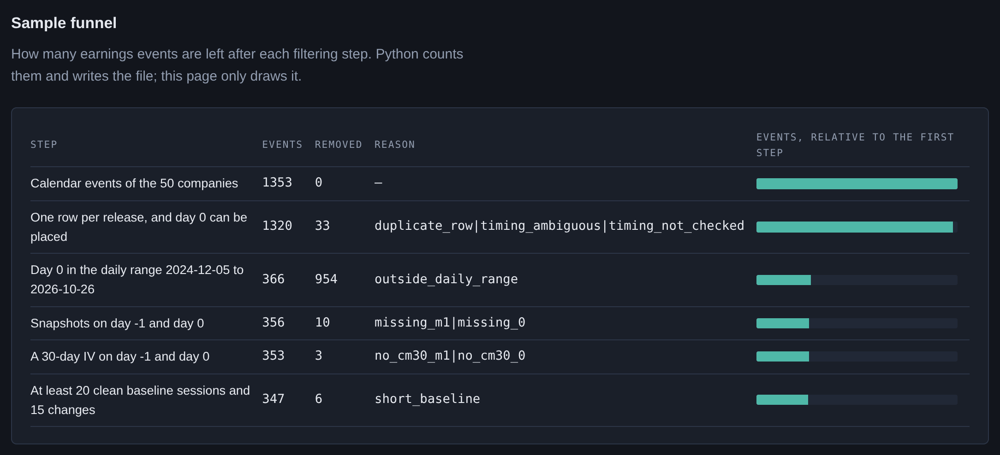
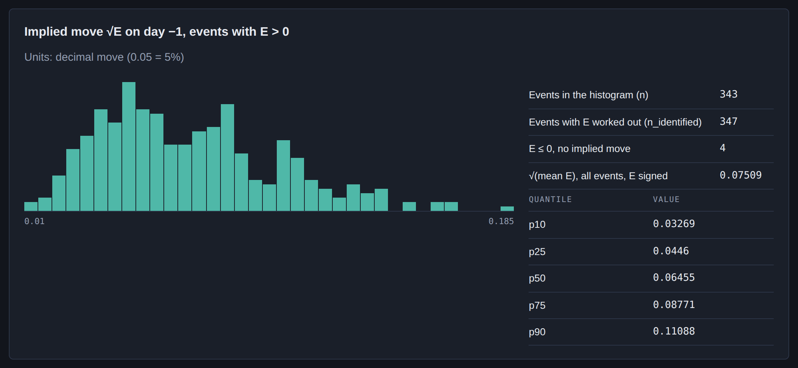
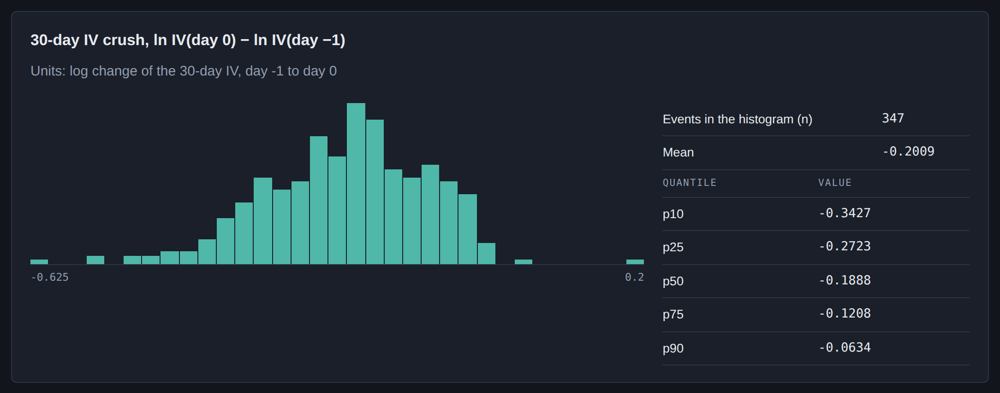
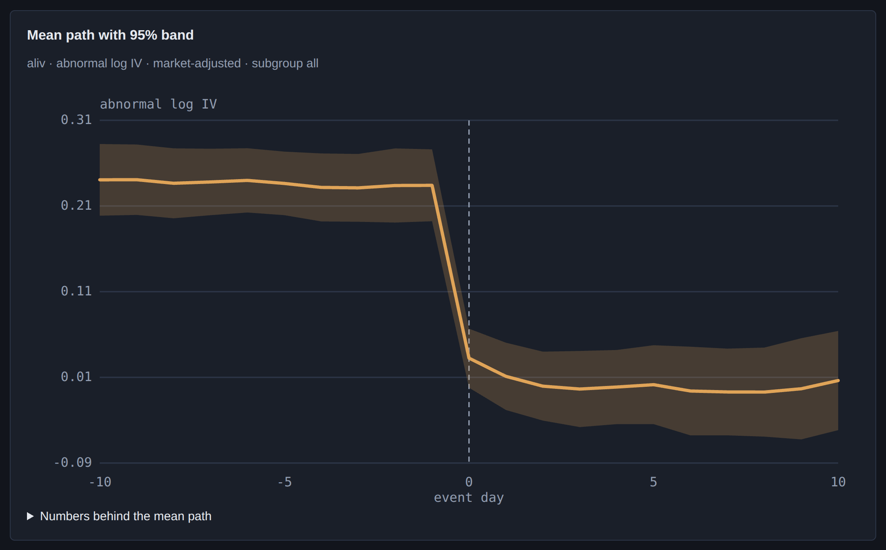
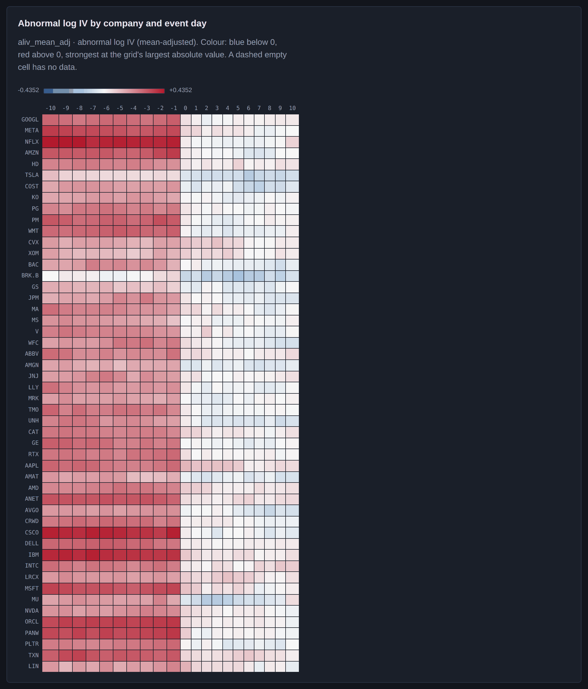
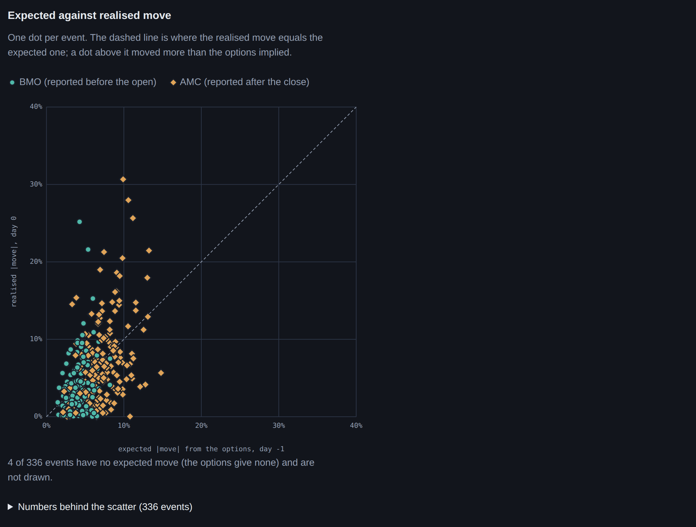
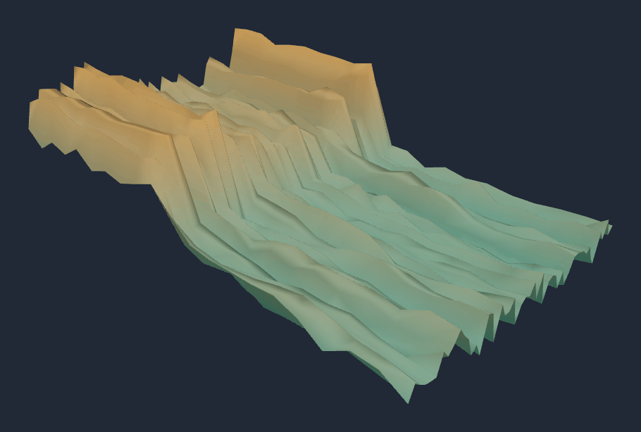

<!-- Generated by tools/report_numbers.py from docs/report/templates/earnings-vol-report.md: edit the template, not this file. -->
**Draft for owner review (2026-10-29): not yet reviewed by the owner.**

# Earnings and implied volatility: an event study

> **Not investment advice.** This report describes how option prices behaved around past earnings announcements of
> 50 large US companies. It recommends no trade, no position and no size. It ignores transaction
> costs. Past patterns in implied volatility do not predict future returns.
>
> **Every result here is provisional.** The session that each announcement reached the option market ("day 0")
> depends on a before-open or after-close label. ADR 0002 requires 473 of these labels to be checked
> against a document. 20 are checked. The other 453 wait for SEC EDGAR filing times, which
> need the owner's contact string before the first request. Until then, those events keep the earnings calendar's
> label, and a few of them may sit on the wrong day 0.

Data: DoltHub `post-no-preference/earnings` at `fjrb6h5le9h1qiif2j4pl6cpaas7pnee` and `post-no-preference/options` at
`msfqpodh24viv7prdqdan8517rkjp861`; parameters hash `74bed6f4b1281810`; app data contract 0.5.0, exported from
commit `75948b3`. Every measured number in this report is filled in by `tools/report_numbers.py` from
`data/derived/results.parquet`, the app's JSON files and the kept ρ̄ output (section 8); one count, the
473 required look-ups, is pinned in that script. Design parameters quoted from the ADRs (window
lengths, minimum counts) are written by hand.

---

## Summary

- **The crush is large and almost universal.** From the last close before the news (day −1) to the first close after
  it (day 0), the 30-day implied volatility (IV) falls by 0.199 log points on average, net of the market's
  volatility: about 18.1%. The market-adjusted change is negative in 99.1% of the 347 events. The test that allows
  for events on the same date and for one company's events being alike gives p = 5.8e−23 (Holm 4.1e−22).
- **The crush is the event leaving the 30-day horizon.** Ordinary volatility (σ_d, the volatility outside the event
  day) does not change measurably (+0.003 log points, p = 0.782), and IV is back at its baseline ten sessions
  later (+0.008, p = 0.743).
- **IV is high before the news.** At day −1 the 30-day IV sits +0.232 log points above its own quiet baseline. The
  direction is not in doubt. Whether it passes the multiple-testing correction depends on how many earnings seasons the
  sample is cut into (section 4.3).
- **The options priced the earnings-day move about right on average.** The realised squared move is 0.77 times the
  implied variance (95% interval [0.46, 1.07], so 1 is inside). 40.1% of the moves were larger than the
  expected move, against the 42.5% that fair pricing of a normal move gives.
- **Neither the earnings surprise nor the prior volatility level explains the size of the crush in a way that
  survives the checks.** The statistics for these driver tests are liberal at this design (they reject 9.55%,
  8.10% and 16.15% of the time under a true null at 5%), and none is rejected.

---

## 1. The question

A stock's implied volatility usually rises before an earnings announcement and falls once the news is out. Traders
call the fall the IV crush. This study measures five things for large US companies:

1. Does IV run up before the announcement? (H2)
2. How large is the crush from day −1 to day 0? (H1)
3. Is IV back at its baseline ten sessions later? (H3)
4. Does ordinary volatility change across the event? (H4)
5. What changes the size of the crush (H5: the earnings surprise; H6: the prior volatility level), and did the
   options price the earnings-day move correctly (H7)?

The seven hypotheses were declared in ADR 0005 before any data was seen. They are corrected together for multiple
testing (Holm, 7 hypotheses). Everything else in this report is labelled robustness or exploratory.

## 2. Data and the sample funnel

**Sources.** The earnings calendar (with before-open and after-close labels) and the EPS history come from DoltHub's
open `post-no-preference/earnings` dataset. The option chains come from DoltHub's `post-no-preference/options`. Both
are CC BY-SA 4.0. Company names and GICS sectors come from Wikipedia's list of S&P 500 companies. The risk-free rate is
FRED's 3-month Treasury bill (`DTB3`). The market adjustment uses the VIX close (FRED `VIXCLS`, a Cboe index); only
aggregates of VIX-adjusted values are published. Yahoo Finance prices are used locally for the size regressor and a
timing diagnostic. [DATA.md](../../DATA.md) gives each source's terms.

**Universe.** Today's 50 largest S&P 500 members by market capitalisation. This has survivorship
bias: companies that shrank or left the index since 2020 are missing.

**The daily sample.** DoltHub's option snapshots are daily only from September 2024 (weekly, then Monday, Wednesday
and Friday, before that). The baseline needs 60 sessions before day 0, so the primary sample's day-0 window runs from
2024-12-05 to 2026-10-26; its 347 events have day 0 from 2024-12-10 to
2026-10-22. The older coarse snapshots form a lower-resolution robustness sample.

| Step | Events left | Removed | Why |
|---|---:|---:|---|
| Calendar events of the 50 companies | 1,353 | – | |
| One row per release, and day 0 can be placed | 1,320 | 33 | duplicate rows, timing not placeable |
| Day 0 in the daily range | 366 | 954 | outside 2024-12-05 to 2026-10-26 |
| Option snapshots on day −1 and day 0 | 356 | 10 | a missing snapshot |
| A 30-day IV on day −1 and day 0 | 353 | 3 | no 30-day IV |
| At least 20 clean baseline sessions and 15 changes | **347** | 6 | short baseline |

The 1,353 calendar events split into 368 daily-era, 49 mixed-era,
868 coarse-era and 68 outside every sample's date range. Each hypothesis then has its own eligibility
rules, so its event count (the `n` in section 4) differs a little from 347.



**Timing labels.** 20 labels were checked against press releases (16 confirmed,
2 corrected, 1 with a corrected date and 1 inferred).
1,333 events keep the calendar's label. A wrong label puts the crush on the wrong day, which makes a
crush look smaller and a run-up look longer.

## 3. Method

### 3.1 Day 0

Day 0 is the first session close after the news reaches the market: the announcement day for a before-open report,
the next session for an after-close one ([ADR 0002](../adr/0002-day-zero-convention.md)). The label comes from a
document, never from the size of the stock's move: a price-gap rule would fix the labels of big movers and leave the
quiet events wrong. Time is counted in NYSE sessions.

### 3.2 IV measures

Every IV is recomputed from bid/ask mid prices with Black-76 on the forward price implied by put-call parity, so no
spot price, dividend or snapshot time is needed ([ADR 0003](../adr/0003-iv-measures.md)). The stored quantity is the
at-the-money total variance w = σ²T of each expiry. From it:

- **The 30-day IV** (the primary series): constant maturity of 21 sessions, interpolated only
  between expiries on the same side of the event, so it never borrows event variance from an expiry on the wrong side.
  The vendor's chain lists only a few expiries, so the weekly expiry right after an announcement is usually absent.
- **The front-expiry IV**: the first listed expiry after the event, followed through the window (exploratory).

### 3.3 Event variance and the implied move

For two expiries that both span the event, w_j = σ_d² τ_j + E, where τ_j is the time to expiry in sessions, σ_d² the
ordinary variance per session and E the extra variance of the event day. Two expiries give both unknowns: σ_d² is the
forward variance between them, and E = w₁ − σ_d² τ₁. The **implied move** is √E, the standard deviation of the
earnings-day move that the options price. E is read at day −1. Its median over the 343 events with E > 0 is
a move of 6.5% (10% of events below 3.3%, 10% above 11.1%). 4
of the 347 primary events have E ≤ 0 and no implied move.



### 3.4 Abnormal IV

Abnormal IV is log IV against the event's own quiet baseline ([ADR 0004](../adr/0004-baseline-and-event-windows.md)):

- The **baseline** is sessions [−60, −22] before day 0, minus every session within [−21, +10] of another
  announcement by the same company. It must keep at least 20 clean sessions. It ends at −22 because from −21 on the
  30-day horizon already contains day 0.
- The **market adjustment** removes β × the change in ln VIX, with β estimated for each company from its pooled clean
  baseline changes. A mean-adjusted twin (no VIX) is kept as a check.
- The tested quantities are levels and one-session changes in log points, not cumulated abnormal IV: IV is a level, so
  summing abnormal levels counts one persistent shift many times. RUNUP is the abnormal level at day −1, CRUSH the
  abnormal change from day −1 to day 0, PERSIST_10 the abnormal level at day +10, ΔSIGMA_D the abnormal change in ln σ_d
  from day −1 to day 0. The event window is [−10, +10].

### 3.5 The test suite

Events are not independent. Many companies report in the same weeks, so one market move hits many events at once, and
one company's events resemble each other. The **primary statistic** is a t-test of the equal-weighted mean with
two-way cluster-robust standard errors ([ADR 0005](../adr/0005-statistical-test-suite.md)):

- for the one-session measures (CRUSH, ΔSIGMA_D): clusters by day-0 date and by company;
- for the multi-week measures (RUNUP, PERSIST_10): clusters by earnings season and by company;
- t on min(G) − 1 degrees of freedom; when the seasons are very unbalanced, a randomisation (Rademacher) p-value by
  season replaces the t, as the ADR declared in advance.

The drivers (H5, H6) are coefficients in a regression of CRUSH on z-scored regressors: |surprise| (the EPS surprise
over the option forward price), ln σ_d at day −1, the term-structure slope at day −1 and size (ln market cap), with
sector and season fixed effects. H7 regresses the squared realised move r₀² on the implied variance E + σ_d²/252
(σ_d annualised) and tests a = 0 and b = 1 jointly. Both use two-way clustering by day-0 date and company.

**Robustness rows** (one-way clustering, BMP, Kolari-Pynnönen, Patell, sign and rank tests, mean-adjusted twins) are
reported but never decide a hypothesis. **Holm** corrects the seven primaries together; **Benjamini-Hochberg** gives
q-values within each family of exploratory rows.

### 3.6 Gate G1: checking the tests before trusting them

A test at 5% should reject a true null 5% of the time. Gate G1 checks this on the real event structure **before the
results run**: the results run refuses to start without the gate's report, and the milestone pages record that each
gate ran before its hypotheses' results (an order the files themselves cannot prove). It simulates 2,000 null data sets per design with the real dates, companies, gaps and
baselines, re-estimates every input with the package's own code, and counts how often each statistic rejects. A
statistic passes when its rate is at most 6.30%, the top of the exact 99% binomial band
[3.80%, 6.30%] for 2,000 replications.

| | H1 | H2 | H3 | H4 | H5 | H6 | H7 |
|---|---:|---:|---:|---:|---:|---:|---:|
| Primary rejects under the null (target 5%) | 4.60% | 0.40% | 0.50% | 4.60% | 9.55% | 8.10% | 16.15% |
| Verdict | pass | pass | pass | pass | **fail** | **fail** | **fail** |

H1–H4 pass (H2 and H3 are conservative). **H5–H7 fail: their statistics are liberal at this design**, so a rejection
by them would not be trusted. They stay in the declared Holm family with their real p-values (section 4.1). A
robustness row that G1 finds oversized keeps its estimate and loses its p-value: 14 rows are withheld this
way (H1: `bmp_t`, `cluster_date_t`, `gen_sign_z`, `kp_ow_t`, `kpp_t`, `patell_z`, `rank_t`; H4: `gen_sign_z`, `rank_t`; H5: `cluster_date_t`, `twoway_date_t` (mean-adjusted twin); H6: `cluster_date_t`, `twoway_date_t` (mean-adjusted twin); H7: `cluster_date_wald`).

## 4. Results

### 4.1 The seven hypotheses

Daily sample, market-adjusted, equal-weighted means (H1–H4) and two-way clustered regressions (H5–H7). Estimates are
in log points; H5 and H6 are log points of crush per standard deviation of the regressor.

| | Question | n | Estimate | 95% interval | p | G1 size | Holm p (H1–H7, binding) |
|---|---|---:|---:|---|---:|---:|---:|
| H1 | Does the 30-day IV fall from day −1 to day 0? | 347 | −0.199 | [−0.222, −0.177] | 5.8e−23 | 4.60% | **4.1e−22** |
| H2 | Is IV abnormally high at day −1? | 356 | +0.232 | – | 0.0078 | 0.40% | **0.0469** (G = 7: 0.0781) |
| H3 | Is IV back at its baseline at day +10? | 329 | +0.008 | [−0.049, 0.065] | 0.743 | 0.50% | 1 |
| H4 | Does ordinary volatility change? | 262 | +0.003 | [−0.019, 0.026] | 0.782 | 4.60% | 1 |
| H5 | Does a bigger surprise change the crush? | 347 | +0.013 | [0.003, 0.023] | 0.0102 | **9.55%** | 0.0511 |
| H6 | Does the prior volatility level change it? | 347 | −0.001 | [−0.023, 0.020] | 0.895 | **8.10%** | 1 |
| H7 | Is the implied variance unbiased (a = 0, b = 1)? | 336 | b = 0.77 | [0.46, 1.07] (b) | 0.275 | **16.15%** | 1 |

**Rejected at 5% after Holm: H1 and H2.** H2's verdict depends on the season count (section 4.3). H3–H7 are not
rejected. Bold G1 sizes failed the gate.

**Which Holm family binds is an open owner decision.** The binding family is the one declared at milestone 0, H1–H7.
A descriptive sensitivity drops the three hypotheses whose size check failed and corrects over H1–H4 only: H1
2.3e−22, H2 0.0234, and H2 with 7 seasons 0.0469, which would be rejected.
Dropping hypotheses after seeing their size check can only lower the others' Holm p, so it is not used as binding
here (milestone 4, decisions table row 24).

### 4.2 H1: the crush

The 30-day IV falls by 0.1994 log points from day −1 to day 0 (se 0.0112, t = −17.73 on 49 df,
172 day-0 dates and 50 companies). The mean-adjusted twin, with no VIX adjustment, is −0.201.
The median log change of the 30-day IV with no VIX adjustment (the mean-adjusted crush, which for one session is the
plain change of ln IV) is −0.189; 10% of events are below −0.343 and 10% above
−0.063.



The crush is larger for after-close reporters (−0.230, n = 182) than for before-open ones
(−0.165, n = 165); this split is exploratory. The front-expiry IV, which holds a larger share of event
variance, falls by 0.299 (mean-adjusted, n = 264). The older samples agree in sign and size:
−0.250 in the mixed era (n = 33) and −0.190 in the coarse era (n = 110,
where the crush can span two sessions), both exploratory.

### 4.3 H2: the run-up, and its season-count dependence

At day −1 the abnormal 30-day IV is +0.2319 log points. The primary statistic is the randomisation p-value by
season, because the 8 seasons are unbalanced. With 8 seasons and every season mean on the
same side, the p-value sits on its floor 2/2^8 = 0.0078, and Holm's multiplier for the second-smallest
p gives **0.0469**: rejected.

**This verdict is a property of the season count, not of the data's strength.** ADR 0005 expected the October 2026
tail to be merged into July, which gives 7 seasons. Then the floor is 0.0156 and the Holm p is
**0.0781: not rejected**. The direction is not in doubt: the two-way season × company t, a robustness row,
is 13.43 (p 3.0e−6), and every season mean is positive (milestone 3 §6.2).

The mean path shows where the run-up sits. The abnormal IV is already +0.239 [0.197, 0.280] at day −10 and
+0.232 [0.191, 0.274] at day −1: the 30-day IV holds the event from day −21 on, and the last ten sessions add
nothing on average. After-close reporters run higher at day −1 (+0.270) than before-open ones
(+0.191).



### 4.4 H3 and H4: what is left after the event

At day +10 the abnormal IV is +0.0080 (interval [−0.049, 0.065], 7 seasons, 6 df). The path is
+0.033 at day 0, +0.012 at day +1, +0.002 at day +5 and +0.007 at day +10. Under the calibrated
design the test detects a persistence of 0.121 log points 80% of the time, so a smaller lasting effect could
go undetected.

Ordinary volatility changes by +0.0031 log points (interval [−0.019, 0.026], n = 262); the test has 80% power at
0.036 log points. So the crush is the event variance leaving the 30-day horizon, not the market becoming calmer about the
stock.



### 4.5 H5–H7: the drivers, with liberal statistics

The crush regression has R² 0.427 on 347 events. A positive coefficient means a smaller fall.

- **H5, the surprise:** +0.0132 per sd (interval [0.003, 0.023], p 0.0102, Holm 0.0511): a bigger surprise
  goes with a slightly smaller crush. The statistic rejects 9.55% of the time under the null, so the p is weaker
  than it looks, and Holm does not reject. The effect does not survive other surprise measures: with the surprise
  scaled by its own history it is +0.002 (q 0.750), with analyst dispersion +0.003
  (q 0.773), and with company fixed effects +0.008 (q 0.587).
- **H6, the prior volatility level:** −0.0014 per sd (interval [−0.023, 0.020], p 0.895): no measurable effect.
- **The slope (exploratory):** a steeper term structure at day −1 goes with a larger crush, −0.032 per sd
  (p 3.9e−5, q 0.0006). That is expected and partly mechanical: the slope proxies the event's share of the
  30-day variance. Its p and q come from the same two-way t that G1 found liberal for H5 and H6; G1 never sized the
  slope's own coefficient, so read it as an indication, not a test at 5%.
- **Size (exploratory):** +0.013 per sd (q 0.177).

Power, from G1's calibrated design: H5's test detects 0.026 log points per sd 80% of the time, H6's
0.042. These powers belong to oversized tests.

## 5. Implied against realised moves

On day −1 the options price the event variance E and the ordinary variance σ_d²/252 of one session. If the day-0 move
is normal with that variance, its expected absolute size is √(2/π)·√(E + σ_d²/252), and fair pricing exceeds it
42.5% of the time, not 50%. The realised move r₀ is the change of the option-implied forward from day −1 to
day 0, on the same expiry both days.

| Measure | Value |
|---|---:|
| Events (E, σ_d and r₀ all present) | 336 |
| Events with E > 0, so with an expected move | 332 |
| Median expected \|move\| | 5.4% |
| Median realised \|move\| (all 336 events) | 4.4% |
| Median ratio realised / expected | 0.82 |
| Share of moves beyond the expected \|move\| (fair: 42.5%) | 40.1% (p 0.319) |
| Mean r₀² over mean implied variance | 0.90 |
| H7 regression r₀² = a + b(E + σ_d²/252): b | 0.767, interval [0.46, 1.07] |
| H7 joint test a = 0, b = 1 | F(2, 49) = 1.33, p 0.275, Holm 1 |
| The same with E read at day −2 (n = 331): b; joint p | 0.92; 0.822 |

The typical realised move is smaller than the expected one (median ratio 0.82), but the mean squared
move is 0.90 of the mean implied variance, so large moves weigh heavily in the average. On variance the
options are close to unbiased: b = 0.77 with 1 inside its interval, and the share of moves beyond the expected size
(40.1%) is close to the fair 42.5%. With E read one session
earlier, b is 0.92: day −1 quotes are often wide on after-close announcement days, which may inflate E a little.
The joint test's G1 size is 16.15%, so even a rejection would not have been trusted; the b and share rows come from
the same kind of two-way statistic.



## 6. Trading implications: observations and their limits

**This section is not investment advice.** It gives no recommendation, no position and no size. It says what the
measured numbers describe about the past, and what they cannot say.

**What the numbers describe.**

1. **The IV fall was near-universal in direction in this sample.** In this sample the market-adjusted 30-day IV
   fell from day −1 to day 0 in 99.1% of events, by 0.199 log points on average. But the fall is the
   event variance leaving the horizon (H4: ordinary volatility unchanged), and the term structure showed that variance
   in advance: E is read from it at day −1. A falling
   IV is not by itself a gain for anyone short options: that position's result depends on the realised move against
   the implied one, plus costs.
2. **On average the options priced the move about right.** b = 0.77 [0.46, 1.07], 40.1% of moves beyond the
   expected size against 42.5% for fair pricing. The data show no reliable average over- or
   under-pricing of the earnings-day move in this sample. The typical move was smaller than expected
   (median ratio 0.82), while the mean squared move was 0.90 of the mean implied variance.
3. **The run-up is in place ten sessions early.** The 30-day IV already holds the event from 21 sessions before
   day 0; the abnormal level at day −10 (+0.239) and at day −1 (+0.232) are about the same on average.
4. **A steeper term structure went with a larger crush** (−0.032 per sd). This is exploratory, partly
   mechanical, and from a statistic that is liberal at this design.
5. **The surprise does not reliably size the crush**, and the surprise is unknown before the event anyway.

**What they cannot say.**

- **Nothing about profit.** There are no bid-ask spreads, commissions, margin, slippage or position limits here. Day −1
  quotes on after-close days are often wide. A cost-aware test belongs to the sibling project
  `vol-strategy-backtester`.
- **Nothing intraday.** The data are daily closes, so they cannot say when during day 0 the IV falls or how the stock
  moves on the way.
- **A narrow, survivor sample.** 50 of today's largest S&P 500 companies, day 0 from
  2024-12-10 to 2026-10-22. Smaller, less liquid names and other periods may behave differently.
- **Provisional timing labels.** 453 of 473 required look-ups are not done.
- **Liberal driver statistics.** H5–H7's tests reject 9.55%, 8.10% and 16.15% of the time under a true
  null at 5%.
- **The averages hide the spread.** The heaviest-tailed events drive the squared-move regression, and a single event
  can move far more than its options priced (the scatter in section 5).

## 7. Caveats, in one place

1. **Provisional timing labels:** 20 of 473 required look-ups are done; 453
   wait for SEC EDGAR (accepted as the timing source on 2026-10-28; no request has been made, because the client needs
   the owner's contact string).
2. **H2 depends on the season count:** rejected with 8 seasons (Holm 0.0469), not rejected with the
   7 that ADR 0005 expected (Holm 0.0781).
3. **H5–H7's statistics are liberal:** G1 sizes 9.55%, 8.10% and 16.15% at 5% (one-way versions
   18.45%, 20.10%, 17.00%). Every exploratory regression p and q comes from the same
   two-way t.
4. **Withheld robustness rows:** 14 rows keep their estimates but not their p-values, because G1 found
   them oversized.
5. **A common date component:** after the VIX adjustment the crush's average same-date correlation ρ̄ is
   0.30 (above ADR 0005's warning line of about 0.2). It is spread over most dates (0.19 without
   the ten largest), not a stale snapshot, and a leave-one-company-out IV factor removes it (−0.028). It is
   linearly unrelated to the change in ln VIX, which is close to automatic because β is fitted on that change. H1's
   two-way statistic is robust to same-date dependence; the Kolari-Pynnönen rows, which model it, are withheld for
   the crush. Adding a second market factor would change every market-adjusted number and is an owner decision.
6. **Which Holm family binds** (H1–H7 declared, or H1–H4 after the gate) is an owner decision (section 4.1).
7. **Survivorship:** the universe is today's largest companies.
8. **Not built:** the Cboe single-stock volatility index cross-check (VXAPL and others), the coarse-sample scale
   correction, the SPY placebo and the drop-the-largest-companies check of ADR 0004.
9. **No 3D hero render:** Blender was unreachable on 2026-10-29, so the Blender script
   (`tools/blender/event_terrain.py`) has not run. The 3D figures are three.js stills of the app's terrain view.



## 8. How this report is built

The report is written in `docs/report/templates/earnings-vol-report.md`. `tools/report_numbers.py` fills every
placeholder in it (a key in double braces) from `data/derived/results.parquet`, the app's JSON files and the kept output
`research/prototypes/rhobar_crush.out.txt`, and writes this file. One number is pinned instead of read: the
473 required look-ups, which need a Yahoo flag that stays local (`--check` compares it with the local
stage report when one exists). The same script fills the results blocks of the README and the PR/FAQ.

```bash
uv sync --frozen --group report                                      # once: python-docx and markdown-it-py
uv run --frozen python tools/report_numbers.py                       # fill the numbers (--check: verify only)
uv run --frozen --with playwright==1.64.1 python tools/screenshots.py   # app screenshots, figures, 3D stills
uv run --frozen --group report --with playwright==1.64.1 python tools/build_report.py   # PDF and DOCX
```

`tools/build_report.py` turns this Markdown into `earnings-vol-report.docx` (python-docx) and
`earnings-vol-report.pdf` (Chromium's print-to-PDF through Playwright). pandoc is not installed on the build machine.

## 9. Questions for the owner

1. **Audience.** Who is this report for: interviewers reading a portfolio, practitioners who know event studies, or a
   record for yourself? The answer decides how much of section 3 stays in the body.
2. **Tone.** Keep the cautious "measured and provisional" voice throughout, or open with a plainer executive summary
   and move the caveats to the end?
3. **What to cut.** Candidates: the robustness-row list (section 3.6), the exploratory driver variants (section 4.5),
   the older-sample numbers (section 4.2), the ρ̄ paragraph (section 7, item 5). Should any of them move to an
   appendix or out?
4. **The Holm family (milestone 4, decisions table row 24).** Keep the declared family H1–H7 as binding (H2 rejected
   with 8 seasons, not with 7), or adopt the post-gate family H1–H4 (H2 rejected either way)?
5. **Trading implications.** Keep section 6 as observations with their limits, shorten it to the "cannot say" list,
   or drop it? Should it point to `vol-strategy-backtester` for a cost-aware test?
6. **Timing labels.** Publish with 20 of 473 labels checked, or wait until SEC EDGAR has
   run (it needs your contact string in `SEC_EDGAR_USER_AGENT`)?
7. **The common date component.** Add an equal-weighted single-stock IV factor next to VIX in the market model? It would
   change every market-adjusted number.
8. **Exports.** Are a PDF and a DOCX the right formats, and is the app's dark theme right for the printed figures?
